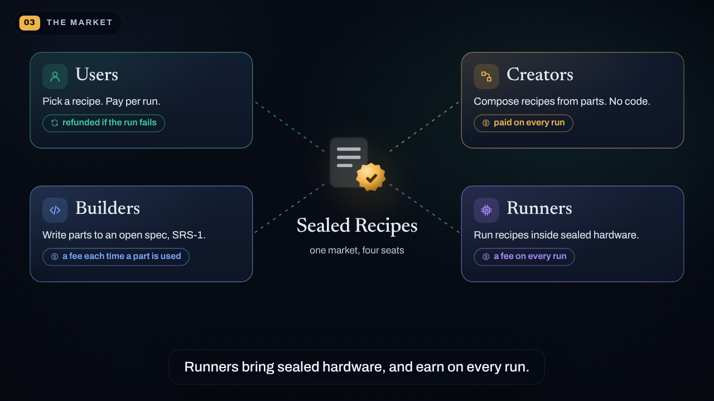
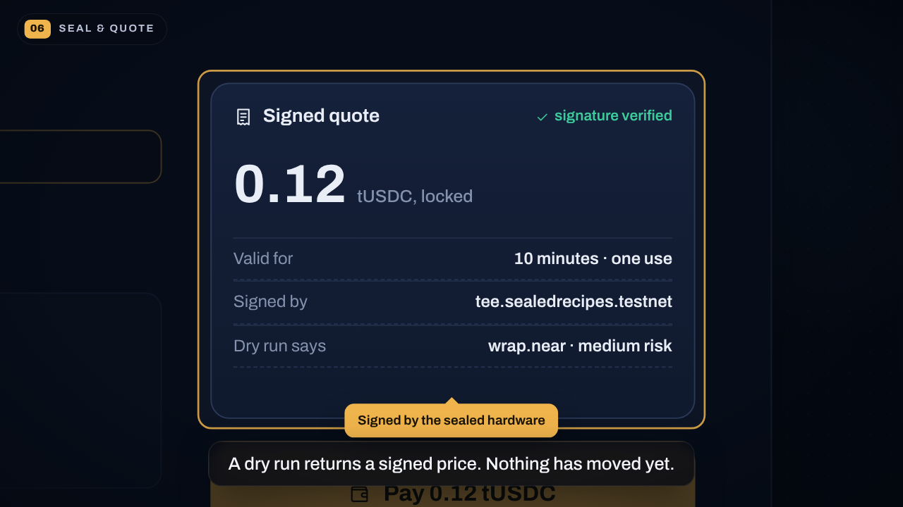
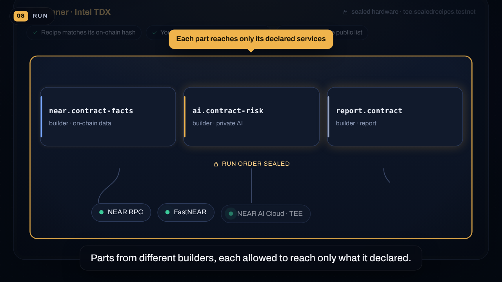
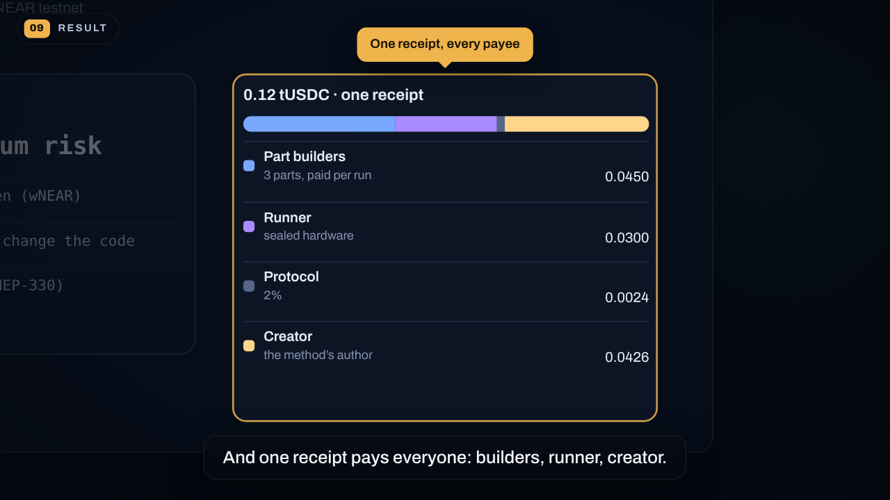
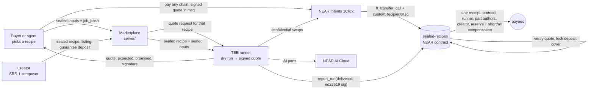

# Sealed Recipes

[](https://github.com/ztoori/sealed-recipes/actions/workflows/ci.yml)
[](LICENSE)
[](https://codespaces.new/ztoori/sealed-recipes)

**Your data stays yours. Their method stays theirs. Everyone gets paid.**

Sealed Recipes is a marketplace on NEAR where an expert's workflow (a *recipe*) runs on your data inside sealed hardware. You never see the method. The expert never sees your data. One on-chain settlement pays everyone who contributed. You pay per run.

| | |
|---|---|
| **Live (NEAR testnet)** | https://sealedrecipes.xyz · contract [`market.sealedrecipes.testnet`](https://testnet.nearblocks.io/address/market.sealedrecipes.testnet) |
| **Film (2:57)** | https://sealedrecipes.xyz/#/demo · file: [docs/media/demo.mp4](docs/media/demo.mp4) · X cut (2:15): [docs/media/demo-x.mp4](docs/media/demo-x.mp4) |
| **Run it locally** | `npm ci && npm run test:e2e` (Node 20.6+, no keys, no network, no sudo) · or nothing to install: [open in Codespaces](https://codespaces.new/ztoori/sealed-recipes) (ready in a few minutes, every command works) |
| **For AI agents and reviewers** | [AGENTS.md](AGENTS.md): every feature with the command that proves it · [llms.txt](web/public/llms.txt) |
| **Spec** | [SRS-1](docs/SRS-1.md), the open spec for parts and recipes |
| **Hackathon** | [NEAR Hackathon](https://nearhackathon.com), Nov 1–14, 2026. Tracks: **Privacy & Private AI**, **AI Security & Defense** ([why](#hackathon-tracks)) |



## Contents

- [Why](#why)
- [Four seats](#four-seats-at-one-table)
- [Try it](#try-it)
- [How one run plays out](#how-one-run-plays-out)
- [Status](#status)
- [Design requirements](#design-requirements-and-where-each-is-built)
- [How it works](#how-it-works)
  - [Market-driven prices](#market-driven-prices)
- [Sample recipes](#the-sample-recipes)
- [Complex workflows](#complex-workflows-durable-runs-partial-settlement-versions)
- [Where this sits](#where-this-sits-comparable-offerings-integrations-and-what-only-this-adds)
- [No investment features](#no-investment-features)
- [Formal verification](#formal-verification)
- [Tests](#tests)
- [What the sealing protects](#what-the-sealing-protects-and-what-it-doesnt)
- [Real vs local](#what-is-real-and-what-is-local)
- [How NEAR is used](#how-near-is-used)
- [Architecture](#architecture)
- [What happens to the accounts you enter](#what-happens-to-the-accounts-you-enter)
- [Configuration](#configuration)
- [Hackathon tracks](#hackathon-tracks)
- [Disclosures](#disclosures)
- [License](#license)

## Why

Every week there is a new app, a new feature, a new agent that promises to do it all. Each comes with its own rules: do this, never do that. Most of us don't read them, and learn the hard way: money lost, a scam, a fine.

A few people do the reading. They work out which tools to trust, in what order, and what to check, across dozens of documents. That workflow is a **recipe**, and it is their edge.

Selling it is the hard part. Paywalls, copyright and licences all leak. One copy gets out and the edge is gone.

Sealed Recipes sells the *run*, never the recipe. The recipe is encrypted to a runner inside confidential hardware, so nobody can read it: not the buyer, not the marketplace, not us.

## Four seats at one table

| Who | What they do | What they get | Where |
|---|---|---|---|
| **Users** (people or AI agents; *buyers* in the code) | Pick a recipe, get a signed quote, pay per run | The result, sealed to their own key. A failed run is refunded by the contract. Where a recipe promises a result, the creator's deposit pays any shortfall | [live](https://sealedrecipes.xyz/#/recipes) · `web/src/live/Quote.tsx` · `scripts/agent-buyer.ts` |
| **Creators** | Compose recipes from parts in a no-code canvas, seal them, set a price band | Their cut of every run, in that run's settlement | Compose › Recipe · `web/src/pages/ComposeRecipe.tsx` |
| **Builders** | Write parts (code, agents, model calls, data sources) to [SRS-1](docs/SRS-1.md) | A fee each time a part is used, in the same settlement | Compose › Part · `runner/src/parts/` · `standard/parts.json` |
| **Runners** | Run recipes inside sealed hardware (Intel TDX), sign quotes and reports | A fee on every run, at the rate they registered | `runner/` · [scripts/testnet/README.md](scripts/testnet/README.md) |

What is true today, and what is not: users and the runner are live on testnet. Composing and publishing without code works in the practice composer on simulated services; on testnet a creator publishes with their own key from the command line. All catalog parts were registered by the team, and there is one runner, approved by the contract owner. Details in [Status](#status).

## Try it

**1. In a browser, no install.** Open https://sealedrecipes.xyz/#/quote/CHECK, type a contract (say `wrap.near`), press **Get a quote**. You should see **runner verified**, **Intel TDX · verified in this browser** and **image matches the pinned compose**, then a signed price of about 0.12 tUSDC (a test token). Continue as a guest, pay, and read the sealed result; every step links to the explorer.

**2. On your machine, no keys, no network, no sudo** (Node.js 20.6+ on Linux, macOS or WSL; check `node -v`, since Ubuntu's apt Node 18 is too old):

```bash
git clone https://github.com/ztoori/sealed-recipes.git && cd sealed-recipes
npm ci
npm run test:e2e    # boots a runner and a marketplace, runs the whole story in the terminal, exits non-zero on any failure
```

It ends with:

```
payouts + reserve == price ($0.7500): every unit accounted for
delivered $28.0249 vs promised $27.8147 → compensation from the guarantee deposit $0.0000
✔ story complete
```

`npm run demo` opens the same thing as an app at http://127.0.0.1:8080 (press **Guided demo** for the narrated film, then **Take the hands-on tour** under it to click through a real run). [docs/WALKTHROUGH.md](docs/WALKTHROUGH.md) is the step-by-step tour; on Windows use WSL ([docs/SETUP-WSL.md](docs/SETUP-WSL.md)). For the proofs and the contract tests too, `bash scripts/setup.sh --all` installs everything in one run on Linux, macOS or WSL; it uses sudo only for missing system packages and says so first ([AGENTS.md](AGENTS.md#setup)). Or skip installing: open the repo in a GitHub Codespace, which runs that script for you.

**3. Check any claim.** Each row is one command; none needs a key. [AGENTS.md](AGENTS.md) has the full list with expected output.

| Claim | Command | Needs |
|---|---|---|
| The whole loop works: compose, seal, quote, pay, run, settle | `npm run test:e2e` | Node |
| 106 unit tests: sealing, quotes, settlement, SRS-1, admission, limits, the TDX image check | `npm test` | Node |
| Inputs never leak in the clear, anywhere | `npm run test:privacy` | Node |
| A drained wallet can't drain the creator's deposit | `npm run demo` in one terminal; in another, `npm run story`, then `npm run attack:drain` | Node |
| A run survives the runner being killed twice; deposits happen once | `npm run test:durable` | Node |
| An agent buys on its own: quotes, policy, payment, verification | in the same two terminals, after the attack: `npm run agent` | Node |
| The same agent on the live site, with real testnet transactions | `npm run agent:live` | Node, internet |
| The live runner really is Intel TDX, running the audited code | `RUNNER_URL=https://sealedrecipes.xyz/runner npx tsx scripts/verify-quote.ts` | Node, internet |
| Money logic is proved, not only tested (66 theorems) | `npm run verify` | Python + Z3 (`bash scripts/setup.sh`) |
| The contract passes the same vectors (114 tests) | `npm run test:rust` | Rust (`bash scripts/setup.sh --all`) |

## How one run plays out

The film walks through these steps; each is a real code path.

| Seal & quote | Run | Result |
|---|---|---|
|  |  |  |

| Step | What happens | Code |
|---|---|---|
| **The box** | A recipe is encrypted in the creator's browser to the runner's attested key (X25519 + XSalsa20-Poly1305). Only its hash and part list go on-chain | `core/src/seal.ts`, `contracts/sealed-recipes/src/lib.rs` (`publish_recipe`) |
| **Pick** | Listings show price, risk and an on-chain track record. Never the method | `web/src/live/Recipes.tsx`, `GET /api/listings` |
| **Seal & quote** | The browser verifies the runner (TDX quote against Intel's root, keys, code hash, image), seals the inputs, and gets a price signed by the runner from a sealed dry run | `web/src/tdx.ts`, `web/src/compose.ts`, `core/src/quotes.ts`, `runner/src/main.ts` |
| **Pay** | `ft_transfer_call` puts the price in escrow in the contract. A failed or abandoned run is refunded | `contracts/sealed-recipes/src/lib.rs` (`ft_on_transfer`, `reclaim_run`) |
| **Run** | The runner checks the paid run against the chain, decrypts inside the TEE and runs each part under its declared limits and allowed hosts | `runner/src/executor.ts`, `runner/src/limits.ts`, `runner/src/sandbox.ts` |
| **Result** | The result leaves the runner encrypted to a one-time key in the buyer's browser. One `report_run`, signed by the runner and verified on-chain, pays builders, runner, protocol and creator | `contracts/sealed-recipes/src/settlement.rs`, `core/src/settlement.ts` |
| **Proof** | Hardware, code and money can each be checked by anyone | `scripts/verify-quote.ts`, `scripts/verify-compose.ts`, the explorer |
| **Agents** | The same flow with no human: verify, collect signed quotes, pick by policy, pay, check every signature | `scripts/agent-buyer.ts` |

## Status

Details in [What is real, and what is local](#what-is-real-and-what-is-local).
- **Deployed on NEAR testnet.** The Rust contract runs at [`market.sealedrecipes.testnet`](https://testnet.nearblocks.io/address/market.sealedrecipes.testnet), paid in tUSDC (a test token with no value, [`tusdc.sealedrecipes.testnet`](https://testnet.nearblocks.io/address/tusdc.sealedrecipes.testnet)). Three recipes are live (CHECK, SAFE3, AUDIT3) and have settled real paid runs ([example settlement](https://testnet.nearblocks.io/txns/2WfyAMcTLPSC3u4DXnjB8bDTSxS8kZ98cUNS73RgWH1H)): payment by `ft_transfer_call`, escrow, sealed execution on real mainnet data with NEAR AI Cloud, runner-signed report checked by the contract, per-part payouts.
- **The runner runs in an Intel TDX confidential VM** (dstack on Phala Cloud, `tee.sealedrecipes.testnet`). Its keys come from the TEE's key service and never leave it; it was registered on the contract only after its TDX quote passed Intel DCAP verification and its code hash matched the audited release (`scripts/testnet/45-tee-runner.sh`). Anyone can check it: `RUNNER_URL=https://sealedrecipes.xyz/runner npx tsx scripts/verify-quote.ts`.
- **Checked in your browser.** Before your inputs are sent, the page checks that the runner's TDX quote carries its registered keys and your fresh nonce; then it verifies the quote against Intel's root certificate itself (DCAP, `web/src/tdx.ts`), with Intel-signed collateral the marketplace relays and cannot forge. It then checks which image the runner runs: it replays RTMR3 from the Intel-verified quote and checks that the compose hash measured there is the pinned `runner/docker-compose.yml`, image digest included (`web/src/compose.ts`; `npx tsx scripts/verify-compose.ts att.json` does the same offline). The quote page then shows **Intel TDX · verified in this browser** and **image matches the pinned compose**; Docs › Trust & privacy lists every check.
- **What is not real yet.** Mainnet is not deployed. The image is checked, but the build is not reproducible: nothing yet proves that the pinned image digest was built from this repository's source, and the code hash the runner reports is its own statement, bound to its keys. NEAR Intents has no testnet, so live payments are direct tUSDC transfers; 1Click is used for real dry quotes only. Wallet connect is not built: buyers pay with a guest key made in the browser. On the live site Compose is a practice composer on simulated services; a creator publishes on testnet with their own key from the command line.
- **The local demo (`npm run demo`) runs end to end** with the same code: an in-process mirror of the contract, and 1Click, NEAR AI Cloud, FastNEAR and NEAR RPC as local mocks with the real request and response shapes. Its transaction hashes are simulated, and the app and terminal label them that way.
- **Tested and proved.** 106 TypeScript tests (CI runs them, the typecheck, the end-to-end story and the Rust tests on every push); the contract's 114 Rust tests run on the same vector files as the mirror; its money, pricing, durable-run and version logic is proved with Z3 and TLA+. `npm run live-check` gets real 1Click dry quotes and, with a key, verifies a real TEE-signed NEAR AI Cloud completion.

## Design requirements, and where each is built

Selling a workflow as a service, run by strangers, needs three things: a no-code spec for building workflows from other people's parts; sealing, so the method can't be copied while it is on sale; and attribution, so every part author is paid in every run. The table maps the original brief to the code. Rows marked *local demo* run against stand-ins on your machine; the rest is also live on testnet.

| Requirement (from the brief) | How it is built here |
|---|---|
| Specialized builders deploy utility apps and bots | **Parts**: code, specialist agents or data sources, with typed ports, declared network capabilities, a per-call fee, **disclosure of model, instructions, harness and verification**, and **per-run resource limits**, registered on-chain ([standard/parts.json](standard/parts.json)) |
| A no-code / low-code standard to compose and swap parts | **SRS-1** ([docs/SRS-1.md](docs/SRS-1.md), and Docs › Spec in the app), an open MIT-licensed spec with conformance checks and an adoption path: a typed graph with subtyping, value schemas checked at every port while running, type variables, conditions, fallbacks and skip-on-error, validation, drop-in swap search, and a withdrawal-risk label. **Compose › Recipe** starts a new recipe or reopens one of yours; in the no-code builder you add parts, they wire themselves, and the buyer's form builds itself from what the parts need (a test rebuilds every seed recipe this way). **Compose › Part** builds a part with live SRS-1 conformance checks |
| Users create recipes without patents or licences | The recipe is **sealed** (X25519 + XSalsa20-Poly1305) to the runner's attested key. Only `sha256(envelope)` goes on-chain. See [What the sealing protects](#what-the-sealing-protects-and-what-it-doesnt) for its limits |
| A decentralized exchange where recipes are listed, bought and traded | **Signed quotes**: a buyer seals their inputs once and asks a recipe (or several) for a quote from a sealed dry run, then the buyer (or an agent's policy) picks one. Recipes are listed and bought **per run**; what is sold is the service, not an asset (see [No investment features](#no-investment-features)) |
| Attribution that pays everyone involved | **`report_run`**: an ed25519-signed runner report is verified on-chain and splits the payment in one receipt. It also compares delivery with the signed quote and compensates any shortfall from the recipe's **guarantee deposit** (a performance bond the creator posts) |
| Deploy on NEAR's privacy platform (TEE) | The runner runs in a **dstack Intel TDX CVM on Phala Cloud** (the stack NEAR's Shade Agents use), verified by each buyer's browser with Intel DCAP. AI parts call **NEAR AI Cloud** private models and verify their TEE signatures |
| Pay through NEAR Intents (*local demo*: Intents has no testnet, so live runs are paid by a direct `ft_transfer_call`) | **1Click** `EXACT_OUTPUT` quote with `customRecipientMsg`, so the solver's delivery *is* the `ft_transfer_call` that opens the run. Swaps inside the workflow use **confidential intents** (`confidentiality: "basic"`) |

## How it works

1. **Builders publish parts.** Each part declares its four layers, so buyers can tell whether it could be rebuilt if its supplier disappeared:

   | Layer | Values |
   |---|---|
   | model | none, open-weights or closed |
   | instructions | open, sealed or closed |
   | harness | open, sealed or closed |
   | verification | open, sealed or closed |

   Parts on open-weights models are labelled **low** withdrawal risk, because anyone can re-host the weights. Parts on closed models are **high** risk, because their provider can retire, change or reprice the model at any time.
2. **Creators compose recipes** in a no-code canvas, set a **price band** (floor, ceiling and a target number of paid runs per period), back their quotes with a guarantee deposit, and publish the recipe sealed.
3. **Buyers ask for a quote.** They pick a recipe and fill its short form, sealed once to the attested runner. The recipe quotes from a dry run inside the runner, with:
   - the value it expects to deliver, a conservative **signed promise**, and how much of it the guarantee deposit covers;
   - its **price**, signed into the quote: the recipe's current market price (below), locked for these inputs;
   - its privacy, withdrawal risk and on-chain track record.

   A buyer or agent can set a **max price**: recipes listed above it aren't even asked to quote, and the contract refuses to charge more.

   Each quote is sealed to the buyer's browser, which checks the runner's signature before paying. The signature binds the quote to that buyer, those sealed inputs and that recipe version, and it can be used once. Recipes stay sealed: buyers compare results, not methods.
4. **The buyer picks a quote and pays**: on testnet with a direct transfer of the test token, in the local demo from any chain through NEAR Intents. The signed promise travels with the payment, so the contract can enforce it (it is then public on-chain; a buyer who prefers privacy can choose "No guarantee" and skip the promise and the bond).
5. **The sealed workflow runs.** First the runner re-prices the run: if the wallet changed since the quote, it aborts and refunds instead of letting the deposit pay for an emptied wallet (`npm run attack:drain` shows this). Each part runs under declared limits on time, HTTP calls, model calls and output size; a run that goes over is cancelled and refunded. Part logs, wallet requests and the result leave the runner encrypted to a one-time key in the buyer's browser.
6. **One settlement** pays the protocol, the runner, every part author used and the creator. A share of the creator's cut that the creator chose (`reserve_bps`) tops up the recipe's guarantee deposit. Delivery is checked against the promise, and any shortfall is paid to the buyer from the deposit, up to the cover in the quote.

### Market-driven prices

There is no fixed price list. Each recipe's price per run follows demand inside the band its creator set, using the same rule Ethereum uses for its base fee (EIP-1559), applied on-chain:
- the contract counts paid runs per pricing period (1 hour on the live testnet contract; 2 minutes in the local demo);
- when a period ends, more runs than the target raise the price by up to 12.5%, fewer lower it by up to 12.5%;
- the price never leaves the band, and the floor must cover every fee, so any price the market reaches still settles.

Each recipe's price comes from its own demand, and a buyer weighs its signed price against the value it promises. The rule's bounds, direction and monotonicity are proved with Z3 for every input, and the Rust contract and TypeScript mirror reproduce the model's vectors exactly.

On the live site each recipe page shows its current price, its band and this period's paid runs against the target, under **Price**. The contract keeps only the current price, not a history, so the price-and-demand chart (price per run, paid runs per period, the target) and the ±% chip next to each recipe in the list are on the local demo's Recipes page, where the in-process contract mirror keeps every period.

```bash
npm run test:pricing    # SAFE with 15-second periods: 4 buyers pay in one period (twice the target) -> +12.5%;
                        # the next quote locks the new price; settlement pays exactly it; a buyer's max price
                        # excludes SAFE; two idle periods pull it back toward the floor
```

## The sample recipes

Eleven sample recipes for common crypto problems, each a sealed workflow of public parts (26 in the catalog). They exist to exercise the platform (composing, sealing, quoting, running and settling); Compose › Recipe builds new ones from the same parts. All eleven are in `seed/recipes/` and run in the local demo (`npm run demo`, and the sandbox at demo.sealedrecipes.xyz). Three are live on testnet, where the runner is read-only on mainnet: **CHECK** (the CHEK recipe), **SAFE3** (SAFE) and **AUDIT3** (AUDT). The others move funds or ask the buyer to sign, so they stay in the demo until there is a mainnet deployment. Earlier testnet listings of the same three (CHEK, SAFE, AUDT, AUDIT, SAFE2, AUDIT2) stay on-chain, since the contract has no delisting, but the site no longer shows, quotes or sells them.

| Recipe | What it does | Parts |
|---|---|---|
| CLNP Clean up and protect | sweeps dust into one asset at a fresh address, privately; scam airdrops quarantined by a private AI | scanner, AI spam shield, dust filter, fresh-address check, confidential swap |
| SWPR Dust sweeper (public) | the cheaper, public version | scanner, allowlist shield, dust filter, public swap |
| EXIT Panic button | every non-scam token to USDC at a fresh address | scanner, AI shield, fresh check, confidential swap |
| TRCH Exit in two tranches | half now, half later; durable across runner restarts | … + wait, merge |
| ATOM Exit, all or nothing | every swap and the payout in one NEAR Intents batch, or nothing | … + atomic swap |
| SAFE Scam airdrop audit | read-only list of tokens never to touch | scanner, AI shield, report |
| **KEYS** Lock down app keys | dApp sign-in keys whose app is gone or known bad are revoked in one `DeleteKey` you sign; full-access keys are only reported | access keys, key-risk rules, key revoker |
| **STAK** Collect unstaked NEAR | `withdraw_all` on every pool that finished unbonding; flags validators that stopped validating or charge high fees | staking positions, unstaked collector |
| **CHEK** Contract check before you sign | a private AI verdict from on-chain facts: code, who can upgrade it, NEP-330 source, lookalike names | contract inspector, AI contract risk, contract report |
| **AUDT** Account security audit | read-only: full-access keys that can move everything, app keys to delete, scam tokens and the value at risk, in one sealed report; the owner makes the fixes in their own wallet | access keys, key-risk rules, scanner, AI spam shield, audit report |
| **TRIM** Concentration cap | sells only the excess of any token above your cap, into a stablecoin at a fresh address | scanner, allowlist shield, trimmer, fresh check, confidential swap |

The five in bold read the same public NEAR interfaces in production that the local mocks serve: RPC `view_access_key_list`, `view_account` and `validators`; the staking pool's `get_account`, `get_reward_fee_fraction` and `withdraw_all`; NEP-330 `contract_source_metadata`; and FastNEAR `/v1/account/{id}/staking`.

```bash
npm run test:recipes  # AUDT reports 4 key issues and 2 scam tokens without asking for a signature; KEYS revokes 2 risky keys and confirms on-chain (full-access keys untouched); STAK withdraws 4.2 NEAR from
                      # 2 pools, skips 1 still unbonding, flags an inactive validator; CHEK rates a phishing lookalike high and
                      # v2.ref-finance.near low; TRIM sells $172 of dana's NEAR (48% → 25%) and delivers USDC to a fresh address
```

## Complex workflows: durable runs, partial settlement, versions

Real workflows span many transactions and can run for hours. Three things make that safe:

- **Durable runs.** The runner checkpoints after every part and before every irreversible step. Each checkpoint is sealed to the runner's own key, signed, and stored by the marketplace before the run moves on.
  - If the runner crashes, the marketplace asks the restarted runner to resume from the last checkpoint.
  - Swap deposits happen exactly once, and the buyer is never asked to sign twice.
  - The progress hash goes on-chain and extends the run's timeout, so a long run can't be reclaimed mid-way.
- **Partial settlement** (opt-in, `settle_mode: "checkpoint"`). Each part's author is paid on-chain as soon as that part finishes. The final receipt pays the rest. A failed run refunds only what was not yet billed.
- **Versions with notice.** A new recipe version is announced on-chain and takes effect after a notice period (30 s in the demo, 24 h suggested). Every run executes the version it paid for, because the vault keeps every version. Quotes for an old version are refused after the switch.

```bash
npm run test:durable    # TRCH "Exit in two tranches": the runner is killed twice mid-run; checks it resumes,
                        # deposits once, asks for 2 signatures (not more), pays every part once, settles once
npm run test:atomic     # ATOM "Exit, all or nothing": a solver backs out of one leg -> nothing is swapped, the run is
                        # refunded; then every swap and the payout settle in ONE execute_intents
npm run test:versions   # announce, cancel, re-announce SWPR v2; a run paid on v1 finishes on v1 after v2 is live
                        # (runner killed in between); a v1 quote is refused after the switch
```

Where everything is stored, and who runs what, is in [docs/ARCHITECTURE.md](docs/ARCHITECTURE.md#storage-what-lives-where).

## Where this sits: comparable offerings, integrations, and what only this adds

Workflow engines and agent markets exist, and some overlap with parts of this project:
- **Phala Cloud (dstack):** confidential VMs on Intel TDX. The live runner runs there.
- **Chainlink CRE:** triggers, consensus, and confidential workflows in beta, on EVM chains and Solana.
- **OutLayer:** attested WASM for NEAR.
- **NEAR AI Cloud and IronClaw:** private inference, and agents with routines.
- **NEAR AI Agent Market:** jobs, escrow and bids.
- **Olas, Gelato, Venice.**

This project treats them as places to run recipes and channels to sell them, not as rivals:
- **Execution is pluggable.** The marketplace talks to executors only through `ExecutionBackend` (`server/src/backends.ts`). [docs/EXECUTION_BACKENDS.md](docs/EXECUTION_BACKENDS.md) maps it to a CRE confidential workflow and to OutLayer (integration paths, not built).
- **NEAR Intents for atomicity.** The `intents.atomic-swap` part swaps everything in one signed Verifier batch: every swap and the payout, or nothing. `npm run test:atomic` makes one leg fail and shows nothing moved.

What none of them offers, and this project does:
- secret recipes sold to strangers, hidden from buyers and from the operators;
- signed quotes from sealed dry runs, bound to the buyer and their sealed inputs;
- outcome guarantees backed by the creator's deposit, with machine-checked safety;
- every part author paid in the same settlement;
- typed, swappable parts that disclose their withdrawal risk;
- durable runs with partial settlement, and versions with a notice period.

Where others are ahead is listed too:
- CRE's multi-node consensus and maturity;
- Agent Market's live network;
- IronClaw's triggers;
- OutLayer's sandbox.

Full comparison: [docs/LANDSCAPE.md](docs/LANDSCAPE.md), and **Docs › Landscape** in the app.

Two more pieces make recipes manageable over time:
- **Durable storage.** Every sealed version and checkpoint is kept in a content-addressed store (`server/src/store.ts`). A blob's id is the hash committed on-chain, and every read is integrity-checked.
- **Creator copies.** Each version is also sealed to a key derived from the creator's wallet signature. The creator can reopen any published version from any device (`GET /api/vault/:ticker/creator-copy`, opened with a key re-derived from a wallet signature), and nothing is kept in the browser. In the composer, **Your recipes › Edit** opens that copy.

## No investment features

Earlier builds let creators sell revenue shares in a recipe, with dividends and share trading in batch auctions. They were removed (archived at git tag `archive/revenue-shares`), for two reasons:
- **Reach.** A token that pays holders a share of a recipe's revenue looks like an investment contract under tests such as Howey in the US, and similar rules elsewhere. That could limit who may list, buy or even see a recipe. Pay-per-run use of a service does not.
- **Little value.** Per-run dividends would be tiny, and taxable as income in most places.

What remains is ordinary commerce plus collateral:
- **Buyers** pay a fixed price for one run. They get the result, plus compensation if it falls short of the signed quote.
- **Creators, part authors, the runner and the protocol** are paid for work actually done, in the settlement of that run.
- **The guarantee deposit** is the creator's own money, posted as collateral (a performance bond, like a contractor's or an escrow). It pays nothing to anyone except buyers who were shorted, earns no return, and only the creator can withdraw it. A creator can let it grow automatically by keeping a share of each run's cut in it (`reserve_bps`).

This is a design choice, not legal advice: anyone launching this commercially should get advice for the countries they operate in.

## Formal verification

The money logic and the protocol are machine-checked, not only tested ([verification/README.md](verification/README.md)):

- **Z3 proofs (66 theorems)** for every input in the u128 range:
  - settlement conserves the price exactly, to the unit, for 0 to 8 parts (also when parts are paid at checkpoints), the creator's reserve is the creator's own money, and a split never fails once the fees fit the price;
  - guarantee-deposit accounting can't be overdrawn, and its ledger invariant (including reserves added at settlement) holds by induction over any history;
  - market prices stay in the creator's band, move at most 12.5% a period, move the way demand points and never fall as demand rises, never overflow, and every price in the band covers the fees.
- **Three TLA+ models**, checked exhaustively by TLC:
  - the bond lifecycle with an adversarial buyer: bond conservation, single-use quotes and **no bond drain**, over 22.7M states;
  - durable runs with a runner that crashes at any point: **deposits exactly once**, every part paid exactly once, and the run always finishes;
  - versions with notice: every run executes the version it paid for, and no version goes live early.

  Each model also has a variant without the safeguard (the old bond rule, no write-ahead checkpoint, a vault that keeps only the current version), and TLC is expected to find a counterexample in each.
- **Conformance vectors** generated by the proved models (400 settlement cases, 200 deposit operations, 300 price updates) must be reproduced exactly by both the Rust contract and the TypeScript mirror. This keeps the proofs tied to the shipped code.

The proofs found three real bugs, all fixed:
- a way to drain the bond by depositing less than asked after the re-check (TLA+; the model and the fix are still here);
- two rounding paths that could have left the contract owing revenue-share holders more than it held. That design was later removed (see [No investment features](#no-investment-features)); its proofs are archived with it.

What is *not* proven is listed plainly in the verification README. That covers the compiled Rust itself (Kani is the next step), and the UI, server and runner, which are tested, not proven.

```bash
npm run verify          # Z3 proofs + conformance freshness (~5 s; Z3 from `bash scripts/setup.sh`)
npm run verify:tla      # also the TLC model check (~10 min; Java + tla2tools.jar from `setup.sh --all`)
```

## Tests

```bash
npm test                # 106 TypeScript tests: any account size for the wallet scanner, the image check against a real CVM attestation, SRS-1 conformance of every part, part admission (tiers, security scan, sandbox, signed release records), all 11 seed recipes rebuilt in the composer, a recipe built from a blank canvas, the web app's state machines, the film's screenplay and narration clips; settlement, bond and pricing vectors; quote signatures and expiry;
                        # event parity with the contract; SRS-1 typing, swaps, value delivered and withdrawal risk; conditions, alternatives, schemas, type variables, billing privacy;
                        # sealing; per-part resource limits; EIP-191; 1Click shapes; attestation; capability guard; code hash
npm run test:rust       # 114 Rust tests for the NEAR contract (same vectors, conformance with the proved models,
                        # market pricing, versions with notice, checkpoints and partial settlement)
npm run typecheck
npm run live-check      # optional, needs internet: real 1Click dry quotes (confidential with ONECLICK_API_KEY), FastNEAR, NEAR RPC,
                        # and with NEAR_AI_API_KEY a real TEE-signed NEAR AI Cloud completion, verified
```

## What the sealing protects, and what it doesn't

Sealed Recipes protects a workflow **by default, without filing anything**. The law (copyright, trade secrets, terms of use) becomes the backup instead of the first line of defence.

| Threat | Covered? | Why |
|---|---|---|
| Copying or pirating the recipe | **Yes** | It is never distributed. Only attested runner code can decrypt it |
| Leaks through partners who run it | **Yes** | There are no licensees holding copies. Runs go through the sealed runner |
| Getting paid without enforcing licences | **Yes** | Access is metered per run, and every part author is paid in the run's settlement |
| Reverse engineering by probing outputs | **Partly, on any platform** | Every probe costs a paid run. Simple recipes can still be inferred from enough input/output pairs. No privacy technology hides outputs from the buyer who paid for them. A copy has to win buyers on its own quotes and track record |
| Inferring a recipe's structure from its listing | **Partly** | The parts and types are public, and for simple linear recipes they leave few possible wirings ([SRS-1 §5.3](docs/SRS-1.md#53-what-the-public-data-gives-away)). The edge lives in sealed params, constants and conditions; execution order, node ids and which branch ran stay out of public data |
| Independent reinvention | **No, on any platform** | The part list is public so authors can be paid. Patents stop reinvention; secrecy does not |
| Hardware or key compromise | **Depends on the TEE** | Intel TDX side channels, or a leaked or lost runner key (one key seals every recipe today). The live runner is in Intel TDX; the local demo has no hardware TEE |
| Part authors' source code | **Not in this build; possible on NEAR** | Parts are bundled into the runner image here, so its auditors can read them. NEAR's stack supports closed code: parts sealed to the runner like recipes, OutLayer closed-source WASM in TDX, or a part running as its own attested TEE service |
| Buyers sharing results, creators leaking their own recipe | **No** | Out of scope for any technical measure |

## What is real, and what is local

These are kept separate so nothing here needs to be taken on faith. The table is about `npm run demo` (and the hands-on sandbox at demo.sealedrecipes.xyz). The live page at sealedrecipes.xyz uses the production path for the contract (NEAR testnet), NEAR AI Cloud, FastNEAR and NEAR RPC (mainnet, read-only), and the same runner code in an Intel TDX confidential VM (`TEE_MODE=dstack`).

| Component | In `npm run demo` | Production path (in this repo) |
|---|---|---|
| Contract logic | `core/src/ledger.ts`, an in-process mirror with the same methods, math and event fields. A test checks every event against `docs/CONTRACT_EVENTS.md` | `contracts/sealed-recipes` (Rust, near-sdk 5.30), **deployed** at `market.sealedrecipes.testnet`. Both pass the **same vector files** in `contracts/test-vectors/` |
| TEE runner | `runner/` as a separate process with `TEE_MODE=local-dev`: real keys, sealing, signed quotes and reports, enforced limits, **no hardware quote** (shown as skipped). Quote and run endpoints require a token shared only with the marketplace | Same code with `TEE_MODE=dstack` in a TDX CVM (`runner/Dockerfile`, `runner/docker-compose.yml`). `scripts/verify-quote.ts` runs Intel DCAP verification with `@phala/dcap-qvl` |
| NEAR Intents 1Click | `/mock/1click`: same request and response shapes, a frozen token-price sample, the real status names | `core/src/oneclick.ts` live mode; `npm run live-check` gets real dry quotes. **NEAR Intents has no testnet**, so the demo cannot move real funds |
| NEAR AI Cloud | `/mock/nearai` signs responses with a real secp256k1 key in the provider-TEE format. The "model" is a transparent heuristic, and there is no hardware quote (reported as skipped) | The same part code calls `cloud-api.near.ai`, and `live-check` verifies a real completion end to end |
| FastNEAR / NEAR RPC | `/mock/fastnear`, `/mock/rpc`, backed by fictional wallets in `fixtures/wallets.json` and fictional keys, staking pools and contracts in `fixtures/chain-state.json` | Same URLs unmocked |
| Wallet signing | A local demo wallet "signs as" the selected account. Demo accounts have unlimited demo USDC, so deposit sizes are illustrative | Live page: a guest key made in the browser signs the buyer's own `ft_transfer_call` on testnet. **Wallet connect is not built yet**; the demo's approval dialog shows the exact `signAndSendTransactions` payload a NEAR wallet would sign |
| Chain view for attestation checks | The browser gets the attestation **directly from the runner**, but the registered keys come from the server's contract mirror, so the marketplace is trusted for that comparison | Clients read `get_runner` from NEAR RPC; the runner reads `get_run` / `get_recipe` over NEAR RPC when `NEAR_RPC_URL` is set |

Every transaction hash in local mode comes from the mirror or the mocks, so none of them is on a NEAR network; the app shows them as *simulated tx* and the terminal story says so at the top. The runner never sees mock-specific code. It always builds URLs for the real hosts, and `SRS_REWRITE` (set by `scripts/demo.mjs`) maps them to the local mocks.

## How NEAR is used

- **NEAR smart contract** (`contracts/sealed-recipes`, live at `market.sealedrecipes.testnet`):
  - a part and runner registry, and sealed recipe commitments;
  - pay-per-run escrow, with signed quotes (including their price) checked by `env::ed25519_verify`;
  - market-driven list prices per recipe (an EIP-1559-style rule inside a creator-set band);
  - guarantee deposits (performance bonds) that compensate shortfalls, and an on-chain track record per recipe;
  - one-receipt settlement with NEP-297 events;
- **NEAR Intents / 1Click** (local demo against a mock with the real shapes, and real dry quotes with `npm run live-check`; Intents has no testnet):
  - Pay-per-run uses `swapType: EXACT_OUTPUT` to the payment token, with `recipient = contract` and `customRecipientMsg = {"action":"run",…,"on_behalf_of":buyer,"quote":{…}}`. The solver's delivery is the `ft_transfer_call` that escrows the run.
  - Swaps inside workflows use `confidentiality: "basic"`. When quoting, recipes price their swaps with `dry: true` 1Click quotes.
  - If a delivered payment fails a business rule, the contract credits `on_behalf_of` instead of bouncing the funds back to the solver.
- **TEE**: the live runner runs in a dstack Intel TDX CVM on Phala Cloud, the stack NEAR's Shade Agents use. Its attestation binds `sha256(codehash, enc key, nonce, signing key)` into REPORTDATA. The contract pins the runner's signing key and the audited code hash (`AUDITED_CODEHASH`). The same key signs quotes and run reports, so a quote is a promise from attested code.
- **NEAR AI Cloud**: AI parts use the private inference API. Each verdict is checked against the attested `signing_address`.
- **NEAR accounts**: a fresh implicit account is generated in the buyer's browser, and its freshness is proven with RPC `view_account → UNKNOWN_ACCOUNT`.

## Architecture



The diagram shows the full path, with payment through NEAR Intents as in the local demo. On testnet the buyer's own `ft_transfer_call` replaces the 1Click hop, and no recipe swaps.

Details: [docs/ARCHITECTURE.md](docs/ARCHITECTURE.md) · threat model: [docs/THREAT_MODEL.md](docs/THREAT_MODEL.md) · contract interface: [docs/CONTRACT_SPEC.md](docs/CONTRACT_SPEC.md) · spec: [docs/SRS-1.md](docs/SRS-1.md)

## What happens to the accounts you enter

Inputs are sealed in the buyer's browser to the runner, and anything the runner says about them (quote details, part logs, the result, and the reason a quote or run failed) is sealed back to the buyer's one-time key. Nothing logs inputs. On-chain there are only hashes. The marketplace and the tunnel see ciphertext. To read an account, the runner asks NEAR data providers (FastNEAR, NEAR RPC) about it, as any block explorer does, so those providers see that lookup. `npm run test:privacy` checks this end to end: it uses made-up canary accounts as inputs and fails if one shows up in process output, responses in the clear, run events, chain events, public endpoints or stored files.

## Configuration

Nothing needs configuring for the local demo or the tests. Copy `.env.example` to `.env` only for the optional live paths below. The live server's settings are listed at the top of `server/src/live.ts`, and deploying your own is in [scripts/testnet/README.md](scripts/testnet/README.md); the demo gateway's settings are in [docs/HOSTING.md](docs/HOSTING.md). Never commit keys.

| Variable | Used by | Purpose |
|---|---|---|
| `NEAR_AI_API_KEY` | runner, live-check | NEAR AI Cloud private inference |
| `SRS_OUTBOUND` | runner, server | per-service limits for outside calls, JSON merged over the defaults in `core/src/outbound.ts` |
| `ONECLICK_API_KEY` | runner, live-check | 1Click partner key (X-API-Key): lower fees; required by 1Click for confidential quotes. `ONECLICK_JWT` still works (legacy Bearer) |
| `TEE_MODE` | runner | `local-dev` (default) or `dstack` |
| `PORT`, `RUNNER_PORT` | launcher | default 8080 / 8787 |
| `RUNNER_PUBLIC_URL` | server | where browsers fetch the runner attestation (default `/runner`, a pass-through on the same origin) |
| `RUNNER_KEYS_PATH` | runner | local-dev key file (default `.data/runner-dev-keys.json`) |
| `SRS_PUBLIC` | server, runner | `1` when hosted for the public: dev endpoints off (set by `demo.mjs --public`) |
| `GATEWAY_PORT`, `SANDBOX_MAX`, `SANDBOX_SPARE`, `SANDBOX_IDLE_MIN`, `SANDBOX_PER_IP` | gateway | see `scripts/gateway.mjs` |
| `SRS_TENANT_PORTS`, `SRS_TENANT_URL` | runner, server | shared runner: the marketplace ports it serves / a marketplace's own address (set by the gateway) |

## Hackathon tracks

One submission, two tracks. What fits each, and the command or page that shows it:

| Track | What fits | See it |
|---|---|---|
| **Privacy & Private AI** (lead) | Recipes and inputs are sealed to a runner in Intel TDX; the buyer's browser verifies the TDX quote against Intel's root before sending anything, and shows what it checked. AI parts call NEAR AI Cloud private models and verify each response's TEE signature. Nothing about the inputs is stored or logged in the clear | [live quote page](https://sealedrecipes.xyz/#/quote/CHECK) · `npm run test:privacy` · `scripts/verify-quote.ts` · `npm run live-check` (with `NEAR_AI_API_KEY`) |
| **AI Security & Defense** | The three live recipes are safety checks: CHECK rates a contract before you sign, SAFE3 flags scam tokens, AUDIT3 audits an account's keys. Agents buy under a policy with a price cap the contract enforces. The relayer signs with a function-call key limited to two methods. Every claim rests on TEE attestation | [live recipes](https://sealedrecipes.xyz/#/recipes) · `npm run agent:live` · `npm run attack:drain` · [docs/THREAT_MODEL.md](docs/THREAT_MODEL.md) |

## Disclosures

- **AI-generated code:** most of this code was written with an AI coding assistant (Claude) working from the team's written brief, and was reviewed and tested by the team.
- **Libraries:** near-sdk (Rust), tweetnacl, @noble/hashes, @noble/curves, bs58, near-api-js, express, marked, React, @xyflow/react, Vite, tsx, @phala/dcap-qvl, @phala/dstack-sdk (runner container only), and the Archivo and Newsreader fonts (OFL). The film's narration is the Piper text-to-speech voice `en_US-libritts-high`, speaker p7665 ([rhasspy/piper](https://github.com/rhasspy/piper)), trained on [LibriTTS](https://www.openslr.org/60/) by Heiga Zen, Viet Dang, Rob Clark, Yu Zhang, Ron J. Weiss, Ye Jia, Zhifeng Chen and Yonghui Wu (2019), licensed [CC BY 4.0](https://creativecommons.org/licenses/by/4.0/); the film page shows the same credit under the player. No templates or boilerplate were used beyond the cargo-near contract layout.
- No existing product on another chain. No other hackathon submission by the same team.

## License

MIT, see [LICENSE](LICENSE).
