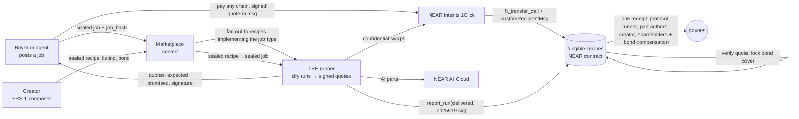

# Fungible Recipes

**Intents for workflows.** A buyer describes a job. Sealed workflows built from other people's parts compete to do it, each quoting the result it expects. The buyer picks one and pays per run from any chain through NEAR Intents. The workflow runs inside secure hardware, so its method can't be copied. One settlement pays every part author, the runner and the creator, and a bond pays the buyer if the result falls short of the signed quote.

NEAR Intents lets solvers compete to fill a swap. Fungible Recipes applies the same idea to whole workflows, which needs three things a swap doesn't:
- a no-code standard for building workflows from other people's parts;
- sealing, so a workflow's method can't be copied while it competes;
- attribution, so every part author is paid, not just the winner.

It uses Intents for payment and for the swaps inside workflows. Creators who want funding can also sell **revenue shares** in a recipe through batch auctions. That is an optional funding tool, not the main product.

Built for the [NEAR Hackathon](https://nearhackathon.com) (Nov 1–14, 2026). Suggested tracks: `privacy`, `agents`, `defi` and `open`.


## The problem

Businesses and agents run on workflows that chain several tools, bots and AI calls. The workflow itself (which parts, in what order, with which thresholds and prompts) is often the real edge. Today it is protected only by NDAs, it is easy to copy, and the people who built the parts are rarely paid when someone else's workflow uses them. Buyers, meanwhile, can't compare workflows on results without seeing how they work.

| Requirement (from the brief) | How it is built here |
|---|---|
| Specialized builders deploy utility apps and bots | **Parts**: code, specialist agents or data sources, with typed ports, declared network capabilities, a per-call fee, **disclosure of model, instructions, harness and verification**, and **per-run resource limits**, registered on-chain ([standard/parts.json](standard/parts.json)) |
| A no-code / low-code standard to compose and swap parts | **FRS-1** ([docs/FRS-1.md](docs/FRS-1.md)): a typed graph with subtyping, validation, drop-in swap search, a withdrawal-risk label and standard **job types**. The visual composer is the Compose tab |
| Users create recipes without patents or licences | The recipe is **sealed** (X25519 + XSalsa20-Poly1305) to the runner's attested key. Only `sha256(envelope)` goes on-chain. See [What the sealing protects](#what-the-sealing-protects-and-what-it-doesnt) for its limits |
| A decentralized exchange where recipes are listed, bought and traded | **Recipe intents**: a buyer posts a job, every recipe that implements its type quotes from a sealed dry run, and the buyer (or an agent's policy) picks one. Optional **revenue shares** sell in frequent batch auctions |
| Attribution that pays everyone involved | **`report_run`**: an ed25519-signed runner report is verified on-chain and splits the payment in one receipt. It also compares delivery with the signed quote and compensates any shortfall from the recipe's **bond** |
| Deploy on NEAR's privacy platform (TEE) | Runner container for a **dstack Intel TDX CVM** (the NEAR Shade Agent / Phala stack). AI parts call **NEAR AI Cloud** private models and verify their TEE signatures |
| Pay through NEAR Intents | **1Click** `EXACT_OUTPUT` quote with `customRecipientMsg`, so the solver's delivery *is* the `ft_transfer_call` that opens the run. Swaps inside the workflow use **confidential intents** (`confidentiality: "basic"`) |

## How it works

1. **Builders publish parts.** Each part declares its four layers, so buyers can tell whether it could be rebuilt if its supplier disappeared:

   | Layer | Values |
   |---|---|
   | model | none, open-weights or closed |
   | instructions | open, sealed or closed |
   | harness | open, sealed or closed |
   | verification | open, sealed or closed |

   Parts on open-weights models are labelled **low** withdrawal risk, because anyone can re-host the weights. Parts on closed models are **high** risk, because their provider can retire, change or reprice the model at any time.
2. **Creators compose recipes** in a no-code canvas, declare which job type they compete for, back their quotes with a bond, and publish the recipe sealed.
3. **Buyers post a job.** They fill one short form, sealed once to the attested runner. Every recipe implementing the job type quotes from a dry run inside the runner, with:
   - the value it expects to deliver, and a conservative **signed promise**;
   - its price, privacy, withdrawal risk and on-chain track record.

   Recipes stay sealed: buyers compare results, not methods. A job nobody serves yet is recorded as **open demand** for builders.
4. **The buyer picks a quote and pays** from any chain through NEAR Intents. The signed promise travels with the payment, so the contract can enforce it.
5. **The sealed workflow runs.** Each part is held to its resource limits; a run that goes over fails and is refunded. Anything about the buyer leaves the runner encrypted to a one-time key in the buyer's browser.
6. **One settlement** pays the protocol, the runner, every part author used, the creator's royalty and the shareholders' dividend. Delivery is checked against the promise, and any shortfall is paid to the buyer from the bond.

## Try it in two minutes (no keys, no network needed)

Requirements: Node.js 20.6 or newer (22 LTS recommended). Rust is only needed for the contract tests.

```bash
npm install
npm run demo            # starts runner :8787 + marketplace :8080, seeds three recipes, opens the browser
```

Then follow these steps. Each one says what you should see.

1. **Open http://127.0.0.1:8080.** You land on **Post a job**, which lists four job types and how many recipes compete for each. *Claim my eligible airdrops* has none yet.
2. **Click "Play the demo story"** (top right). The brief's four steps play automatically, with a caption for each:
   1. **Compose.** Five parts snap together into *Clean up and protect* (CLNP). The seal dialog verifies the runner attestation: 6 checks pass, and "Hardware TDX quote" shows as skipped in local mode. The plaintext turns into ciphertext and gets a wax seal. `publish_recipe` returns a tx hash, and a $25 bond backs CLNP's quotes.
   2. **Post a job.**
      - As `bob.testnet`, a fresh address is generated in the browser and the job *Clean up my wallet* is sealed and posted.
      - Two recipes quote. **SWPR** expects $37.54 and promises $36.98, but it is *public* and sweeps the wallet's gas token. **CLNP** expects $28.02 and promises $27.81, is *confidential* and has a $25 bond.
      - Bob chooses CLNP. A 1Click quote shows *0.75188 USDC on Arbitrum → $0.75 delivered to the contract*, with the signed promise in the `customRecipientMsg`.
   3. **Execute.**
      - The runner checks the paid run against its on-chain commitments, decrypts, and runs each part, showing its author and fee. Part details carry a *sealed to you* tag.
      - The AI Spam Shield quarantines two scam airdrops, with its signature verified.
      - A wallet dialog, decrypted in the browser, asks to approve four `ft_transfer`s. Four confidential swaps then reach `SUCCESS`.
   4. **Settle.** "Delivered $28.02 against a signed promise of $27.81: promise kept, the bond is untouched." Below that, a diagram shows $0.75 split between the protocol, the runner, five part authors, the creator's royalty and **$0.5085 to all CLNP shareholders**, in one tx.
3. **Revenue shares → CLNP.** The track record shows 1 successful run, delivery at 101% of the promise and a $25 bond. Batch #1 is tagged *opening*: the float was sold in an opening auction at one price.
4. **Acting as → chef.testnet, then Wallet.** Income shows `creator royalty CLNP +$0.0565`. Withdraw works.
5. **Compose → "Load Dust sweeper", then select the *Allowlist Shield* node.**
   - The inspector shows the part's disclosure (model none, bundled, low risk) and its limits.
   - Drop-in replacements list *AI Spam Shield* (low risk) and *AI Spam Shield Pro* (**high** risk: closed model, closed harness, remote). Swap in Pro: Checks now shows *high withdrawal risk* and warns that the closed model can be withdrawn or repriced.
   - Drag *Confidential Swap* onto the canvas and wire `form.recipient` into its `to` port. The edge turns red: `"to" expects address.near.fresh but form.recipient is address.near`.
6. **Post a job → *Claim my eligible airdrops* → Seal the job and get quotes.** "No recipe does this job yet. It was recorded as open demand." Compose now lists it under *Open demand*.
7. **Trust & privacy** shows three things:
   - what the marketplace stores (ciphertext), what the contract stores, and what only the runner sees;
   - runner attestation, re-run with a new nonce;
   - the exact JSON 1Click receives, and the contract's NEP-297 events.
8. **An agent as the buyer** (with the demo running and the story done): `npm run agent`. The agent posts a job for `carol.testnet`, compares quotes against its policy (confidential only, maximum risk, price cap, approval cap), pays the winner, approves only within its limit, and checks delivery against the promise. No human in the loop.

Headless version for CI or AI judges. It exits non-zero if any step fails:

```bash
npm run test:e2e        # boots everything and runs the 4-step story in the terminal
```

Expected tail of the output:

```
  quote SWPR  expects  $37.5416  promises  $36.9785 (bond $10.0000)  price $0.2000  public       risk low
  quote CLNP  expects  $28.0249  promises  $27.8147 (bond $25.0000)  price $0.7500  confidential risk low
  policy {"requirePrivacy":"confidential","maxRisk":"medium","sort":"net"} → CLNP
  ...
     $0.5085  CLNP shareholders         pro-rata dividend (claimable)
  delivered $28.0249 vs promised $27.8147 → bond compensation $0.0000
✔ story complete
```

## Tests

```bash
npm test                # 27 TypeScript tests: settlement, batch-auction and bond vectors; quote signatures and expiry;
                        # event parity with the contract; FRS-1 typing, swaps, job types and withdrawal risk;
                        # sealing; per-part resource limits; EIP-191; 1Click shapes; attestation; capability guard; code hash
npm run test:rust       # 61 Rust tests for the NEAR contract (same settlement, dividend, auction and bond vectors)
npm run typecheck
npm run live-check      # optional, needs internet: real 1Click dry quotes (incl. confidential), FastNEAR, NEAR RPC,
                        # and with NEAR_AI_API_KEY a real TEE-signed NEAR AI Cloud completion, verified
```

## What the sealing protects, and what it doesn't

Fungible Recipes protects a workflow **by default, without filing anything**. The law (copyright, trade secrets, terms of use) becomes the backup instead of the first line of defence.

| Threat | Covered? | Why |
|---|---|---|
| Copying or pirating the recipe | **Yes** | It is never distributed. Only attested runner code can decrypt it |
| Leaks through partners who run it | **Yes** | There are no licensees holding copies. Runs go through the sealed runner |
| Getting paid without enforcing licences | **Yes** | Access is metered per run, and every part author is paid in the run's settlement |
| Reverse engineering by probing outputs | **Partly, on any platform** | Every probe costs a paid run. Simple recipes can still be inferred from enough input/output pairs. No privacy technology hides outputs from the buyer who paid for them. With recipe intents, a copy simply competes on results |
| Independent reinvention | **No, on any platform** | The part list is public so authors can be paid. Patents stop reinvention; secrecy does not |
| Hardware or key compromise | **Depends on the TEE** | Intel TDX side channels, or a leaked or lost runner key (one key seals every recipe today). The local demo has no hardware TEE |
| Part authors' source code | **Not in this build; possible on NEAR** | Parts are bundled into the runner image here, so its auditors can read them. NEAR's stack supports closed code: parts sealed to the runner like recipes, OutLayer closed-source WASM in TDX, or a part running as its own attested TEE service |
| Buyers sharing results, creators leaking their own recipe | **No** | Out of scope for any technical measure |

## What is real, and what is local

These are kept separate so nothing here needs to be taken on faith.

| Component | In `npm run demo` | Production path (in this repo) |
|---|---|---|
| Contract logic | `core/src/ledger.ts`, an in-process mirror with the same methods, math and event fields. A test checks every event against `docs/CONTRACT_EVENTS.md` | `contracts/fungible-recipes` (Rust, near-sdk 5.30). Both pass the **same vector files** in `contracts/test-vectors/` |
| TEE runner | `runner/` as a separate process with `TEE_MODE=local-dev`: real keys, sealing, signed quotes and reports, enforced limits, **no hardware quote** (shown as skipped). Job endpoints require a token shared only with the marketplace | Same code with `TEE_MODE=dstack` in a TDX CVM (`runner/Dockerfile`, `runner/docker-compose.yml`). `scripts/verify-quote.ts` runs Intel DCAP verification with `@phala/dcap-qvl` |
| NEAR Intents 1Click | `/mock/1click`: same request and response shapes, a frozen token-price sample, the real status names | `core/src/oneclick.ts` live mode; `npm run live-check` gets real dry quotes. **NEAR Intents has no testnet**, so the demo cannot move real funds |
| NEAR AI Cloud | `/mock/nearai` signs responses with a real secp256k1 key in the provider-TEE format. The "model" is a transparent heuristic, and there is no hardware quote (reported as skipped) | The same part code calls `cloud-api.near.ai`, and `live-check` verifies a real completion end to end |
| FastNEAR / NEAR RPC | `/mock/fastnear`, `/mock/rpc`, backed by fictional wallets in `fixtures/wallets.json` | Same URLs unmocked |
| Wallet signing | A local demo wallet "signs as" the selected account. Demo accounts and sim traders have unlimited demo USDC, so bonds, share prices and market caps are illustrative | **Not built yet.** The approval dialog shows the exact `signAndSendTransactions` payload a NEAR wallet would sign |
| Chain view for attestation checks | The browser gets the attestation **directly from the runner**, but the registered keys come from the server's contract mirror, so the marketplace is trusted for that comparison | Clients read `get_runner` from NEAR RPC; the runner reads `get_run` / `get_recipe` over NEAR RPC when `NEAR_RPC_URL` is set |
| Revenue-share market | Grey candles before server start are **synthetic**. Labelled "sim traders" place real orders into each batch, and a local keeper calls `clear_batch` | Real clearings only; anyone can call `clear_batch` |

The runner never sees mock-specific code. It always builds URLs for the real hosts, and `FRS_REWRITE` (set by `scripts/demo.mjs`) maps them to the local mocks.

## How NEAR is used

- **NEAR smart contract** (`contracts/fungible-recipes`):
  - a part and runner registry, and sealed recipe commitments;
  - pay-per-run escrow, with signed quotes checked by `env::ed25519_verify`;
  - bonds that compensate shortfalls, and an on-chain track record per recipe;
  - one-receipt settlement with NEP-297 events;
  - revenue shares with dividend accounting, sold in uniform-price batch auctions.
- **NEAR Intents / 1Click**:
  - Pay-per-run uses `swapType: EXACT_OUTPUT` to the payment token, with `recipient = contract` and `customRecipientMsg = {"action":"run",…,"on_behalf_of":buyer,"quote":{…}}`. The solver's delivery is the `ft_transfer_call` that escrows the run.
  - Swaps inside workflows use `confidentiality: "basic"`. When quoting, recipes price their swaps with `dry: true` 1Click quotes.
  - If a delivered payment fails a business rule, the contract credits `on_behalf_of` instead of bouncing the funds back to the solver.
- **TEE**: the runner is built for a dstack Intel TDX CVM, the stack NEAR's Shade Agents use. Its attestation binds `sha256(codehash, enc key, nonce, signing key)` into REPORTDATA. The contract pins the runner's signing key and the audited code hash (`AUDITED_CODEHASH`). The same key signs quotes and run reports, so a quote is a promise from attested code.
- **NEAR AI Cloud**: AI parts use the private inference API. Each verdict is checked against the attested `signing_address`.
- **NEAR accounts**: a fresh implicit account is generated in the buyer's browser, and its freshness is proven with RPC `view_account → UNKNOWN_ACCOUNT`.

## Architecture



Details: [docs/ARCHITECTURE.md](docs/ARCHITECTURE.md) · threat model: [docs/THREAT_MODEL.md](docs/THREAT_MODEL.md) · contract interface: [docs/CONTRACT_SPEC.md](docs/CONTRACT_SPEC.md) · standard: [docs/FRS-1.md](docs/FRS-1.md)

## Repository map

```
contracts/fungible-recipes/   Rust NEAR contract + 61 unit tests
contracts/test-vectors/       settlement, dividend, batch-auction and bond vectors shared by Rust and TS
core/src/                     FRS-1 (parts, disclosure, job types), sealing, settlement, ledger mirror, auctions, job hashing, clients, attestation
runner/                       sealed TEE runner: dry-run quotes, execution with resource limits, 8 parts (7 implementation files)
server/                       marketplace API (jobs, quotes, runs, revenue shares) and local mocks of external services
web/                          React UI: Post a job, Compose, Wallet, Revenue shares, Trust & privacy, story mode
standard/parts.json           FRS-1 part catalog (ports, capabilities, fees, disclosure, limits)
standard/jobs.json            FRS-1 job types (inputs, output, value metric)
seed/recipes/                 plaintext of the demo recipes (in the app they only ever travel sealed)
fixtures/                     fictional wallets, frozen 1Click token sample
scripts/                      demo launcher, seed, story CLI, agent buyer, live-check, verify-quote, video recorder
docs/                         FRS-1, architecture, threat model, contract spec and events, submission kit, media
```

## Configuration

Copy `.env.example` to `.env` only if you want the live paths. Never commit keys.

| Variable | Used by | Purpose |
|---|---|---|
| `NEAR_AI_API_KEY` | runner, live-check | NEAR AI Cloud private inference |
| `ONECLICK_JWT` | runner, live-check | authenticated 1Click fee tier |
| `TEE_MODE` | runner | `local-dev` (default) or `dstack` |
| `FRS_BOTS` | server | `0` disables the sim traders |
| `FRS_BATCH_MS` | server | revenue-share batch length (default 12000) |
| `PORT`, `RUNNER_PORT` | launcher | default 8080 / 8787 |

## Limitations and next steps

- **Not deployed yet.** The contract has 61 unit tests and the same vectors as the mirror, but it was not built to wasm or deployed from our build machine (no wasm target, no NEAR RPC access). Deploy commands are in [contracts/fungible-recipes/README.md](contracts/fungible-recipes/README.md).
- **No live chain adapter or wallet.** The server talks to the in-process mirror. A NEAR RPC adapter and near-connect are the main pieces missing for testnet.
- **The runner is trusted to measure delivery.** Bonds pay out on the runner's signed `delivered` value. That is sound only as far as the runner is attested; on-chain DCAP verification of the runner is the next step.
- **Quotes cost compute.** Dry runs are capped at 5 recipes per job and 12 jobs per minute per client. A small quote fee would be the on-chain version.
- **Supplier risk.** Bundled parts can't be switched off by their author, but remote and closed-model parts can. FRS-1 labels this risk; fallback parts, notice periods and supplier bonds are planned.
- **Spam and keeper.** No storage deposits yet. Revenue-share books are capped at 200 orders, and batches need a keeper to call `clear_batch`.
- **What 1Click sees.** Confidential intents hide the deposit-to-payout link from chain observers, not from the 1Click service. See [docs/THREAT_MODEL.md](docs/THREAT_MODEL.md).

## Disclosures

- **Built during:** the initial build was written on 2026-10-31, after the hackathon announcement. Tag `baseline-2026-10-31` marks that state; everything after it was built during the hackathon window (`git diff baseline-2026-10-31..main`).
- **AI-generated code:** most of this code was written with an AI coding assistant (Claude) working from the team's written brief, and was reviewed and tested by the team.
- **Libraries:** near-sdk (Rust), tweetnacl, @noble/hashes, @noble/curves, bs58, express, React, @xyflow/react, lightweight-charts (TradingView, attribution shown in the chart), Vite, tsx, @phala/dcap-qvl, @phala/dstack-sdk (runner container only), and the Archivo and Newsreader fonts (OFL). No templates or boilerplate were used beyond the cargo-near contract layout.
- No existing product on another chain. No other hackathon submission by the same team.

## License

MIT, see [LICENSE](LICENSE).
