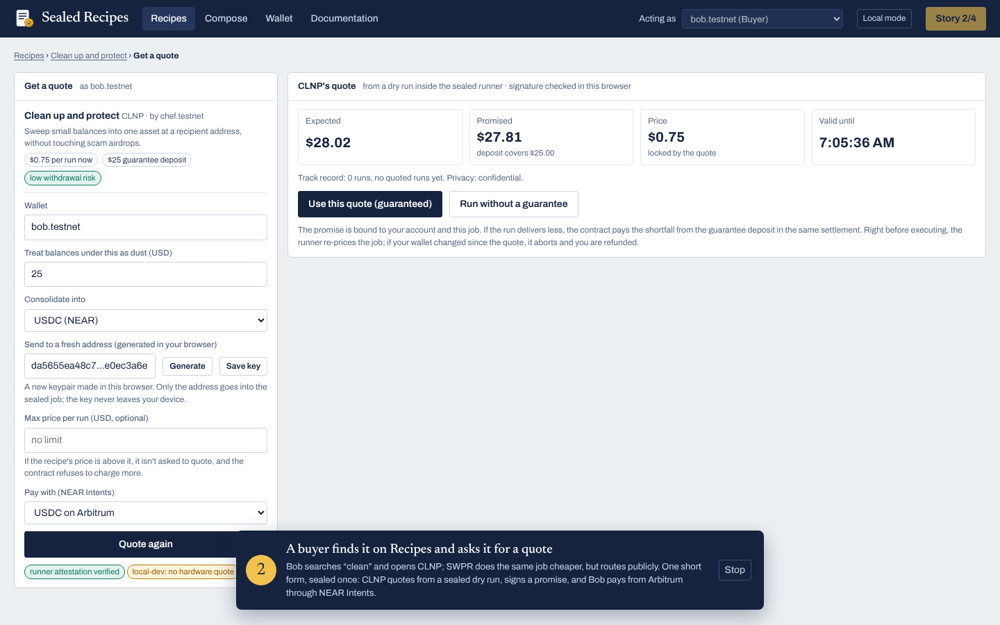
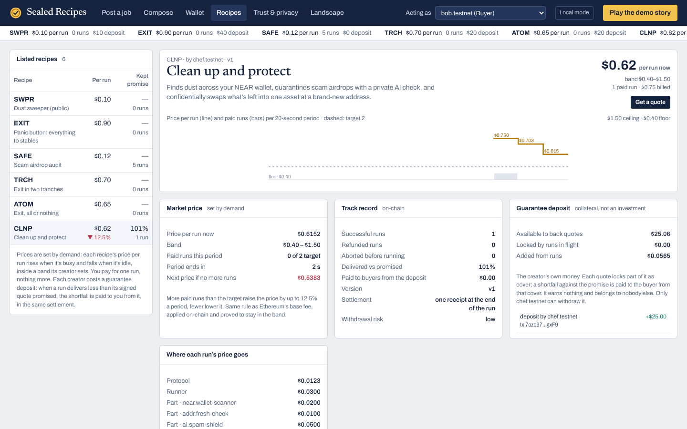
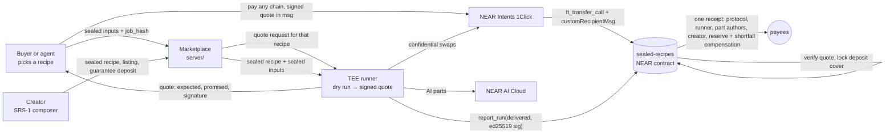

# Sealed Recipes

**A platform to compose and run sealed workflows on NEAR, paid per run.**
- **Compose.** Creators build *recipes* without code from other builders' typed, swappable *parts* (code, agents, NEAR AI Cloud models, data), using an open spec, [SRS-1](docs/SRS-1.md). Developers build and publish parts, with conformance checks as they type.
- **Seal.** A recipe is encrypted in the creator's browser to an attested TEE runner. Only its hash and part list go on-chain, so its method can't be copied while it is on sale.
- **Run.** A buyer or an agent gets a signed quote from a sealed dry run, pays from any chain through NEAR Intents, and the runner executes the recipe privately, under per-part limits.
- **Settle.** One settlement pays every part author, the runner and the creator. If the result falls short of the quote, the creator's guarantee deposit pays the buyer the difference.

The ten recipes in this repo are samples that show what the platform can run; anyone can compose new ones from the same parts or add parts of their own.



**Quick start** (Node.js 20.6+ on Linux, macOS or WSL; no keys, no network). The step-by-step walkthrough is in [Try it in two minutes](#try-it-in-two-minutes-no-keys-no-network-needed).

```bash
npm install
npm run demo        # opens http://127.0.0.1:8080; press "Play the demo story"
npm run test:e2e    # the same story in the terminal; exits non-zero if any step fails
```

**Status.** Details in [What is real, and what is local](#what-is-real-and-what-is-local).
- **Runs end to end locally.** The contract is an in-process mirror of the Rust contract, and 1Click, NEAR AI Cloud, FastNEAR and NEAR RPC are local mocks with the real request and response shapes. Transaction hashes in the demo are simulated, and the app and terminal label them that way.
- **The Rust NEAR contract** passes 112 unit tests on the same vector files as the mirror, and its money, pricing, durable-run and version logic is proved with Z3 and TLA+. It is **not deployed yet**.
- **Real services:** `npm run live-check` gets real 1Click dry quotes (confidential ones need a 1Click partner key) and, with a key, verifies a real TEE-signed NEAR AI Cloud completion.

Built for the [NEAR Hackathon](https://nearhackathon.com) (Nov 1–14, 2026). Tracks: **Privacy & Private AI**, **Agent Economy**.

## What it is

Selling a workflow as a service, run by strangers, needs three things:
- a no-code spec for building workflows from other people's parts;
- sealing, so a workflow's method can't be copied while it is on sale;
- attribution, so every part author is paid in every run.

It uses Intents for payment and for the swaps inside workflows.

Every recipe is unique: a sealed combination of typed, swappable parts ([SRS-1](docs/SRS-1.md)). Buyers judge a recipe by its signed quote, price and track record, never by its method.

**No investment features.** A buyer pays for one run of a service. A creator posts collateral that pays buyers when a run falls short. Nothing is sold that gives anyone a share of profits: there are no recipe shares, dividends, tokens or trading. This keeps the product usable by any wallet in any country, and it is deliberate (see [No investment features](#no-investment-features)).

## The problem

Businesses and agents run on workflows that chain several tools, bots and AI calls. The workflow itself (which parts, in what order, with which thresholds and prompts) is often the real edge. Today it is protected only by NDAs, it is easy to copy, and the people who built the parts are rarely paid when someone else's workflow uses them. Buyers, meanwhile, can't compare workflows on results without seeing how they work.

| Requirement (from the brief) | How it is built here |
|---|---|
| Specialized builders deploy utility apps and bots | **Parts**: code, specialist agents or data sources, with typed ports, declared network capabilities, a per-call fee, **disclosure of model, instructions, harness and verification**, and **per-run resource limits**, registered on-chain ([standard/parts.json](standard/parts.json)) |
| A no-code / low-code standard to compose and swap parts | **SRS-1** ([docs/SRS-1.md](docs/SRS-1.md), and Docs › Spec in the app), an open MIT-licensed spec with conformance checks and an adoption path: a typed graph with subtyping, value schemas checked at every port while running, type variables, conditions, fallbacks and skip-on-error, validation, drop-in swap search, and a withdrawal-risk label. **Compose › Recipe** starts a new recipe or reopens one of yours; in the no-code builder you add parts, they wire themselves, and the buyer's form builds itself from what the parts need (a test rebuilds all 10 seed recipes this way). **Compose › Part** builds a part with live SRS-1 conformance checks |
| Users create recipes without patents or licences | The recipe is **sealed** (X25519 + XSalsa20-Poly1305) to the runner's attested key. Only `sha256(envelope)` goes on-chain. See [What the sealing protects](#what-the-sealing-protects-and-what-it-doesnt) for its limits |
| A decentralized exchange where recipes are listed, bought and traded | **Signed quotes**: a buyer seals their inputs once and asks a recipe (or several) for a quote from a sealed dry run, then the buyer (or an agent's policy) picks one. Recipes are listed and bought **per run**; what is sold is the service, not an asset, so nothing here is a security (see [No investment features](#no-investment-features)) |
| Attribution that pays everyone involved | **`report_run`**: an ed25519-signed runner report is verified on-chain and splits the payment in one receipt. It also compares delivery with the signed quote and compensates any shortfall from the recipe's **guarantee deposit** (a performance bond the creator posts) |
| Deploy on NEAR's privacy platform (TEE) | Runner container for a **dstack Intel TDX CVM** (the NEAR Shade Agent / Phala stack). AI parts call **NEAR AI Cloud** private models and verify their TEE signatures |
| Pay through NEAR Intents | **1Click** `EXACT_OUTPUT` quote with `customRecipientMsg`, so the solver's delivery *is* the `ft_transfer_call` that opens the run. Swaps inside the workflow use **confidential intents** (`confidentiality: "basic"`) |

## How it works

1. **Builders publish parts.** Each part declares its four layers, so buyers can tell whether it could be rebuilt if its supplier disappeared:

   | Layer | Values |
   |---|---|
   | model | none, open-weights or closed |
   | instructions | open, sealed or closed |
   | harness | open, sealed or closed |
   | verification | open, sealed or closed |

   Parts on open-weights models are labelled **low** withdrawal risk, because anyone can re-host the weights. Parts on closed models are **high** risk, because their provider can retire, change or reprice the model at any time.
2. **Creators compose recipes** in a no-code canvas, set a **price band** (floor, ceiling and a target number of paid runs per period), back their quotes with a guarantee deposit, and publish the recipe sealed.
3. **Buyers ask for a quote.** They pick a recipe and fill its short form, sealed once to the attested runner. The recipe quotes from a dry run inside the runner, with:
   - the value it expects to deliver, a conservative **signed promise**, and how much of it the guarantee deposit covers;
   - its **price**, signed into the quote: the recipe's current market price (below), locked for these inputs;
   - its privacy, withdrawal risk and on-chain track record.

   A buyer or agent can set a **max price**: recipes listed above it aren't even asked to quote, and the contract refuses to charge more.

   Each quote is sealed to the buyer's browser, which checks the runner's signature before paying. The signature binds the quote to that buyer, those sealed inputs and that recipe version, and it can be used once. Recipes stay sealed: buyers compare results, not methods.
4. **The buyer picks a quote and pays** from any chain through NEAR Intents. The signed promise travels with the payment, so the contract can enforce it (it is then public on-chain; a buyer who prefers privacy can choose "No guarantee" and skip the promise and the bond).
5. **The sealed workflow runs.** First the runner re-prices the run: if the wallet changed since the quote, it aborts and refunds instead of letting the deposit pay for an emptied wallet (`npm run attack:drain` shows this). Each part runs under declared limits on time, HTTP calls, model calls and output size; a run that goes over is cancelled and refunded. Part logs, wallet requests and the result leave the runner encrypted to a one-time key in the buyer's browser.
6. **One settlement** pays the protocol, the runner, every part author used and the creator. A share of the creator's cut that the creator chose (`reserve_bps`) tops up the recipe's guarantee deposit. Delivery is checked against the promise, and any shortfall is paid to the buyer from the deposit, up to the cover in the quote.

### Market-driven prices

There is no fixed price list. Each recipe's price per run follows demand inside the band its creator set, using the same rule Ethereum uses for its base fee (EIP-1559), applied on-chain:
- the contract counts paid runs per pricing period (1 hour suggested on mainnet; 2 minutes in the demo);
- when a period ends, more runs than the target raise the price by up to 12.5%, fewer lower it by up to 12.5%;
- the price never leaves the band, and the floor must cover every fee, so any price the market reaches still settles.

Each recipe's price comes from its own demand, and a buyer weighs its signed price against the value it promises. The rule's bounds, direction and monotonicity are proved with Z3 for every input, and the Rust contract and TypeScript mirror reproduce the model's vectors exactly.



```bash
npm run test:pricing    # SAFE with 15-second periods: 4 buyers pay in one period (twice the target) -> +12.5%;
                        # the next quote locks the new price; settlement pays exactly it; a buyer's max price
                        # excludes SAFE; two idle periods pull it back toward the floor
```

## Try it in two minutes (no keys, no network needed)

Requirements: Linux, macOS or WSL, and Node.js 20.6 or newer (22 LTS recommended). Rust is only needed for the contract tests. On Windows, build in WSL ([Building on WSL](#building-on-wsl)).

```bash
npm install
npm run demo            # starts runner :8787 + marketplace :8080, seeds the recipes, opens the browser
```

Then follow these steps. Each one says what you should see.

The app opens on a landing page. Past it, the top menu has four sections: **Recipes** (find one and get a quote), **Compose** (build a recipe from parts with no code, or build a part), **Wallet**, and **Docs** (the SRS-1 spec, Trust & privacy, Landscape, and guides). Every page has its own link (`#/recipes/CLNP`, `#/quote/STAK`, `#/compose/part/…`), so the back button works.

1. **Open http://127.0.0.1:8080.** The landing page explains the idea. **Proceed to recipes** opens **Recipes**: nine listed recipes with a search box and favorites (★).
2. **Click "Play demo"** (top right; on the landing page, **Watch the demo**). Seven chapters play automatically, each with a caption and a speed control. Chapters 1–4 are the loop itself:
   1. **Compose.** As `chef.testnet`, the creator starts a new recipe and adds five parts one by one. Each wires itself to the previous step's matching output, and the buyer's form (wallet, dust threshold, target asset, fresh address) comes with them. The seal dialog verifies the runner attestation: 6 checks pass, and "Hardware TDX quote" shows as skipped in local mode. The plaintext turns into ciphertext and gets a wax seal. `publish_recipe` returns a transaction hash (simulated in local mode), and a $25 guarantee deposit backs CLNP's quotes.
   2. **Find it and get a quote.**
      - As `bob.testnet`, the buyer searches “clean”, opens *Clean up and protect* (CLNP) and presses **Get a quote**.
      - The quote page asks only CLNP: a fresh address is generated in the browser, the inputs are sealed, and CLNP quotes from a sealed dry run. It expects $28.02 and promises $27.81, with $25.00 covered by the deposit, at a signed price of $0.75.
      - Bob uses the quote. A 1Click quote shows *0.75188 USDC on Arbitrum → $0.75 delivered to the contract*, with the signed promise in the `customRecipientMsg`.
   3. **Execute.**
      - The runner checks the paid run against its on-chain commitments, decrypts, and runs each part, showing its author and fee. Part details carry a *sealed to you* tag.
      - The AI Spam Shield quarantines two scam airdrops, with its signature verified.
      - A wallet dialog, decrypted in the browser, asks to approve four `ft_transfer`s. Four confidential swaps then reach `SUCCESS`.
   4. **Settle.** "Delivered $28.02 against a signed promise of $27.81: promise kept, the deposit is untouched." Below that, a diagram shows $0.75 split between the protocol, the runner, five part authors, **$0.5085 to the creator** and **$0.0565 into CLNP's guarantee deposit** (the creator's 10% reserve), in one transaction.

   Chapters 5–7 explain why it holds together: prices that follow demand, what the marketplace, the chain and your browser can each check, and the three ways in (run a recipe, compose one, build a part).
3. **Recipes → CLNP.** The track record shows 1 successful run, delivery at 101% of the promise and a guarantee deposit of $25.06: the $25 the creator posted plus the reserve from the run. "Where the price goes" itemizes the split, which sums to exactly $0.75. "Inside" shows what the marketplace can see: the part chain (each part opens its internals) and the sealed on-chain commitment.
4. **Acting as → chef.testnet, then Wallet.** Income shows the creator's $0.5085, and *Your recipes* lists CLNP with its deposit. As `bob.testnet`, Wallet's *Account* panel reads his on-chain state and points to the recipes that would help: app keys left by dApps (KEYS), and unstaked NEAR waiting to be withdrawn (STAK).
5. **The four everyday-safety recipes.** Search Recipes for *keys*, *stake*, *contract* or *cap*, then press **Get a quote** and run:
   - **KEYS** revokes two risky app keys in one `DeleteKey` transaction you approve, then confirms they are gone. It never removes a full-access key; those are listed for review.
   - **STAK** withdraws 4.2 NEAR from two pools that finished unbonding, skips one still unbonding, and flags a validator that stopped validating.
   - **CHEK** checks a contract before you sign. Try `near-gift-claim.near` (high risk: reward-bait name, upgradable, no published source) and `v2.ref-finance.near` (low risk: locked, source published).
   - **TRIM** caps any token at a share of your wallet (use `dana.testnet`, about 48% NEAR): it sells only the excess, privately, into USDC at a fresh address.
6. **Compose → Recipe** (no code). Start a **New recipe**, or search **Your recipes** (the ones published by the account you act as) and press **Edit**. Add parts from the palette: *Suggested next* lists what fits, each part wires itself, and every input has a plain "comes from" list: an earlier part, the buyer's form, a new question for the buyer, or a fixed value. Click the *Buyer's form* on the canvas to word its questions and set defaults. Select a part to see its settings (sealed), its withdrawal risk, and drop-in alternatives. For example, swap *Allowlist Shield* for *AI Spam Shield Pro* and the recipe turns **high** risk (closed model). *Ready to publish?* lists what is left in plain words. Recipes are private: **Edit** opens the copy sealed to your own wallet key. Changing wiring or settings publishes a new version after the notice period; changing the parts, the buyer's form or the result publishes a new recipe with its own short code.
7. **Compose → Part** (for developers). Open any part to read its manifest, source and how it was admitted (all parts are public in this demo), or build a new one. SRS-1 conformance, static and security checks run live, and the panel shows the part's **admission tier**. Register the manifest on-chain, then **Submit for review**: the code goes to the queue, signed by your wallet.
8. **Compose → Review**. The admission queue. Every submission gets automated checks: conformance, a security scan, and a behaviour test in a sandbox, once as a quote and once as a run, showing the hosts it reached and any transaction it asked the buyer to sign. Then it depends on the tier:
   - **Open** (pure, or reads public NEAR data): admitted on the checks alone, and runs in the sandbox.
   - **Reviewed** (sends buyer data to a model or a new host): one appointed reviewer approves.
   - **Signing** (asks the buyer to sign): two independent appointed reviewers approve.
   Switch "Acting as" to `audit-a` or `audit-b` to review: tick the checklist, approve or request changes. The owner then runs `npm run release:parts -- --yes` to ship admitted parts in a new runner release; the release log is inside the code hash, and the runner refuses any part whose record does not verify.
9. **Docs** opens on **Spec (SRS-1)**: the full text of [docs/SRS-1.md](docs/SRS-1.md), rendered from the file, next to the live type registry and a conformance count of every part checked in the browser. §9 says how conformance is checked, §10 how others can adopt and extend the spec, and §11 how parts are admitted by tier. A panel lists the three admission tiers with how many parts are in each. **Trust & privacy** shows what the marketplace stores (ciphertext), what the contract stores and what only the runner sees, the runner attestation (re-run with a new nonce), the exact JSON 1Click receives, and the contract's NEP-297 events. The remaining tabs are guides: **Price & demand**, **Compose Recipe**, **Compose Part** and **Runner · TEE**.
10. **An agent as the buyer** (with the demo running and the story done): `npm run agent`. The agent seals one request for `carol.testnet`, asks the recipes it shortlisted (CLNP and SWPR by default) for quotes, compares them against its policy (confidential only, maximum risk, price cap, approval cap), pays the winner, approves only within its limit, and checks delivery against the promise. No human in the loop.

Headless version for CI or AI judges. It exits non-zero if any step fails:

```bash
npm run test:e2e        # boots everything and runs the 4-step story in the terminal
```

Expected tail of the output:

```
  quote SWPR  expects  $37.5416  promises  $36.9785 (deposit $10.0000)  price $0.2000  public       risk low
  quote CLNP  expects  $28.0249  promises  $27.8147 (deposit $25.0000)  price $0.7500  confidential risk low
  policy {"requirePrivacy":"confidential","maxRisk":"medium","sort":"net"} → CLNP
  ...
     $0.0565  CLNP guarantee deposit     creator's reserve, held as collateral for future quotes
  payouts + reserve == price ($0.7500): every unit accounted for
  delivered $28.0249 vs promised $27.8147 → compensation from the guarantee deposit $0.0000
✔ story complete
```

## The sample recipes

Ten sample recipes for common crypto problems, each a sealed workflow of public parts. They exist to exercise the platform (composing, sealing, quoting, running and settling); Compose › Recipe builds new ones from the same parts.

| Recipe | What it does | Parts |
|---|---|---|
| CLNP Clean up and protect | sweeps dust into one asset at a fresh address, privately; scam airdrops quarantined by a private AI | scanner, AI spam shield, dust filter, fresh-address check, confidential swap |
| SWPR Dust sweeper (public) | the cheaper, public version | scanner, allowlist shield, dust filter, public swap |
| EXIT Panic button | every non-scam token to USDC at a fresh address | scanner, AI shield, fresh check, confidential swap |
| TRCH Exit in two tranches | half now, half later; durable across runner restarts | … + wait, merge |
| ATOM Exit, all or nothing | every swap and the payout in one NEAR Intents batch, or nothing | … + atomic swap |
| SAFE Scam airdrop audit | read-only list of tokens never to touch | scanner, AI shield, report |
| **KEYS** Lock down app keys | dApp sign-in keys whose app is gone or known bad are revoked in one `DeleteKey` you sign; full-access keys are only reported | access keys, key-risk rules, key revoker |
| **STAK** Collect unstaked NEAR | `withdraw_all` on every pool that finished unbonding; flags validators that stopped validating or charge high fees | staking positions, unstaked collector |
| **CHEK** Contract check before you sign | a private AI verdict from on-chain facts: code, who can upgrade it, NEP-330 source, lookalike names | contract inspector, AI contract risk, contract report |
| **TRIM** Concentration cap | sells only the excess of any token above your cap, into a stablecoin at a fresh address | scanner, allowlist shield, trimmer, fresh check, confidential swap |

The four in bold were added with ten new parts. They read the same public NEAR interfaces in production that the local mocks serve: RPC `view_access_key_list`, `view_account` and `validators`; the staking pool's `get_account`, `get_reward_fee_fraction` and `withdraw_all`; NEP-330 `contract_source_metadata`; and FastNEAR `/v1/account/{id}/staking`.

```bash
npm run test:recipes  # KEYS revokes 2 risky keys and confirms on-chain (full-access keys untouched); STAK withdraws 4.2 NEAR from
                      # 2 pools, skips 1 still unbonding, flags an inactive validator; CHEK rates a phishing lookalike high and
                      # v2.ref-finance.near low; TRIM sells $172 of dana's NEAR (48% → 25%) and delivers USDC to a fresh address
```

## Complex workflows: durable runs, partial settlement, versions

Real workflows span many transactions and can run for hours. Three things make that safe:

- **Durable runs.** The runner checkpoints after every part and before every irreversible step. Each checkpoint is sealed to the runner's own key, signed, and stored by the marketplace before the run moves on.
  - If the runner crashes, the marketplace asks the restarted runner to resume from the last checkpoint.
  - Swap deposits happen exactly once, and the buyer is never asked to sign twice.
  - The progress hash goes on-chain and extends the run's timeout, so a long run can't be reclaimed mid-way.
- **Partial settlement** (opt-in, `settle_mode: "checkpoint"`). Each part's author is paid on-chain as soon as that part finishes. The final receipt pays the rest. A failed run refunds only what was not yet billed.
- **Versions with notice.** A new recipe version is announced on-chain and takes effect after a notice period (30 s in the demo, 24 h suggested). Every run executes the version it paid for, because the vault keeps every version. Quotes for an old version are refused after the switch.

```bash
npm run test:durable    # TRCH "Exit in two tranches": the runner is killed twice mid-run; checks it resumes,
                        # deposits once, asks for 2 signatures (not more), pays every part once, settles once
npm run test:atomic     # ATOM "Exit, all or nothing": a solver backs out of one leg -> nothing is swapped, the run is
                        # refunded; then every swap and the payout settle in ONE execute_intents
npm run test:versions   # announce, cancel, re-announce SWPR v2; a run paid on v1 finishes on v1 after v2 is live
                        # (runner killed in between); a v1 quote is refused after the switch
```

Where everything is stored, and who runs what, is in [docs/ARCHITECTURE.md](docs/ARCHITECTURE.md#storage-what-lives-where).

## Where this sits: comparable offerings, integrations, and what only this adds

Workflow engines and agent markets exist, and some overlap with parts of this project:
- **Chainlink CRE:** triggers, consensus, and confidential workflows in beta, on EVM chains and Solana.
- **OutLayer:** attested WASM for NEAR.
- **NEAR AI Cloud and IronClaw:** private inference, and agents with routines.
- **NEAR AI Agent Market:** jobs, escrow and bids.
- **Olas, Gelato, Venice.**

This project treats them as places to run recipes and channels to sell them, not as rivals:
- **Execution is pluggable.** The marketplace talks to executors only through `ExecutionBackend` (`server/src/backends.ts`). [docs/EXECUTION_BACKENDS.md](docs/EXECUTION_BACKENDS.md) maps it to a CRE confidential workflow and to OutLayer (integration paths, not built).
- **NEAR Intents for atomicity.** The `intents.atomic-swap` part swaps everything in one signed Verifier batch: every swap and the payout, or nothing. `npm run test:atomic` makes one leg fail and shows nothing moved.

What none of them offers, and this project does:
- secret recipes sold to strangers, hidden from buyers and from the operators;
- signed quotes from sealed dry runs, bound to the buyer and their sealed inputs;
- outcome guarantees backed by the creator's deposit, with machine-checked safety;
- every part author paid in the same settlement;
- typed, swappable parts that disclose their withdrawal risk;
- durable runs with partial settlement, and versions with a notice period.

Where others are ahead is listed too:
- CRE's multi-node consensus and maturity;
- Agent Market's live network;
- IronClaw's triggers;
- OutLayer's sandbox.

Full comparison: [docs/LANDSCAPE.md](docs/LANDSCAPE.md), and **Docs › Landscape** in the app.

Two more pieces make recipes manageable over time:
- **Durable storage.** Every sealed version and checkpoint is kept in a content-addressed store (`server/src/store.ts`). A blob's id is the hash committed on-chain, and every read is integrity-checked.
- **Creator copies.** Each version is also sealed to a key derived from the creator's wallet signature. The creator can reopen any published version from any device (`GET /api/vault/:ticker/creator-copy`, opened with a key re-derived from a wallet signature), and nothing is kept in the browser. The composer has no "load" option in the UI; editing a published recipe as a new version is a planned Wallet feature.

## No investment features

Earlier builds let creators sell revenue shares in a recipe, with dividends and share trading in batch auctions. They were removed (archived at git tag `archive/revenue-shares`), for two reasons:
- **Reach.** A token that pays holders a share of a recipe's revenue looks like an investment contract under tests such as Howey in the US, and similar rules elsewhere. That could limit who may list, buy or even see a recipe. Pay-per-run use of a service does not.
- **Little value.** Per-run dividends would be tiny, and taxable as income in most places.

What remains is ordinary commerce plus collateral:
- **Buyers** pay a fixed price for one run. They get the result, plus compensation if it falls short of the signed quote.
- **Creators, part authors, the runner and the protocol** are paid for work actually done, in the settlement of that run.
- **The guarantee deposit** is the creator's own money, posted as collateral (a performance bond, like a contractor's or an escrow). It pays nothing to anyone except buyers who were shorted, earns no return, and only the creator can withdraw it. A creator can let it grow automatically by keeping a share of each run's cut in it (`reserve_bps`).

This is a design choice, not legal advice: anyone launching this commercially should get advice for the countries they operate in.

## Formal verification

The money logic and the protocol are machine-checked, not only tested ([verification/README.md](verification/README.md)):

- **Z3 proofs (66 theorems)** for every input in the u128 range:
  - settlement conserves the price exactly, to the unit, for 0 to 8 parts (also when parts are paid at checkpoints), the creator's reserve is the creator's own money, and a split never fails once the fees fit the price;
  - guarantee-deposit accounting can't be overdrawn, and its ledger invariant (including reserves added at settlement) holds by induction over any history;
  - market prices stay in the creator's band, move at most 12.5% a period, move the way demand points and never fall as demand rises, never overflow, and every price in the band covers the fees.
- **Three TLA+ models**, checked exhaustively by TLC:
  - the bond lifecycle with an adversarial buyer: bond conservation, single-use quotes and **no bond drain**, over 22.7M states;
  - durable runs with a runner that crashes at any point: **deposits exactly once**, every part paid exactly once, and the run always finishes;
  - versions with notice: every run executes the version it paid for, and no version goes live early.

  Each model also has a variant without the safeguard (the old bond rule, no write-ahead checkpoint, a vault that keeps only the current version), and TLC is expected to find a counterexample in each.
- **Conformance vectors** generated by the proved models (400 settlement cases, 200 deposit operations, 300 price updates) must be reproduced exactly by both the Rust contract and the TypeScript mirror. This keeps the proofs tied to the shipped code.

The proofs found three real bugs, all fixed:
- a way to drain the bond by depositing less than asked after the re-check (TLA+; the model and the fix are still here);
- two rounding paths that could have left the contract owing revenue-share holders more than it held. That design was later removed (see [No investment features](#no-investment-features)); its proofs are archived with it.

What is *not* proven is listed plainly in the verification README. That covers the compiled Rust itself (Kani is the next step), and the UI, server and runner, which are tested, not proven.

```bash
npm run verify          # Z3 proofs + conformance freshness (~5 s; pip install z3-solver)
npm run verify:tla      # also the TLC model check (~10 min; Java + tla2tools.jar)
```

## Tests

```bash
npm test                # 72 TypeScript tests: SRS-1 conformance of every part, part admission (tiers, security scan, sandbox, signed release records), all 10 seed recipes rebuilt in the composer, a recipe built from a blank canvas, the web app's state machines; settlement, bond and pricing vectors; quote signatures and expiry;
                        # event parity with the contract; SRS-1 typing, swaps, value delivered and withdrawal risk; conditions, alternatives, schemas, type variables, billing privacy;
                        # sealing; per-part resource limits; EIP-191; 1Click shapes; attestation; capability guard; code hash
npm run test:rust       # 112 Rust tests for the NEAR contract (same vectors, conformance with the proved models,
                        # market pricing, versions with notice, checkpoints and partial settlement)
npm run typecheck
npm run live-check      # optional, needs internet: real 1Click dry quotes (confidential with ONECLICK_API_KEY), FastNEAR, NEAR RPC,
                        # and with NEAR_AI_API_KEY a real TEE-signed NEAR AI Cloud completion, verified
```

## Building on WSL

On Windows, build and run everything inside WSL (Ubuntu), not in PowerShell. The scripts, the Rust contract build and the Z3/TLA+ tools all expect Linux.

1. **Put the project in the WSL filesystem**, not on `C:`. Under `/mnt/c` npm and cargo are many times slower, and `node_modules` installed on Windows contain Windows binaries that fail in Linux.
   ```bash
   git clone https://github.com/ztoori/sealed-recipes.git ~/sealed-recipes
   # add --depth 1 for just the latest version; the full history (and the tags) stays on GitHub
   cd ~/sealed-recipes
   ```
2. **Install the toolchain** with one script. It is safe to re-run, uses `sudo` only for apt packages, and installs Node with nvm and Z3 in a project virtualenv (`.venv`).
   ```bash
   bash scripts/setup-wsl.sh             # Node 22, npm packages, Python + Z3
   bash scripts/setup-wsl.sh --all       # + Rust, wasm target + cargo-near, Java + tla2tools.jar, ffmpeg + Playwright
   ```
   Options: `--with-rust` (contract tests), `--with-wasm` (contract build), `--with-tla` (TLC model check), `--with-media` (re-record the video).
3. **Check, then build and run**:
   ```bash
   npm run doctor          # what is installed, what each npm script needs, how to fix what's missing
   npm test && npm run verify && npm run test:rust
   npm run build:wasm      # contract wasm via cargo-near -> contracts/sealed-recipes/target/near/
   npm run demo            # opens http://127.0.0.1:8080 in your Windows browser
   ```

**Getting a new version.** Pull it, then reinstall in case dependencies changed:
```bash
cd ~/sealed-recipes
git pull
npm install
npm run demo            # rebuilds the web app automatically when its sources changed
```
If the browser still shows the old screens, reload with Ctrl+F5.

If `npm` fails with "UNC paths are not supported" or `C:\Windows\scripts\...`, the shell is running Windows npm: WSL adds the Windows PATH, and Linux Node isn't loaded in that terminal yet. Run `source ~/.nvm/nvm.sh` or open a new terminal; `which npm` should show `~/.nvm/...`, not `/mnt/c/...`.

WSL2 forwards `localhost` to Windows by default, so the Windows browser reaches the demo. If yours doesn't (custom `.wslconfig`), start it with `SRS_HOST=0.0.0.0 npm run demo` and open `http://<WSL IP>:8080` (`hostname -I` shows the IP).

The setup script was tested end to end on Ubuntu 24.04: from a fresh clone it installs everything, after which `npm test`, `npm run verify`, `npm run test:e2e` and `npm run test:rust` pass. `npm run build:wasm` couldn't be tested on our build machine, because it can't download the wasm target. If `cargo near` rejects the wasm for unsupported wasm features with a very new Rust, add a `rust-toolchain.toml` with `channel = "1.86"` in `contracts/sealed-recipes` and run it again.

## What the sealing protects, and what it doesn't

Sealed Recipes protects a workflow **by default, without filing anything**. The law (copyright, trade secrets, terms of use) becomes the backup instead of the first line of defence.

| Threat | Covered? | Why |
|---|---|---|
| Copying or pirating the recipe | **Yes** | It is never distributed. Only attested runner code can decrypt it |
| Leaks through partners who run it | **Yes** | There are no licensees holding copies. Runs go through the sealed runner |
| Getting paid without enforcing licences | **Yes** | Access is metered per run, and every part author is paid in the run's settlement |
| Reverse engineering by probing outputs | **Partly, on any platform** | Every probe costs a paid run. Simple recipes can still be inferred from enough input/output pairs. No privacy technology hides outputs from the buyer who paid for them. A copy has to win buyers on its own quotes and track record |
| Inferring a recipe's structure from its listing | **Partly** | The parts and types are public, and for simple linear recipes they leave few possible wirings ([SRS-1 §5.3](docs/SRS-1.md#53-what-the-public-data-gives-away)). The edge lives in sealed params, constants and conditions; execution order, node ids and which branch ran stay out of public data |
| Independent reinvention | **No, on any platform** | The part list is public so authors can be paid. Patents stop reinvention; secrecy does not |
| Hardware or key compromise | **Depends on the TEE** | Intel TDX side channels, or a leaked or lost runner key (one key seals every recipe today). The local demo has no hardware TEE |
| Part authors' source code | **Not in this build; possible on NEAR** | Parts are bundled into the runner image here, so its auditors can read them. NEAR's stack supports closed code: parts sealed to the runner like recipes, OutLayer closed-source WASM in TDX, or a part running as its own attested TEE service |
| Buyers sharing results, creators leaking their own recipe | **No** | Out of scope for any technical measure |

## What is real, and what is local

These are kept separate so nothing here needs to be taken on faith.

| Component | In `npm run demo` | Production path (in this repo) |
|---|---|---|
| Contract logic | `core/src/ledger.ts`, an in-process mirror with the same methods, math and event fields. A test checks every event against `docs/CONTRACT_EVENTS.md` | `contracts/sealed-recipes` (Rust, near-sdk 5.30). Both pass the **same vector files** in `contracts/test-vectors/` |
| TEE runner | `runner/` as a separate process with `TEE_MODE=local-dev`: real keys, sealing, signed quotes and reports, enforced limits, **no hardware quote** (shown as skipped). Quote and run endpoints require a token shared only with the marketplace | Same code with `TEE_MODE=dstack` in a TDX CVM (`runner/Dockerfile`, `runner/docker-compose.yml`). `scripts/verify-quote.ts` runs Intel DCAP verification with `@phala/dcap-qvl` |
| NEAR Intents 1Click | `/mock/1click`: same request and response shapes, a frozen token-price sample, the real status names | `core/src/oneclick.ts` live mode; `npm run live-check` gets real dry quotes. **NEAR Intents has no testnet**, so the demo cannot move real funds |
| NEAR AI Cloud | `/mock/nearai` signs responses with a real secp256k1 key in the provider-TEE format. The "model" is a transparent heuristic, and there is no hardware quote (reported as skipped) | The same part code calls `cloud-api.near.ai`, and `live-check` verifies a real completion end to end |
| FastNEAR / NEAR RPC | `/mock/fastnear`, `/mock/rpc`, backed by fictional wallets in `fixtures/wallets.json` and fictional keys, staking pools and contracts in `fixtures/chain-state.json` | Same URLs unmocked |
| Wallet signing | A local demo wallet "signs as" the selected account. Demo accounts have unlimited demo USDC, so deposit sizes are illustrative | **Not built yet.** The approval dialog shows the exact `signAndSendTransactions` payload a NEAR wallet would sign |
| Chain view for attestation checks | The browser gets the attestation **directly from the runner**, but the registered keys come from the server's contract mirror, so the marketplace is trusted for that comparison | Clients read `get_runner` from NEAR RPC; the runner reads `get_run` / `get_recipe` over NEAR RPC when `NEAR_RPC_URL` is set |

Every transaction hash in local mode comes from the mirror or the mocks, so none of them is on a NEAR network; the app shows them as *simulated tx* and the terminal story says so at the top. The runner never sees mock-specific code. It always builds URLs for the real hosts, and `SRS_REWRITE` (set by `scripts/demo.mjs`) maps them to the local mocks.

## How NEAR is used

- **NEAR smart contract** (`contracts/sealed-recipes`):
  - a part and runner registry, and sealed recipe commitments;
  - pay-per-run escrow, with signed quotes (including their price) checked by `env::ed25519_verify`;
  - market-driven list prices per recipe (an EIP-1559-style rule inside a creator-set band);
  - guarantee deposits (performance bonds) that compensate shortfalls, and an on-chain track record per recipe;
  - one-receipt settlement with NEP-297 events;
- **NEAR Intents / 1Click**:
  - Pay-per-run uses `swapType: EXACT_OUTPUT` to the payment token, with `recipient = contract` and `customRecipientMsg = {"action":"run",…,"on_behalf_of":buyer,"quote":{…}}`. The solver's delivery is the `ft_transfer_call` that escrows the run.
  - Swaps inside workflows use `confidentiality: "basic"`. When quoting, recipes price their swaps with `dry: true` 1Click quotes.
  - If a delivered payment fails a business rule, the contract credits `on_behalf_of` instead of bouncing the funds back to the solver.
- **TEE**: the runner is built for a dstack Intel TDX CVM, the stack NEAR's Shade Agents use. Its attestation binds `sha256(codehash, enc key, nonce, signing key)` into REPORTDATA. The contract pins the runner's signing key and the audited code hash (`AUDITED_CODEHASH`). The same key signs quotes and run reports, so a quote is a promise from attested code.
- **NEAR AI Cloud**: AI parts use the private inference API. Each verdict is checked against the attested `signing_address`.
- **NEAR accounts**: a fresh implicit account is generated in the buyer's browser, and its freshness is proven with RPC `view_account → UNKNOWN_ACCOUNT`.

## Architecture



Details: [docs/ARCHITECTURE.md](docs/ARCHITECTURE.md) · threat model: [docs/THREAT_MODEL.md](docs/THREAT_MODEL.md) · contract interface: [docs/CONTRACT_SPEC.md](docs/CONTRACT_SPEC.md) · spec: [docs/SRS-1.md](docs/SRS-1.md)

## Repository map

```
contracts/sealed-recipes/   Rust NEAR contract + 112 unit tests
contracts/test-vectors/       settlement and bond vectors shared by Rust and TS; conformance vectors from the proofs
verification/                 Z3 proofs (settlement, billing, guarantee deposits), TLA+ models (bonds, durable runs, versions), results
core/src/                     SRS-1 (parts, disclosure, value delivered), sealing, settlement, ledger mirror, quote hashing, clients, attestation
runner/                       sealed TEE runner: dry-run quotes, durable execution (checkpoints, resume), resource limits, part admission and the sandbox for open-tier parts, 23 parts
server/                       marketplace API (quotes, runs, track records, part submissions and reviews) and local mocks of external services
web/                          React UI: Recipes (search, favorites, Get a quote), Compose (Recipe, Part), Wallet, Documentation (Spec, Trust & privacy, Landscape), story mode
standard/parts.json           SRS-1 part catalog (ports, capabilities, fees, disclosure, limits)
standard/reviews.json         release log: how every part was admitted (tier, hashes, signed approvals); inside the code hash
standard/reviewers.json       the owner-appointed reviewers and their keys; inside the code hash
seed/recipes/                 plaintext of the demo recipes (in the app they only ever travel sealed)
fixtures/                     fictional wallets, frozen 1Click token sample
scripts/                      demo launcher, seed, story CLI, agent buyer, release:parts, live-check, verify-quote, video recorder
docs/                         SRS-1, architecture, threat model, contract spec and events, submission kit, media
```

## Hosting the public demo

`npm run demo` is for one person on their own machine. A shared server needs `npm run gateway` (`scripts/gateway.mjs`) instead:

- **A private sandbox per visitor.** Demo accounts sign with keys anyone can derive (it is a demo wallet), and anyone can read a creator copy in the demo. On one shared market, a visitor could act as any account or open another visitor's recipe. The gateway gives each visitor their own marketplace (contract mirror, market, part reviews, sealed-recipe store), keyed by an HttpOnly cookie, so nothing one visitor does reaches anyone else. Sandboxes are deleted after 10 idle minutes; warm spares mean a new visitor doesn't wait.
- **One shared runner.** All sandboxes use one runner process. Each request names its marketplace; the runner accepts only local marketplaces on the gateway's ports and keeps their runs apart.
- **No dev endpoints.** Sandboxes run with `SRS_PUBLIC=1`, which turns off the endpoints the test suites use to crash the runner or make the solver fail.
- **Local only.** The gateway and every sandbox listen on 127.0.0.1; put Cloudflare Tunnel (or another reverse proxy) in front. Attestation reaches browsers through `/runner/attestation` on the same origin.

**Pre-compiled.** `npm run build` also bundles the marketplace, the runner and the seeding script into plain JavaScript (`scripts/build-node.mjs`, `*.bundle.mjs` next to each entry, gitignored); the gateway uses them when they are newer than the sources and falls back to TypeScript through tsx otherwise. Measured with 10 sandboxes starting at once: ready in 3.6 s instead of 5.9 s, 584 MB instead of 753 MB. `npm run demo` and the tests still run the TypeScript.

**Capacity.** Measured on a 2-CPU, 4 GB machine: 20 browsing visitors at once used about 830 MB in total (API p99 under 30 ms, no errors); 10 visitors running the full story at the same moment all passed. A sandbox's processes show about 100 MB RSS, but much of it is shared code, so each extra visitor costs about 40–45 MB of real memory (pre-compiled), plus one shared runner (~140 MB). Start-up is CPU-bound: when many visitors arrive in the same second, raise `SANDBOX_SPARE`.

**Traffic and performance.** `curl -s http://127.0.0.1:8080/gateway/metrics` (on the server only; it answers 404 through the tunnel) shows requests, latency percentiles, visitors, boot times and the memory and swap of every process; the gateway logs a one-line summary every minute (`journalctl -u srs-demo`). `npm run loadtest -- --visitors 20 --mode browse` (or `--mode story`) simulates visitors and prints what they experienced next to the server's peak memory.

`deploy/srs-demo.service` runs it under systemd from a read-only checkout; `deploy/cloudflared-config.example.yml` shows the tunnel side.

None of this makes the demo wallet a real wallet: the live mode (real NEAR testnet wallets, signatures checked on every write) is separate work.

## Calls to outside services

Every call our processes make to a service outside the machine (FastNEAR, NEAR RPC, 1Click, NEAR AI Cloud, NVIDIA attestation) goes through one guard, `core/src/outbound.ts`, so a busy demo or a bug can't get us rate-limited or blocked:

- per service, a rate limit and a cap on calls in flight;
- "too many requests" (429) pauses that service for its `Retry-After` and the call is retried (a rejected request was never executed);
- network errors and 502/503/504 are retried, with backoff, only for requests that are safe to repeat: reads, NEAR RPC queries (never a transaction broadcast) and 1Click quotes (no funds move);
- repeated lookups (FastNEAR account data, the 1Click token list) are cached briefly, and identical lookups in flight share one request;
- a call that would wait too long fails fast instead of piling up.

Limits are per process and tunable without a code change: `SRS_OUTBOUND='{"api.fastnear.com":{"rps":20}}'`. The runner's `/health` shows the counts per service. Calls to this machine (the demo's mocks) are not limited.

## What happens to the accounts you enter

Inputs are sealed in the buyer's browser to the runner, and anything the runner says about them (quote details, part logs, the result, and the reason a quote or run failed) is sealed back to the buyer's one-time key. Nothing logs inputs. On-chain there are only hashes. The marketplace and the tunnel see ciphertext. To read an account, the runner asks NEAR data providers (FastNEAR, NEAR RPC) about it, as any block explorer does, so those providers see that lookup. `npm run test:privacy` checks this end to end: it uses made-up canary accounts as inputs and fails if one shows up in process output, responses in the clear, run events, chain events, public endpoints or stored files.

## Configuration

Copy `.env.example` to `.env` only if you want the live paths. Never commit keys.

| Variable | Used by | Purpose |
|---|---|---|
| `NEAR_AI_API_KEY` | runner, live-check | NEAR AI Cloud private inference |
| `SRS_OUTBOUND` | runner, server | per-service limits for outside calls, JSON merged over the defaults in `core/src/outbound.ts` |
| `ONECLICK_API_KEY` | runner, live-check | 1Click partner key (X-API-Key): lower fees; required by 1Click for confidential quotes. `ONECLICK_JWT` still works (legacy Bearer) |
| `TEE_MODE` | runner | `local-dev` (default) or `dstack` |
| `PORT`, `RUNNER_PORT` | launcher | default 8080 / 8787 |
| `RUNNER_PUBLIC_URL` | server | where browsers fetch the runner attestation (default `/runner`, a pass-through on the same origin) |
| `RUNNER_KEYS_PATH` | runner | local-dev key file (default `.data/runner-dev-keys.json`) |
| `SRS_PUBLIC` | server, runner | `1` when hosted for the public: dev endpoints off (set by `demo.mjs --public`) |
| `GATEWAY_PORT`, `SANDBOX_MAX`, `SANDBOX_SPARE`, `SANDBOX_IDLE_MIN`, `SANDBOX_PER_IP` | gateway | see `scripts/gateway.mjs` |
| `SRS_TENANT_PORTS`, `SRS_TENANT_URL` | runner, server | shared runner: the marketplace ports it serves / a marketplace's own address (set by the gateway) |

## Limitations and next steps

- **Durable storage is in-memory in the demo.** The vault and checkpoint store would be a database or IPFS in production, keyed by `sealed_hash` and run id. The runner and the contract already behave as if it were durable.
- **One runner.** Runners are approved by the contract owner. A permissionless set of staked runners, and recipes sealed to several of them, are next.
- **No triggers or schedules yet.** A run starts when a buyer pays. A workflow can wait inside a run (`time.wait`), but nothing starts a run on a timer or an on-chain event.
- **Not deployed yet.** The contract has 112 unit tests and the same vectors as the mirror, but it was not built to wasm or deployed from our build machine (no wasm target, no NEAR RPC access). `npm run build:wasm` builds it on WSL or Linux. Deploy commands are in [contracts/sealed-recipes/README.md](contracts/sealed-recipes/README.md).
- **No live chain adapter or wallet.** The server talks to the in-process mirror. A NEAR RPC adapter and near-connect are the main pieces missing for testnet.
- **The runner is trusted to measure delivery.** Guarantee deposits pay out on the runner's signed `delivered` value. That is sound only as far as the runner is attested; on-chain DCAP verification of the runner is the next step.
- **Quotes cost compute.** Quote requests are capped at 12 per minute per client. A small quote fee would be the on-chain version.
- **Part admission is partly permissioned.** Open-tier parts are admitted on automated checks and sandboxed; parts that send data somewhere new or ask buyers to sign need owner-appointed reviewers (SRS-1 §11). The release log makes every decision auditable. Next: a multisig or DAO as owner, reviewer stakes, several runners with their own releases, reproducible builds. The sandbox is a Node process with the permission model, not yet WASM with fuel metering.
- **Supplier risk.** Bundled parts can't be switched off by their author, but remote and closed-model parts can. SRS-1 labels this risk; fallback parts, notice periods and supplier bonds are planned.
- **Thin markets.** With 10 recipes, each price moves with its own demand only.
- **Demand can be faked, at a cost.** A creator can pay for their own runs to push the price up. Each fake run costs the protocol, runner and part fees, and the price rises at most 12.5% a period while buyers simply pick another recipe or set a max price. Counting only quoted runs from distinct buyers would make it harder.
- **Unquoted payments can miss a price change.** A payment without a quote is charged the list price when it arrives; if that rose since the payment was quoted, the payment is credited back to the buyer (never overcharged). Paying with a signed quote locks the price.
- **Spam.** `register_part` and `publish_recipe` are payable: the caller attaches NEAR for the bytes stored (the rest is refunded). Versions and hashes have size limits; names and part lists don't (SRS-1 §12), they just cost more storage. Run records and used quotes are created by `ft_on_transfer`, which can't carry NEAR, so their storage is paid from the contract's balance; a minimum protocol fee sized to cover it, or pruning settled runs, is next.
- **What 1Click sees.** Confidential intents hide the deposit-to-payout link from chain observers, not from the 1Click service. See [docs/THREAT_MODEL.md](docs/THREAT_MODEL.md).

## Disclosures

- **Built during:** the initial build was written on 2026-10-31, after the hackathon announcement. Tag `baseline-2026-10-31` marks that state; everything after it was built during the hackathon window (`git diff baseline-2026-10-31..main`).
- **AI-generated code:** most of this code was written with an AI coding assistant (Claude) working from the team's written brief, and was reviewed and tested by the team.
- **Libraries:** near-sdk (Rust), tweetnacl, @noble/hashes, @noble/curves, bs58, express, React, @xyflow/react, lightweight-charts (TradingView, attribution shown in the chart), Vite, tsx, @phala/dcap-qvl, @phala/dstack-sdk (runner container only), and the Archivo and Newsreader fonts (OFL). No templates or boilerplate were used beyond the cargo-near contract layout.
- No existing product on another chain. No other hackathon submission by the same team.

## License

MIT, see [LICENSE](LICENSE).
