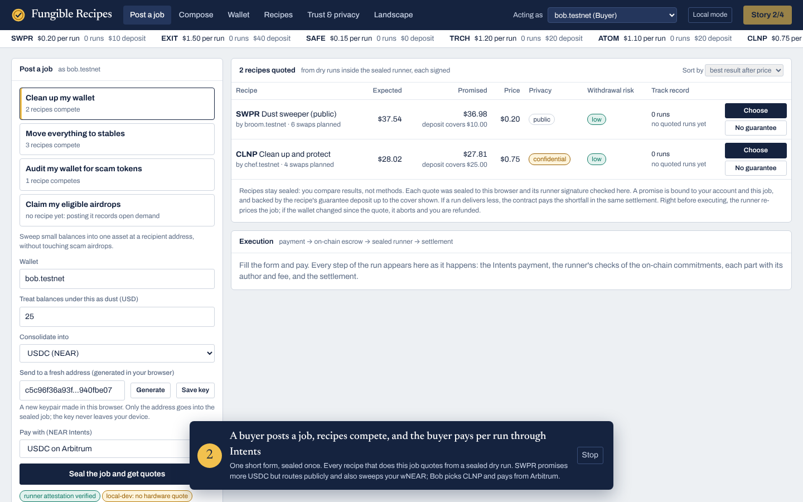
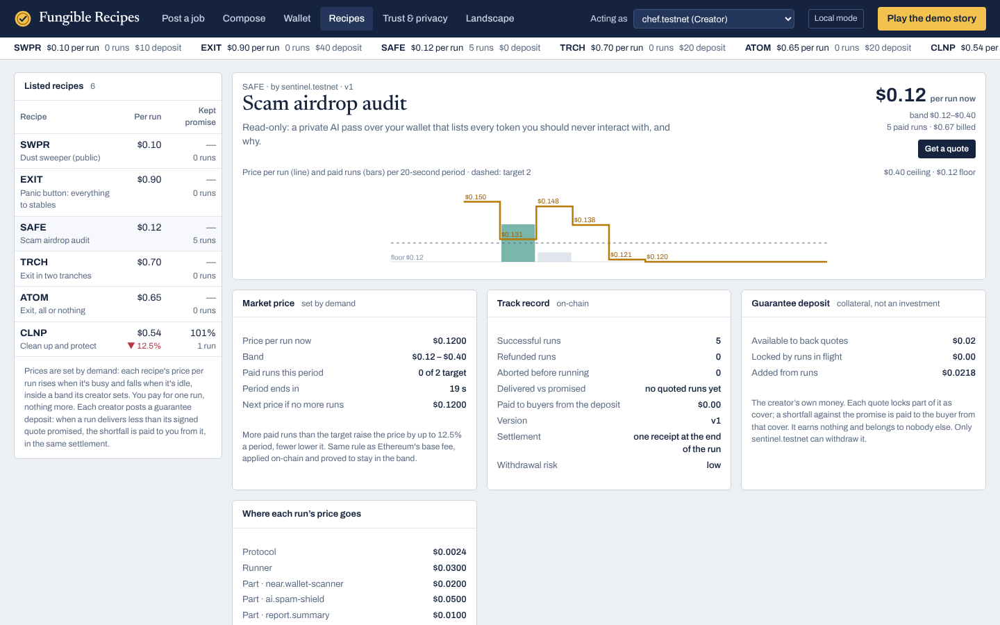
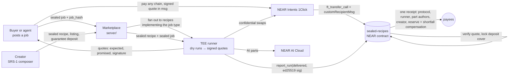

# Sealed Recipes

**Intents for workflows.** A buyer describes a job. Sealed workflows built from other people's parts compete to do it, each quoting the result it expects. The buyer picks one and pays per run from any chain through NEAR Intents. The workflow runs inside secure hardware, so its method can't be copied. One settlement pays every part author, the runner and the creator, and the creator's guarantee deposit pays the buyer if the result falls short of the signed quote.

NEAR Intents lets solvers compete to fill a swap. Sealed Recipes applies the same idea to whole workflows, which needs three things a swap doesn't:
- a no-code standard for building workflows from other people's parts;
- sealing, so a workflow's method can't be copied while it competes;
- attribution, so every part author is paid, not just the winner.

It uses Intents for payment and for the swaps inside workflows.

Every recipe is unique: a sealed combination of standard, swappable parts ([SRS-1](docs/SRS-1.md)). Recipes that do the same job are compared on results and price, never on method.

**No investment features.** A buyer pays for one run of a service. A creator posts collateral that pays buyers when a run falls short. Nothing is sold that gives anyone a share of profits: there are no recipe shares, dividends, tokens or trading. This keeps the product usable by any wallet in any country, and it is deliberate (see [No investment features](#no-investment-features)).

Built for the [NEAR Hackathon](https://nearhackathon.com) (Nov 1–14, 2026). Suggested tracks: `privacy`, `agents`, `defi` and `open`.



## The problem

Businesses and agents run on workflows that chain several tools, bots and AI calls. The workflow itself (which parts, in what order, with which thresholds and prompts) is often the real edge. Today it is protected only by NDAs, it is easy to copy, and the people who built the parts are rarely paid when someone else's workflow uses them. Buyers, meanwhile, can't compare workflows on results without seeing how they work.

| Requirement (from the brief) | How it is built here |
|---|---|
| Specialized builders deploy utility apps and bots | **Parts**: code, specialist agents or data sources, with typed ports, declared network capabilities, a per-call fee, **disclosure of model, instructions, harness and verification**, and **per-run resource limits**, registered on-chain ([standard/parts.json](standard/parts.json)) |
| A no-code / low-code standard to compose and swap parts | **SRS-1** ([docs/SRS-1.md](docs/SRS-1.md)): a typed graph with subtyping, validation, drop-in swap search, a withdrawal-risk label and standard **job types**. The visual composer is the Compose tab |
| Users create recipes without patents or licences | The recipe is **sealed** (X25519 + XSalsa20-Poly1305) to the runner's attested key. Only `sha256(envelope)` goes on-chain. See [What the sealing protects](#what-the-sealing-protects-and-what-it-doesnt) for its limits |
| A decentralized exchange where recipes are listed, bought and traded | **Recipe intents**: a buyer posts a job, every recipe that implements its type quotes from a sealed dry run, and the buyer (or an agent's policy) picks one. Recipes are listed and bought **per run**; what competes is the service, not an asset, so nothing here is a security (see [No investment features](#no-investment-features)) |
| Attribution that pays everyone involved | **`report_run`**: an ed25519-signed runner report is verified on-chain and splits the payment in one receipt. It also compares delivery with the signed quote and compensates any shortfall from the recipe's **guarantee deposit** (a performance bond the creator posts) |
| Deploy on NEAR's privacy platform (TEE) | Runner container for a **dstack Intel TDX CVM** (the NEAR Shade Agent / Phala stack). AI parts call **NEAR AI Cloud** private models and verify their TEE signatures |
| Pay through NEAR Intents | **1Click** `EXACT_OUTPUT` quote with `customRecipientMsg`, so the solver's delivery *is* the `ft_transfer_call` that opens the run. Swaps inside the workflow use **confidential intents** (`confidentiality: "basic"`) |

## How it works

1. **Builders publish parts.** Each part declares its four layers, so buyers can tell whether it could be rebuilt if its supplier disappeared:

   | Layer | Values |
   |---|---|
   | model | none, open-weights or closed |
   | instructions | open, sealed or closed |
   | harness | open, sealed or closed |
   | verification | open, sealed or closed |

   Parts on open-weights models are labelled **low** withdrawal risk, because anyone can re-host the weights. Parts on closed models are **high** risk, because their provider can retire, change or reprice the model at any time.
2. **Creators compose recipes** in a no-code canvas, declare which job type they compete for, set a **price band** (floor, ceiling and a target number of paid runs per period), back their quotes with a guarantee deposit, and publish the recipe sealed.
3. **Buyers post a job.** They fill one short form, sealed once to the attested runner. Every recipe implementing the job type quotes from a dry run inside the runner, with:
   - the value it expects to deliver, a conservative **signed promise**, and how much of it the guarantee deposit covers;
   - its **price**, signed into the quote: the recipe's current market price (below), locked for this job;
   - its privacy, withdrawal risk and on-chain track record.

   A buyer or agent can set a **max price**: recipes listed above it aren't even asked to quote, and the contract refuses to charge more.

   Each quote is sealed to the buyer's browser, which checks the runner's signature before paying. The signature binds the quote to that buyer, that job and that recipe version, and it can be used once. Recipes stay sealed: buyers compare results, not methods. A job nobody serves yet is recorded as **open demand** for builders.
4. **The buyer picks a quote and pays** from any chain through NEAR Intents. The signed promise travels with the payment, so the contract can enforce it (it is then public on-chain; a buyer who prefers privacy can choose "No guarantee" and skip the promise and the bond).
5. **The sealed workflow runs.** First the runner re-prices the job: if the wallet changed since the quote, it aborts and refunds instead of letting the deposit pay for an emptied wallet (`npm run attack:drain` shows this). Each part runs under declared limits on time, HTTP calls, model calls and output size; a run that goes over is cancelled and refunded. Part logs, wallet requests and the result leave the runner encrypted to a one-time key in the buyer's browser.
6. **One settlement** pays the protocol, the runner, every part author used and the creator. A share of the creator's cut that the creator chose (`reserve_bps`) tops up the recipe's guarantee deposit. Delivery is checked against the promise, and any shortfall is paid to the buyer from the deposit, up to the cover in the quote.

### Market-driven prices

There is no fixed price list. Each recipe's price per run follows demand inside the band its creator set, using the same rule Ethereum uses for its base fee (EIP-1559), applied on-chain:
- the contract counts paid runs per pricing period (1 hour suggested on mainnet; 2 minutes in the demo);
- when a period ends, more runs than the target raise the price by up to 12.5%, fewer lower it by up to 12.5%;
- the price never leaves the band, and the floor must cover every fee, so any price the market reaches still settles.

Unique recipes compete on results: for a job type, the buyer compares each recipe's signed price against the value it promises. A recipe with no direct rival still gets a market price from its own demand. The rule's bounds, direction and monotonicity are proved with Z3 for every input, and the Rust contract and TypeScript mirror reproduce the model's vectors exactly.



```bash
npm run test:pricing    # SAFE with 15-second periods: 4 buyers pay in one period (twice the target) -> +12.5%;
                        # the next quote locks the new price; settlement pays exactly it; a buyer's max price
                        # excludes SAFE; two idle periods pull it back toward the floor
```

## Try it in two minutes (no keys, no network needed)

Requirements: Linux, macOS or WSL, and Node.js 20.6 or newer (22 LTS recommended). Rust is only needed for the contract tests. On Windows, build in WSL ([Building on WSL](#building-on-wsl)).

```bash
npm install
npm run demo            # starts runner :8787 + marketplace :8080, seeds the recipes, opens the browser
```

Then follow these steps. Each one says what you should see.

1. **Open http://127.0.0.1:8080.** You land on **Post a job**, which lists four job types and how many recipes compete for each. *Claim my eligible airdrops* has none yet.
2. **Click "Play the demo story"** (top right). The brief's four steps play automatically, with a caption for each:
   1. **Compose.** Five parts snap together into *Clean up and protect* (CLNP). The seal dialog verifies the runner attestation: 6 checks pass, and "Hardware TDX quote" shows as skipped in local mode. The plaintext turns into ciphertext and gets a wax seal. `publish_recipe` returns a tx hash, and a $25 guarantee deposit backs CLNP's quotes.
   2. **Post a job.**
      - As `bob.testnet`, a fresh address is generated in the browser and the job *Clean up my wallet* is sealed and posted.
      - Two recipes quote. **SWPR** expects $37.54 and promises $36.98, but it is *public* and also sweeps the wallet's wNEAR. **CLNP** expects $28.02 and promises $27.81, is *confidential* and its $25 guarantee deposit covers $25.00 of the promise.
      - Bob chooses CLNP. A 1Click quote shows *0.75188 USDC on Arbitrum → $0.75 delivered to the contract*, with the signed promise in the `customRecipientMsg`.
   3. **Execute.**
      - The runner checks the paid run against its on-chain commitments, decrypts, and runs each part, showing its author and fee. Part details carry a *sealed to you* tag.
      - The AI Spam Shield quarantines two scam airdrops, with its signature verified.
      - A wallet dialog, decrypted in the browser, asks to approve four `ft_transfer`s. Four confidential swaps then reach `SUCCESS`.
   4. **Settle.** "Delivered $28.02 against a signed promise of $27.81: promise kept, the deposit is untouched." Below that, a diagram shows $0.75 split between the protocol, the runner, five part authors, **$0.5085 to the creator** and **$0.0565 into CLNP's guarantee deposit** (the creator's 10% reserve), in one tx.
3. **Recipes → CLNP.** The track record shows 1 successful run, delivery at 101% of the promise and a guarantee deposit of $25.06: the $25 the creator posted plus the reserve from the run. "Where each run's price goes" itemizes the split, which sums to exactly $0.75.
4. **Acting as → chef.testnet, then Wallet.** Income shows `creator earnings CLNP +$0.5085`, and *Recipes you created* lists CLNP with its deposit. Withdraw works; the creator can also top up or withdraw the free part of the deposit from the Recipes tab.
5. **Compose → "Load Dust sweeper", then select the *Allowlist Shield* node.**
   - The inspector shows the part's disclosure (model none, bundled, low risk) and its limits.
   - Drop-in replacements list *AI Spam Shield* (low risk) and *AI Spam Shield Pro* (**high** risk: closed model, closed harness, remote). Swap in Pro: Checks now shows *high withdrawal risk* and warns that the closed model can be withdrawn or repriced.
   - Drag *Confidential Swap* onto the canvas and wire `form.recipient` into its `to` port. The edge turns red: `"to" expects address.near.fresh but form.recipient is address.near`.
6. **Post a job → *Claim my eligible airdrops* → Seal the job and get quotes.** "No recipe does this job yet. It was recorded as open demand." Compose now lists it under *Open demand*.
7. **Trust & privacy** shows three things:
   - what the marketplace stores (ciphertext), what the contract stores, and what only the runner sees;
   - runner attestation, re-run with a new nonce;
   - the exact JSON 1Click receives, and the contract's NEP-297 events.
8. **An agent as the buyer** (with the demo running and the story done): `npm run agent`. The agent posts a job for `carol.testnet`, compares quotes against its policy (confidential only, maximum risk, price cap, approval cap), pays the winner, approves only within its limit, and checks delivery against the promise. No human in the loop.

Headless version for CI or AI judges. It exits non-zero if any step fails:

```bash
npm run test:e2e        # boots everything and runs the 4-step story in the terminal
```

Expected tail of the output:

```
  quote SWPR  expects  $37.5416  promises  $36.9785 (deposit $10.0000)  price $0.2000  public       risk low
  quote CLNP  expects  $28.0249  promises  $27.8147 (deposit $25.0000)  price $0.7500  confidential risk low
  policy {"requirePrivacy":"confidential","maxRisk":"medium","sort":"net"} → CLNP
  ...
     $0.0565  CLNP guarantee deposit     creator's reserve, held as collateral for future quotes
  payouts + reserve == price ($0.7500): every unit accounted for
  delivered $28.0249 vs promised $27.8147 → compensation from the guarantee deposit $0.0000
✔ story complete
```

## Complex workflows: durable runs, partial settlement, versions

Real workflows span many transactions and can run for hours. Three things make that safe:

- **Durable runs.** The runner checkpoints after every part and before every irreversible step. Each checkpoint is sealed to the runner's own key, signed, and stored by the marketplace before the run moves on.
  - If the runner crashes, the marketplace asks the restarted runner to resume from the last checkpoint.
  - Swap deposits happen exactly once, and the buyer is never asked to sign twice.
  - The progress hash goes on-chain and extends the run's timeout, so a long run can't be reclaimed mid-way.
- **Partial settlement** (opt-in, `settle_mode: "checkpoint"`). Each part's author is paid on-chain as soon as that part finishes. The final receipt pays the rest. A failed run refunds only what was not yet billed.
- **Versions with notice.** A new recipe version is announced on-chain and takes effect after a notice period (30 s in the demo, 24 h suggested). Every run executes the version it paid for, because the vault keeps every version. Quotes for an old version are refused after the switch.

```bash
npm run test:durable    # TRCH "Exit in two tranches": the runner is killed twice mid-run; checks it resumes,
                        # deposits once, asks for 2 signatures (not more), pays every part once, settles once
npm run test:atomic     # ATOM "Exit, all or nothing": a solver backs out of one leg -> nothing is swapped, the run is
                        # refunded; then every swap and the payout settle in ONE execute_intents
npm run test:versions   # announce, cancel, re-announce SWPR v2; a run paid on v1 finishes on v1 after v2 is live
                        # (runner killed in between); a v1 quote is refused after the switch
```

Where everything is stored, and who runs what, is in [docs/ARCHITECTURE.md](docs/ARCHITECTURE.md#storage-what-lives-where).

## Where this sits: comparable offerings, integrations, and what only this adds

Workflow engines and agent markets exist, and some overlap with parts of this project:
- **Chainlink CRE:** triggers, consensus, and confidential workflows in beta, on EVM chains and Solana.
- **OutLayer:** attested WASM for NEAR.
- **NEAR AI Cloud and IronClaw:** private inference, and agents with routines.
- **NEAR AI Agent Market:** jobs, escrow and bids.
- **Olas, Gelato, Venice.**

This project treats them as places to run recipes and channels to sell them, not as rivals:
- **Execution is pluggable.** The marketplace talks to executors only through `ExecutionBackend` (`server/src/backends.ts`). [docs/EXECUTION_BACKENDS.md](docs/EXECUTION_BACKENDS.md) maps it to a CRE confidential workflow and to OutLayer (integration paths, not built).
- **NEAR Intents for atomicity.** The `intents.atomic-swap` part swaps everything in one signed Verifier batch: every swap and the payout, or nothing. `npm run test:atomic` makes one leg fail and shows nothing moved.

What none of them offers, and this project does:
- secret recipes sold to strangers, hidden from buyers and from the operators;
- recipes competing on standard jobs with signed quotes;
- outcome guarantees backed by the creator's deposit, with machine-checked safety;
- every part author paid in the same settlement;
- typed, swappable parts that disclose their withdrawal risk;
- durable runs with partial settlement, and versions with a notice period.

Where others are ahead is listed too:
- CRE's multi-node consensus and maturity;
- Agent Market's live network;
- IronClaw's triggers;
- OutLayer's sandbox.

Full comparison: [docs/LANDSCAPE.md](docs/LANDSCAPE.md), and the **Landscape** tab in the app.

Two more pieces make recipes manageable over time:
- **Durable storage.** Every sealed version and checkpoint is kept in a content-addressed store (`server/src/store.ts`). A blob's id is the hash committed on-chain, and every read is integrity-checked.
- **Creator copies.** Each version is also sealed to a key derived from the creator's wallet signature. The creator can reopen and edit any published version from any device ("Reopen my published recipe…" in Compose), and nothing is kept in the browser.

## No investment features

Earlier builds let creators sell revenue shares in a recipe, with dividends and share trading in batch auctions. They were removed (archived at git tag `archive/revenue-shares`), for two reasons:
- **Reach.** A token that pays holders a share of a recipe's revenue looks like an investment contract under tests such as Howey in the US, and similar rules elsewhere. That could limit who may list, buy or even see a recipe. Pay-per-run use of a service does not.
- **Little value.** Per-run dividends would be tiny, and taxable as income in most places.

What remains is ordinary commerce plus collateral:
- **Buyers** pay a fixed price for one run. They get the result, plus compensation if it falls short of the signed quote.
- **Creators, part authors, the runner and the protocol** are paid for work actually done, in the settlement of that run.
- **The guarantee deposit** is the creator's own money, posted as collateral (a performance bond, like a contractor's or an escrow). It pays nothing to anyone except buyers who were shorted, earns no return, and only the creator can withdraw it. A creator can let it grow automatically by keeping a share of each run's cut in it (`reserve_bps`).

This is a design choice, not legal advice: anyone launching this commercially should get advice for the countries they operate in.

## Formal verification

The money logic and the protocol are machine-checked, not only tested ([verification/README.md](verification/README.md)):

- **Z3 proofs (66 theorems)** for every input in the u128 range:
  - settlement conserves the price exactly, to the unit, for 0 to 8 parts (also when parts are paid at checkpoints), the creator's reserve is the creator's own money, and a split never fails once the fees fit the price;
  - guarantee-deposit accounting can't be overdrawn, and its ledger invariant (including reserves added at settlement) holds by induction over any history;
  - market prices stay in the creator's band, move at most 12.5% a period, move the way demand points and never fall as demand rises, never overflow, and every price in the band covers the fees.
- **Three TLA+ models**, checked exhaustively by TLC:
  - the bond lifecycle with an adversarial buyer: bond conservation, single-use quotes and **no bond drain**, over 22.7M states;
  - durable runs with a runner that crashes at any point: **deposits exactly once**, every part paid exactly once, and the run always finishes;
  - versions with notice: every run executes the version it paid for, and no version goes live early.

  Each model also has a variant without the safeguard (the old bond rule, no write-ahead checkpoint, a vault that keeps only the current version), and TLC is expected to find a counterexample in each.
- **Conformance vectors** generated by the proved models (400 settlement cases, 200 deposit operations, 300 price updates) must be reproduced exactly by both the Rust contract and the TypeScript mirror. This keeps the proofs tied to the shipped code.

The proofs found three real bugs, all fixed:
- a way to drain the bond by depositing less than asked after the re-check (TLA+; the model and the fix are still here);
- two rounding paths that could have left the contract owing revenue-share holders more than it held. That design was later removed (see [No investment features](#no-investment-features)); its proofs are archived with it.

What is *not* proven is listed plainly in the verification README. That covers the compiled Rust itself (Kani is the next step), and the UI, server and runner, which are tested, not proven.

```bash
npm run verify          # Z3 proofs + conformance freshness (~5 s; pip install z3-solver)
npm run verify:tla      # also the TLC model check (~10 min; Java + tla2tools.jar)
```

## Tests

```bash
npm test                # 38 TypeScript tests: settlement, bond and pricing vectors; quote signatures and expiry;
                        # event parity with the contract; SRS-1 typing, swaps, job types and withdrawal risk;
                        # sealing; per-part resource limits; EIP-191; 1Click shapes; attestation; capability guard; code hash
npm run test:rust       # 105 Rust tests for the NEAR contract (same vectors, conformance with the proved models,
                        # market pricing, versions with notice, checkpoints and partial settlement)
npm run typecheck
npm run live-check      # optional, needs internet: real 1Click dry quotes (incl. confidential), FastNEAR, NEAR RPC,
                        # and with NEAR_AI_API_KEY a real TEE-signed NEAR AI Cloud completion, verified
```

## Building on WSL

On Windows, build and run everything inside WSL (Ubuntu), not in PowerShell. The scripts, the Rust contract build and the Z3/TLA+ tools all expect Linux.

1. **Put the project in the WSL filesystem**, not on `C:`. Under `/mnt/c` npm and cargo are many times slower, and `node_modules` installed on Windows contain Windows binaries that fail in Linux.
   ```bash
   git clone /mnt/c/CMR/CC/sealed-recipes ~/sealed-recipes     # keeps the full history and archive tags
   cd ~/sealed-recipes
   ```
2. **Install the toolchain** with one script. It is safe to re-run, uses `sudo` only for apt packages, and installs Node with nvm and Z3 in a project virtualenv (`.venv`).
   ```bash
   bash scripts/setup-wsl.sh             # Node 22, npm packages, Python + Z3
   bash scripts/setup-wsl.sh --all       # + Rust, wasm target + cargo-near, Java + tla2tools.jar, ffmpeg + Playwright
   ```
   Options: `--with-rust` (contract tests), `--with-wasm` (contract build), `--with-tla` (TLC model check), `--with-media` (re-record the video).
3. **Check, then build and run**:
   ```bash
   npm run doctor          # what is installed, what each npm script needs, how to fix what's missing
   npm test && npm run verify && npm run test:rust
   npm run build:wasm      # contract wasm via cargo-near -> contracts/sealed-recipes/target/near/
   npm run demo            # opens http://127.0.0.1:8080 in your Windows browser
   ```

WSL2 forwards `localhost` to Windows by default, so the Windows browser reaches the demo. If yours doesn't (custom `.wslconfig`), start it with `SRS_HOST=0.0.0.0 npm run demo` and open `http://<WSL IP>:8080` (`hostname -I` shows the IP).

The setup script was tested end to end on Ubuntu 24.04: from a fresh clone it installs everything, after which `npm test`, `npm run verify`, `npm run test:e2e` and `npm run test:rust` pass. `npm run build:wasm` couldn't be tested on our build machine, because it can't download the wasm target. If `cargo near` rejects the wasm for unsupported wasm features with a very new Rust, add a `rust-toolchain.toml` with `channel = "1.86"` in `contracts/sealed-recipes` and run it again.

## What the sealing protects, and what it doesn't

Sealed Recipes protects a workflow **by default, without filing anything**. The law (copyright, trade secrets, terms of use) becomes the backup instead of the first line of defence.

| Threat | Covered? | Why |
|---|---|---|
| Copying or pirating the recipe | **Yes** | It is never distributed. Only attested runner code can decrypt it |
| Leaks through partners who run it | **Yes** | There are no licensees holding copies. Runs go through the sealed runner |
| Getting paid without enforcing licences | **Yes** | Access is metered per run, and every part author is paid in the run's settlement |
| Reverse engineering by probing outputs | **Partly, on any platform** | Every probe costs a paid run. Simple recipes can still be inferred from enough input/output pairs. No privacy technology hides outputs from the buyer who paid for them. With recipe intents, a copy simply competes on results |
| Independent reinvention | **No, on any platform** | The part list is public so authors can be paid. Patents stop reinvention; secrecy does not |
| Hardware or key compromise | **Depends on the TEE** | Intel TDX side channels, or a leaked or lost runner key (one key seals every recipe today). The local demo has no hardware TEE |
| Part authors' source code | **Not in this build; possible on NEAR** | Parts are bundled into the runner image here, so its auditors can read them. NEAR's stack supports closed code: parts sealed to the runner like recipes, OutLayer closed-source WASM in TDX, or a part running as its own attested TEE service |
| Buyers sharing results, creators leaking their own recipe | **No** | Out of scope for any technical measure |

## What is real, and what is local

These are kept separate so nothing here needs to be taken on faith.

| Component | In `npm run demo` | Production path (in this repo) |
|---|---|---|
| Contract logic | `core/src/ledger.ts`, an in-process mirror with the same methods, math and event fields. A test checks every event against `docs/CONTRACT_EVENTS.md` | `contracts/sealed-recipes` (Rust, near-sdk 5.30). Both pass the **same vector files** in `contracts/test-vectors/` |
| TEE runner | `runner/` as a separate process with `TEE_MODE=local-dev`: real keys, sealing, signed quotes and reports, enforced limits, **no hardware quote** (shown as skipped). Job endpoints require a token shared only with the marketplace | Same code with `TEE_MODE=dstack` in a TDX CVM (`runner/Dockerfile`, `runner/docker-compose.yml`). `scripts/verify-quote.ts` runs Intel DCAP verification with `@phala/dcap-qvl` |
| NEAR Intents 1Click | `/mock/1click`: same request and response shapes, a frozen token-price sample, the real status names | `core/src/oneclick.ts` live mode; `npm run live-check` gets real dry quotes. **NEAR Intents has no testnet**, so the demo cannot move real funds |
| NEAR AI Cloud | `/mock/nearai` signs responses with a real secp256k1 key in the provider-TEE format. The "model" is a transparent heuristic, and there is no hardware quote (reported as skipped) | The same part code calls `cloud-api.near.ai`, and `live-check` verifies a real completion end to end |
| FastNEAR / NEAR RPC | `/mock/fastnear`, `/mock/rpc`, backed by fictional wallets in `fixtures/wallets.json` | Same URLs unmocked |
| Wallet signing | A local demo wallet "signs as" the selected account. Demo accounts have unlimited demo USDC, so deposit sizes are illustrative | **Not built yet.** The approval dialog shows the exact `signAndSendTransactions` payload a NEAR wallet would sign |
| Chain view for attestation checks | The browser gets the attestation **directly from the runner**, but the registered keys come from the server's contract mirror, so the marketplace is trusted for that comparison | Clients read `get_runner` from NEAR RPC; the runner reads `get_run` / `get_recipe` over NEAR RPC when `NEAR_RPC_URL` is set |

The runner never sees mock-specific code. It always builds URLs for the real hosts, and `SRS_REWRITE` (set by `scripts/demo.mjs`) maps them to the local mocks.

## How NEAR is used

- **NEAR smart contract** (`contracts/sealed-recipes`):
  - a part and runner registry, and sealed recipe commitments;
  - pay-per-run escrow, with signed quotes (including their price) checked by `env::ed25519_verify`;
  - market-driven list prices per recipe (an EIP-1559-style rule inside a creator-set band);
  - guarantee deposits (performance bonds) that compensate shortfalls, and an on-chain track record per recipe;
  - one-receipt settlement with NEP-297 events;
- **NEAR Intents / 1Click**:
  - Pay-per-run uses `swapType: EXACT_OUTPUT` to the payment token, with `recipient = contract` and `customRecipientMsg = {"action":"run",…,"on_behalf_of":buyer,"quote":{…}}`. The solver's delivery is the `ft_transfer_call` that escrows the run.
  - Swaps inside workflows use `confidentiality: "basic"`. When quoting, recipes price their swaps with `dry: true` 1Click quotes.
  - If a delivered payment fails a business rule, the contract credits `on_behalf_of` instead of bouncing the funds back to the solver.
- **TEE**: the runner is built for a dstack Intel TDX CVM, the stack NEAR's Shade Agents use. Its attestation binds `sha256(codehash, enc key, nonce, signing key)` into REPORTDATA. The contract pins the runner's signing key and the audited code hash (`AUDITED_CODEHASH`). The same key signs quotes and run reports, so a quote is a promise from attested code.
- **NEAR AI Cloud**: AI parts use the private inference API. Each verdict is checked against the attested `signing_address`.
- **NEAR accounts**: a fresh implicit account is generated in the buyer's browser, and its freshness is proven with RPC `view_account → UNKNOWN_ACCOUNT`.

## Architecture



Details: [docs/ARCHITECTURE.md](docs/ARCHITECTURE.md) · threat model: [docs/THREAT_MODEL.md](docs/THREAT_MODEL.md) · contract interface: [docs/CONTRACT_SPEC.md](docs/CONTRACT_SPEC.md) · standard: [docs/SRS-1.md](docs/SRS-1.md)

## Repository map

```
contracts/sealed-recipes/   Rust NEAR contract + 105 unit tests
contracts/test-vectors/       settlement and bond vectors shared by Rust and TS; conformance vectors from the proofs
verification/                 Z3 proofs (settlement, billing, guarantee deposits), TLA+ models (bonds, durable runs, versions), results
core/src/                     SRS-1 (parts, disclosure, job types), sealing, settlement, ledger mirror, job hashing, clients, attestation
runner/                       sealed TEE runner: dry-run quotes, durable execution (checkpoints, resume), resource limits, 11 parts (9 implementation files)
server/                       marketplace API (jobs, quotes, runs, track records) and local mocks of external services
web/                          React UI: Post a job, Compose, Wallet, Recipes, Trust & privacy, story mode
standard/parts.json           SRS-1 part catalog (ports, capabilities, fees, disclosure, limits)
standard/jobs.json            SRS-1 job types (inputs, output, value metric)
seed/recipes/                 plaintext of the demo recipes (in the app they only ever travel sealed)
fixtures/                     fictional wallets, frozen 1Click token sample
scripts/                      demo launcher, seed, story CLI, agent buyer, live-check, verify-quote, video recorder
docs/                         SRS-1, architecture, threat model, contract spec and events, submission kit, media
```

## Configuration

Copy `.env.example` to `.env` only if you want the live paths. Never commit keys.

| Variable | Used by | Purpose |
|---|---|---|
| `NEAR_AI_API_KEY` | runner, live-check | NEAR AI Cloud private inference |
| `ONECLICK_JWT` | runner, live-check | authenticated 1Click fee tier |
| `TEE_MODE` | runner | `local-dev` (default) or `dstack` |
| `PORT`, `RUNNER_PORT` | launcher | default 8080 / 8787 |

## Limitations and next steps

- **Durable storage is in-memory in the demo.** The vault and checkpoint store would be a database or IPFS in production, keyed by `sealed_hash` and run id. The runner and the contract already behave as if it were durable.
- **One runner.** Runners are approved by the contract owner. A permissionless set of staked runners, and recipes sealed to several of them, are next.
- **No triggers or schedules yet.** A run starts when a buyer pays. A workflow can wait inside a run (`time.wait`), but nothing starts a run on a timer or an on-chain event.
- **Not deployed yet.** The contract has 105 unit tests and the same vectors as the mirror, but it was not built to wasm or deployed from our build machine (no wasm target, no NEAR RPC access). `npm run build:wasm` builds it on WSL or Linux. Deploy commands are in [contracts/sealed-recipes/README.md](contracts/sealed-recipes/README.md).
- **No live chain adapter or wallet.** The server talks to the in-process mirror. A NEAR RPC adapter and near-connect are the main pieces missing for testnet.
- **The runner is trusted to measure delivery.** Guarantee deposits pay out on the runner's signed `delivered` value. That is sound only as far as the runner is attested; on-chain DCAP verification of the runner is the next step.
- **Quotes cost compute.** Dry runs are capped at 5 recipes per job and 12 jobs per minute per client. A small quote fee would be the on-chain version.
- **Supplier risk.** Bundled parts can't be switched off by their author, but remote and closed-model parts can. SRS-1 labels this risk; fallback parts, notice periods and supplier bonds are planned.
- **Thin markets.** Head-to-head price competition needs several recipes per job type; there are 3 job types and 6 recipes today. A niche recipe's price moves with its own demand only.
- **Demand can be faked, at a cost.** A creator can pay for their own runs to push the price up. Each fake run costs the protocol, runner and part fees, and the price rises at most 12.5% a period while buyers simply pick a cheaper rival or set a max price. Counting only quoted runs from distinct buyers would make it harder.
- **Unquoted payments can miss a price change.** A payment without a quote is charged the list price when it arrives; if that rose since the payment was quoted, the payment is credited back to the buyer (never overcharged). Paying with a signed quote locks the price.
- **Spam.** No storage deposits yet.
- **What 1Click sees.** Confidential intents hide the deposit-to-payout link from chain observers, not from the 1Click service. See [docs/THREAT_MODEL.md](docs/THREAT_MODEL.md).

## Disclosures

- **Built during:** the initial build was written on 2026-10-31, after the hackathon announcement. Tag `baseline-2026-10-31` marks that state; everything after it was built during the hackathon window (`git diff baseline-2026-10-31..main`).
- **AI-generated code:** most of this code was written with an AI coding assistant (Claude) working from the team's written brief, and was reviewed and tested by the team.
- **Libraries:** near-sdk (Rust), tweetnacl, @noble/hashes, @noble/curves, bs58, express, React, @xyflow/react, lightweight-charts (TradingView, attribution shown in the chart), Vite, tsx, @phala/dcap-qvl, @phala/dstack-sdk (runner container only), and the Archivo and Newsreader fonts (OFL). No templates or boilerplate were used beyond the cargo-near contract layout.
- No existing product on another chain. No other hackathon submission by the same team.

## License

MIT, see [LICENSE](LICENSE).
