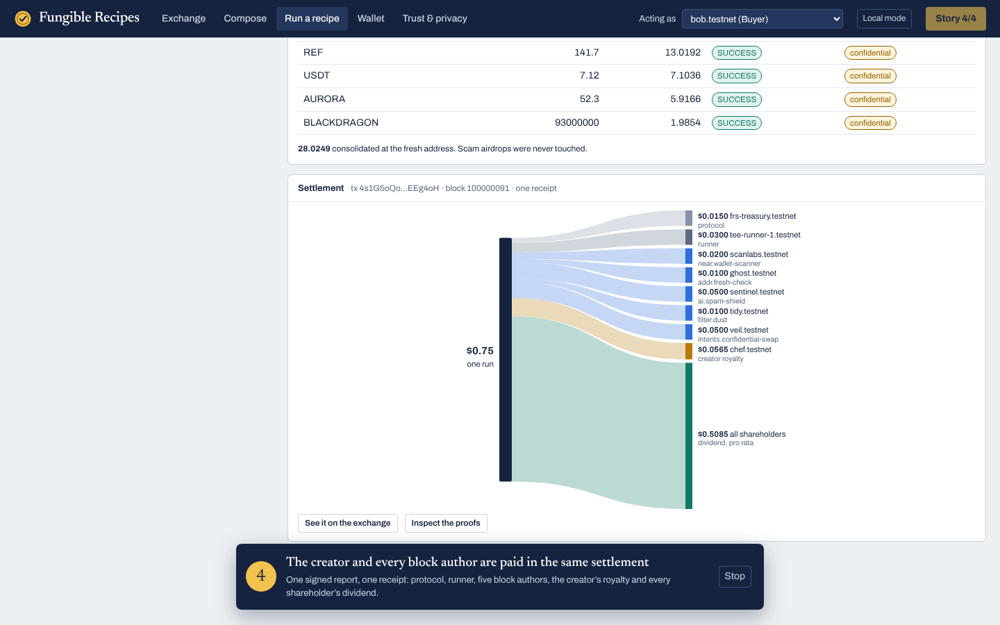
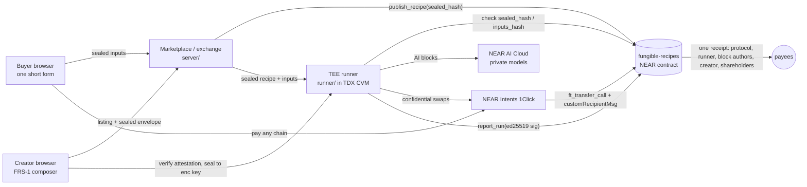

# Fungible Recipes

**Sealed, composable workflows that are paid per run through NEAR Intents and traded like stocks.**

A creator chains blocks (apps, bots, AI calls) into a workflow, a *recipe*. The recipe is encrypted in the creator's browser to an attested TEE runner, so the marketplace, the buyers and the chain only ever see ciphertext and a hash. Everything a run reveals about the buyer (logs, wallet requests, the result) is sealed back to a one-time key in the buyer's browser. Buyers pay per run from any chain through NEAR Intents and fill one short form. Each run is settled in one receipt that pays the protocol, the TEE runner, every block author whose block ran, the creator's royalty and a dividend to every holder of the recipe's shares. The shares trade in frequent batch auctions: orders collect for a few seconds and everything that crosses clears at one uniform price. So the market prices how valuable each workflow's edge really is, and nobody profits from being faster than everyone else.

Built for the [NEAR Hackathon](https://nearhackathon.com) (Nov 1–14, 2026). Suggested tracks: `privacy`, `defi`, `agents` and `open`.



## The problem

Businesses run on workflows that chain several tools together. The software inside them is protected by licences and subscriptions, but the *workflow*, meaning which tools, in what order and with which thresholds and prompts, is protected only by NDAs. It is easy to copy and hard to price, and the people who build the pieces are rarely paid when someone else's workflow uses them.

Fungible Recipes makes a workflow something you can sell without revealing it, and something whose value the market sets:

| Requirement (from the brief) | How it is built here |
|---|---|
| Specialized builders deploy utility apps and bots | **Blocks** with typed ports, declared network capabilities and a per-call fee, registered on-chain ([standard/blocks.json](standard/blocks.json)) |
| A no-code / low-code standard to compose and swap blocks | **FRS-1** ([docs/FRS-1.md](docs/FRS-1.md)): a typed DAG with nominal subtyping, validation, and drop-in swap search. The visual composer is in the Compose tab |
| Users create recipes without patents or licences | The recipe is **sealed** (X25519 + XSalsa20-Poly1305) to the runner's attested key. Only `sha256(envelope)` goes on-chain. No filing or licence is needed to stop *copying*. See [What the sealing protects](#what-the-sealing-protects-and-what-it-doesnt) for its limits |
| A decentralized exchange where recipes are listed, bought and traded | **Frequent batch auctions** per recipe in the contract: an opening auction at listing, then a uniform-price clearing every batch (`clear_batch`, callable by anyone), plus **pay-per-run** escrow |
| Attribution that pays everyone involved | **`report_run`**: an ed25519-signed runner report is verified on-chain and splits the payment in one receipt |
| Deploy on NEAR's privacy platform (TEE) | Runner container for a **dstack Intel TDX CVM** (the NEAR Shade Agent / Phala stack); AI blocks call **NEAR AI Cloud** private models and verify their TEE signatures |
| Pay through NEAR Intents | **1Click** `EXACT_OUTPUT` quote with `customRecipientMsg`, so the solver's delivery *is* the `ft_transfer_call` that opens the run. Swaps inside the workflow use **confidential intents** (`confidentiality: "basic"`) |

## What the sealing protects, and what it doesn't

Fungible Recipes protects a workflow **by default, without filing anything**. The law (copyright, trade secrets, terms of use) becomes the backup instead of the first line of defence. Sealing the recipe in a TEE is also strong evidence of the "reasonable measures" trade-secret law expects.

| Threat | Covered? | Why |
|---|---|---|
| Copying or pirating the recipe | **Yes** | It is never distributed. Only attested runner code can decrypt it; the marketplace, the chain and buyers see ciphertext and a hash |
| Leaks through partners who run it | **Yes** | There are no licensees holding copies. Runs go through the sealed runner |
| Getting paid without enforcing licences | **Yes** | Access is metered per run, and every builder is paid in the run's settlement |
| Reverse engineering by probing outputs | **Partly** | Every probe costs a paid run, which slows this down. Simple recipes can still be inferred from enough input/output pairs; complex ones (tuned prompts, many parameters) are much harder |
| Independent reinvention | **No** | The block list is public so builders can be paid, and a competitor can build their own version. Patents stop reinvention; secrecy does not. The share price shows a shrinking edge, so creators are paid while it lasts |
| Hardware or key compromise | **Depends on the TEE** | Intel TDX side channels, a leaked runner key (one key seals every recipe today) or a lost key. The local demo has no hardware TEE at all |
| Block authors' source code | **No** | Blocks run inside the runner image, so its builders and auditors can read them. Authors who need secrecy should serve the block from their own API or TEE |
| Buyers sharing results, creators leaking their own recipe | **No** | Out of scope for any technical measure |

Planned mitigations: one key per recipe with rotation across several runners, probe resistance (per-buyer rate limits, minimal outputs, flagging unusual input patterns), and remote blocks that run in their author's own TEE. Details are in [docs/THREAT_MODEL.md](docs/THREAT_MODEL.md).

## Try it in two minutes (no keys, no network needed)

Requirements: Node.js 20.6 or newer (22 LTS recommended). Rust is only needed for the contract tests.

```bash
npm install
npm run demo            # starts runner :8787 + marketplace :8080, seeds the market, opens the browser
```

Then follow these steps. Each one says what you should see.

1. **Open http://127.0.0.1:8080.** You see the Exchange with three listed recipes (SWPR, EXIT, SAFE), a candle chart, and the current batch: a countdown bar, the bids and asks collected so far (from labelled "sim traders"), and the *indicative* price at which they would clear right now. Every 12 seconds the batch clears and a new row appears under *Auction results*.
2. **Click "Play the demo story"** (top right). The four steps of the brief play automatically, with a caption for each:
   1. **Compose.** Five blocks snap together into *Clean up and protect*. The seal dialog verifies the runner attestation (6 checks pass; "Hardware TDX quote" shows as skipped in local mode), then the plaintext turns into ciphertext and gets a wax seal. `publish_recipe` returns a tx hash and CLNP appears in the ticker tape.
   2. **Pay.** As `bob.testnet`, a fresh address is generated in the browser, the inputs are sealed, and a 1Click quote shows *0.75188 USDC on Arbitrum → $0.75 USDC delivered to the contract*. After payment the timeline shows `KNOWN_DEPOSIT_TX → PROCESSING`, then "Solver delivered via ft_transfer_call: run escrowed on-chain".
   3. **Execute.** The runner checks that the paid run's recipe and inputs match their on-chain commitments, decrypts, and runs each block, showing its author and fee. Block details carry a *sealed to you* tag: they arrived encrypted to the buyer's browser key, and the marketplace only relayed ciphertext. The AI Spam Shield quarantines two scam airdrops (its verdict signature is verified), the Dust Filter selects four balances, and a wallet dialog, decrypted in the browser, asks to approve four `ft_transfer`s to 1Click deposit addresses. Then four confidential swaps reach `SUCCESS`.
   4. **Settle.** A single settlement diagram shows $0.75 split into protocol $0.015, runner $0.03, five block authors, creator royalty $0.0565 and **$0.5085 to all CLNP shareholders**, with one tx hash.
3. **Exchange → CLNP.** You see "Paid runs: 1", batch #1 tagged *opening* under Auction results (the float cleared at one price), the settlement in the Settlements panel, and "What the market can see": the block list and form fields, with the wiring and parameters sealed.
4. **Acting as → chef.testnet, then Wallet.** The withdrawable balance includes the creator royalty, shown under Income as `creator royalty CLNP +$0.0565`. Dividends move into the balance automatically whenever a holder's shares move, and the sim traders trade constantly, so *Claim* is often already at $0. Withdraw works.
5. **Compose → "Load Dust sweeper", select the *Allowlist Shield* node.** "Drop-in replacements" lists *AI Spam Shield*. Swap it in and the fees in Checks update. Now drag *Confidential Swap* onto the canvas and wire `form.recipient` (an `address.near`) into its `to` port: the edge turns red with `"to" expects address.near.fresh but form.recipient is address.near`. That is FRS-1 subtyping at work.
6. **Trust & privacy.** Three columns show what the marketplace stores (a ciphertext), what the contract stores (hash, blocks, economics) and what only the runner sees. The page also re-runs attestation with a new nonce, shows the exact JSON bodies sent to 1Click, and lists the contract's NEP-297 events.

Headless version for CI or AI judges. It exits non-zero if any step fails:

```bash
npm run test:e2e        # boots everything, runs the 4-step story in the terminal, exits
```

Expected tail of the output:

```
STEP 4 · creator and each block author are paid in the same settlement
     $0.0150  frs-treasury.testnet     protocol
     $0.0300  tee-runner-1.testnet     runner
     $0.0200  scanlabs.testnet         block:near.wallet-scanner@1.0.0
     ...
     $0.5085  CLNP shareholders         pro-rata dividend (claimable)
✔ story complete
```

## Tests

```bash
npm test                # 22 TypeScript tests: settlement + batch-auction vectors, ledger, event parity with the contract, Intents rejection semantics,
                        # sealing, FRS-1 typing/swaps, EIP-191, 1Click shapes, attestation, capability guard, pinned code hash
npm run test:rust       # 50 Rust tests for the NEAR contract (same settlement, dividend and batch-auction vectors)
npm run typecheck
npm run live-check      # optional, needs internet: real 1Click dry quotes (incl. confidential), FastNEAR, NEAR RPC,
                        # and with NEAR_AI_API_KEY a real TEE-signed NEAR AI Cloud completion, verified
```

## What is real, and what is local

We separate these explicitly so nothing here needs to be taken on faith.

| Component | In `npm run demo` | Production path (in this repo) |
|---|---|---|
| Contract logic | `core/src/ledger.ts`, an in-process mirror with the same methods, math and event fields (a test checks every event against `docs/CONTRACT_EVENTS.md`) | `contracts/fungible-recipes` (Rust, near-sdk 5.30). Both pass the **same vector files** in `contracts/test-vectors/` |
| TEE runner | `runner/` as a separate process with `TEE_MODE=local-dev`: real keys, real sealing, real signed reports, **no hardware quote** (the UI marks this check as skipped). Its job endpoints require a token shared only with the marketplace | Same code with `TEE_MODE=dstack` in a TDX CVM (`runner/Dockerfile`, `runner/docker-compose.yml`). Keys come from dstack `getKey`, the quote from `getQuote(report_data)`, and `scripts/verify-quote.ts` runs Intel DCAP verification with `@phala/dcap-qvl` |
| NEAR Intents 1Click | `/mock/1click` with the same request and response shapes and a frozen token-price sample. Deposits progress through the real status names | `core/src/oneclick.ts` live mode. `npm run live-check` gets real dry quotes. **NEAR Intents has no testnet**, so the demo cannot move real funds |
| NEAR AI Cloud | `/mock/nearai`: signs responses with a real secp256k1 key in the provider-TEE format (`model:sha256(req):sha256(resp)`, EIP-191). The "model" is a transparent heuristic, and there is no `intel_quote` or `nvidia_payload` (reported as skipped) | The same block code calls `cloud-api.near.ai`, and `live-check` verifies a real completion end to end |
| FastNEAR / NEAR RPC | `/mock/fastnear`, `/mock/rpc`, backed by fictional wallets in `fixtures/wallets.json` | Same URLs unmocked (`api.fastnear.com`, `rpc.mainnet.fastnear.com`) |
| Wallet signing | A local demo wallet "signs as" the selected account. Sim traders and demo accounts have unlimited demo USDC, so share prices and market caps in local mode are illustrative | **Not built yet.** The approval dialog already shows the exact `signAndSendTransactions` payload a NEAR wallet (near-connect / wallet selector) would sign |
| Chain view used for attestation checks | The browser gets the attestation **directly from the runner**, but the registered runner keys come from the server's contract mirror. In local mode the marketplace is therefore trusted for that comparison | Clients read `get_runner` from NEAR RPC. The runner also reads `get_run` / `get_recipe` over NEAR RPC when `NEAR_RPC_URL` is set (`runner/docker-compose.yml`) |
| Market history | Candles before server start are **synthetic** and drawn in grey. "sim traders" are local bots placing real orders into each batch, including opening-auction bids for new listings (set `FRS_BOTS=0` to disable). A local keeper calls `clear_batch` when each batch closes | Real clearings only. Anyone can call `clear_batch`, so a keeper bot or the next trader closes the batch |

The runner never sees mock-specific code. It always builds URLs for the real hosts, and `FRS_REWRITE` (set by `scripts/demo.mjs`) maps those hosts to the local mocks. Remove the rewrite and the same code talks to the real services.

## How NEAR is used

- **NEAR smart contract** (`contracts/fungible-recipes`): block and runner registry, sealed recipe commitments, shares with dividend accounting, frequent batch auctions with a uniform clearing price, pay-per-run escrow, `env::ed25519_verify` on runner reports, and one-receipt settlement with NEP-297 events.
- **NEAR Intents / 1Click**:
  - Pay-per-run uses `swapType: EXACT_OUTPUT` to the payment token with `recipient = contract` and `customRecipientMsg = {"action":"run",…,"on_behalf_of":buyer}`. The solver's delivery is the `ft_transfer_call` that escrows the run.
  - Dust swaps inside the workflow use `confidentiality: "basic"`, so deposits and withdrawals cannot be linked on-chain.
  - The contract's `on_behalf_of` field exists because the Intents side (not the buyer) is `sender_id` of the delivery. If a delivered payment fails a business rule, the contract credits `on_behalf_of` instead of bouncing the funds back to the solver.
- **TEE**: the runner is built for a dstack Intel TDX CVM, the stack NEAR's Shade Agents use. Its attestation binds `sha256(codehash, enc key, nonce, signing key)` into REPORTDATA. The contract pins the runner's signing key and the audited code hash (`AUDITED_CODEHASH`), and clients refuse to seal to a runner whose attestation checks fail. A runner is only reported as *hardware-backed* after its quote passes Intel DCAP verification (`scripts/verify-quote.ts`). The browser never marks it hardware-backed by itself.
- **NEAR AI Cloud**: AI blocks use the OpenAI-compatible private inference API. Each verdict is checked against the attested `signing_address` (request/response hashes, EIP-191 recovery, TDX report-data binding, NVIDIA NRAS claims when present).
- **NEAR accounts**: a fresh implicit account (64-hex ed25519 public key) is generated in the buyer's browser, and its freshness is proven with RPC `view_account → UNKNOWN_ACCOUNT`.

## Architecture



Details: [docs/ARCHITECTURE.md](docs/ARCHITECTURE.md) · threat model: [docs/THREAT_MODEL.md](docs/THREAT_MODEL.md) · contract interface: [docs/CONTRACT_SPEC.md](docs/CONTRACT_SPEC.md) · standard: [docs/FRS-1.md](docs/FRS-1.md)

## Repository map

```
contracts/fungible-recipes/   Rust NEAR contract + 50 unit tests
contracts/test-vectors/       settlement, dividend and batch-auction vectors shared by Rust and TS (auction vectors come from an independent Python reference)
core/src/                     FRS-1, sealing, settlement, ledger mirror, 1Click + NEAR AI clients, attestation
runner/                       sealed TEE runner, 8 blocks (7 implementation files), Dockerfile, docker-compose (dstack)
server/                       marketplace + exchange API, local mocks of external services
web/                          React UI: Exchange, Compose, Run, Wallet, Trust & privacy, story mode
standard/blocks.json          FRS-1 block catalog (types, ports, capabilities, fees)
seed/recipes/                 plaintext of the demo recipes (in the app they only ever travel sealed)
fixtures/                     fictional wallets, frozen 1Click token sample
scripts/                      demo launcher, seed, story CLI, live-check, verify-quote, video recorder
docs/                         FRS-1, architecture, threat model, contract spec, submission kit, media
```

## Configuration

Copy `.env.example` to `.env` only if you want the live paths. Never commit keys.

| Variable | Used by | Purpose |
|---|---|---|
| `NEAR_AI_API_KEY` | runner, live-check | NEAR AI Cloud private inference |
| `ONECLICK_JWT` | runner, live-check | authenticated 1Click fee tier |
| `TEE_MODE` | runner | `local-dev` (default) or `dstack` |
| `FRS_BOTS` | server | `0` disables the sim traders |
| `PORT`, `RUNNER_PORT` | launcher | default 8080 / 8787 |

## Limitations and next steps

- **Not deployed yet.** The contract has 50 unit tests and the same vectors as the mirror, but it was not built to wasm or deployed from our build machine, which had no wasm target and no NEAR RPC access. Deploy commands are in [contracts/fungible-recipes/README.md](contracts/fungible-recipes/README.md).
- **No live chain adapter.** The marketplace server talks to the in-process mirror. A NEAR RPC adapter and a wallet connection (near-connect) are the main pieces missing for a testnet deployment.
- **Runner approval is off-chain.** The contract owner approves runners after verifying their attestation off-chain. On-chain DCAP verification (as Shade Agent contracts do) is the next step. Until then the owner, and the runner itself, are trusted to report runs honestly.
- **Spam.** v1 has no storage deposits or trading fees. Each recipe's book is capped at 200 orders to bound the gas cost of clearing, which also means a spammer could fill a book. Storage deposits per order have to come before mainnet.
- **Keeper.** Batches close only when someone calls `clear_batch`. In local mode a keeper does it. On-chain it needs a keeper bot or a small reward for the caller.
- **Dividend timing.** Shares bought just before a run settles earn that run's whole dividend, which is standard for accumulator dividends.
- **What 1Click sees.** Confidential intents hide the deposit-to-payout link from chain observers, but the 1Click service itself sees the requests, including the fresh recipient. See [docs/THREAT_MODEL.md](docs/THREAT_MODEL.md).

## Disclosures

- **Built during:** the initial build was written on 2026-10-31, after the hackathon announcement. Tag `baseline-2026-10-31` marks this state, so later in-window work can be diffed (`git diff baseline-2026-10-31..main`).
- **AI-generated code:** most of this code was written with an AI coding assistant (Claude) working from the team's written brief, and was reviewed and tested by the team.
- **Libraries:** near-sdk (Rust), tweetnacl, @noble/hashes, @noble/curves, bs58, express, React, @xyflow/react, lightweight-charts (TradingView, attribution shown in the chart), Vite, tsx, @phala/dcap-qvl, @phala/dstack-sdk (runner container only), and the Archivo and Newsreader fonts (OFL). No templates or boilerplate were used beyond the cargo-near contract layout.
- No existing product on another chain. No other hackathon submission by the same team.

## License

MIT, see [LICENSE](LICENSE).
