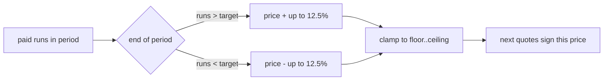

# Architecture

## Processes

| Process | Code | Holds secrets? | Talks to |
|---|---|---|---|
| Creator / buyer client | `web/` (also `scripts/lib/client.ts` for the CLI) | buyer's fresh-address key (browser only) | marketplace, runner attestation (via marketplace) |
| Marketplace | `server/` | none (ciphertext only) | contract, runner, 1Click |
| TEE runner | `runner/` | X25519 sealing key, ed25519 report key (from dstack `getKey` in production) | contract (views + relayed report), FastNEAR, NEAR RPC, 1Click, NEAR AI Cloud |
| Contract | `contracts/sealed-recipes` (mirror: `core/src/ledger.ts`) | none | payment token (NEP-141), 1Click solver deliveries |

## Quotes: from sealed inputs to a signed quote

A buyer, or an agent acting for one, picks a recipe, fills its public form and seals the inputs once to the attested runner (`{inputs, salt, reply_to}`), with `job_hash` (the contract's name for the hash of the sealed request). It asks that recipe for a quote through `POST /api/quotes` (rate-limited per client); an agent may send the same sealed request to several recipes it shortlisted. For each request the runner:
1. checks the sealed recipe against its on-chain hash and its parts against the on-chain parts list;
2. runs it in quote mode (read-only; swaps priced with dry 1Click quotes);
3. for a recipe whose result is swap receipts, measures the value delivered (expected, and promised at the post-slippage minimums); sets `cover = min(promised, bond_available)`, and signs `srs-quote-v3` at the recipe's current list price (bound to the recipe version, the sealed request and inputs, buyer and price) with the same key that later signs run reports;
4. seals the whole quote to the buyer's `reply_to` key. The marketplace adds the public listing facts (price, privacy and risk labels it computes from the on-chain parts, track record) and relays the ciphertext.

The buyer's client opens the quote, verifies the runner signature against the exact message the contract will check, and compares expected value, the signed promise and cover, price, privacy, withdrawal risk and track record. It pays the chosen recipe with the quote attached (or with no quote: no guarantee, nothing written on-chain about the wallet's value). The contract verifies the quote, marks it used and locks `cover` from the bond. Before executing, the runner re-prices the run and aborts with a refund if the wallet no longer supports the quote. At settlement the contract compares `delivered` with `promised` and pays any shortfall from the locked cover.

## Lifecycle of one run

```mermaid
sequenceDiagram
  autonumber
  participant B as Buyer browser
  participant M as Marketplace
  participant I as 1Click (NEAR Intents)
  participant K as sealed-recipes contract
  participant R as TEE runner
  participant A as NEAR AI Cloud
  B->>M: GET runner attestation (fresh nonce)
  B->>B: verify attestation, seal inputs to runner key
  B->>M: sealed inputs + pay asset
  M->>I: POST /v0/quote EXACT_OUTPUT, recipient=contract, customRecipientMsg={run, inputs_hash, on_behalf_of}
  B->>I: deposit (any chain)
  I->>K: ft_transfer_call(amount=price, msg) → ft_on_transfer → Run{Pending}
  M->>R: run_id + sealed recipe + sealed inputs
  R->>K: view run + recipe: check sealed_hash, inputs_hash, Pending
  R->>R: decrypt in memory, execute SRS-1 DAG
  R->>A: private classification (sealed prompt), verify TEE signature
  R->>I: confidential quotes (confidentiality=basic) → deposit txs
  R-->>B: approval request (ft_transfers to deposit addresses)
  B->>I: signed deposits
  R->>I: poll /v0/status → SUCCESS
  R->>K: report_run(…, ed25519 signature)
  K->>K: verify signature, split: protocol, runner, part authors, creator; reserve → guarantee deposit; shortfall → buyer
```

## Part admission (SRS-1 §11)

```
author ──register_part (manifest hash)──▶ contract
author ──POST /api/parts/submissions (manifest + code, signed)──▶ marketplace
            │ automated checks: conformance · static + security scan · behaviour test in the sandbox (quote + run)
            ├─ open tier ──────────────────────────────▶ approved (no human review)
            ├─ reviewed tier ── 1 appointed reviewer ──▶ approved
            └─ signing tier ─── 2 appointed reviewers ─▶ approved          (any reviewer can request changes)
owner ──npm run release:parts──▶ code + manifest + signed record in standard/reviews.json ──▶ pinned code hash
runner start ──verifyRecord for every part──▶ admitted (open parts compiled for the sandbox) | refused
```

The tier comes from the manifest alone (`partTier` in `core/src/review.ts`): asking the buyer to sign makes a part *signing*; calling a model, running remotely or reaching a host outside the known NEAR data hosts makes it *reviewed*; anything else is *open*. Submissions live in `.data/reviews/submissions.json`; the release script and the marketplace read the same file. The runner sandbox (`runner/src/sandbox.ts`) compiles a part with esbuild, refusing imports outside the runner helpers, and runs it in a forked process with Node's permission model; `ctx.http`, wallet requests, state saves and waits cross over IPC, so the runner's guarded fetch, limits and approval flow stay in charge. The marketplace's automated checks reuse the same sandbox with local mocks of the declared hosts.

## Durable multi-step runs

A recipe can span many transactions and a long time: TRCH sells half of a wallet, waits, then sells the rest.
Each run stays one paid ticket on-chain, and the runner makes it survive crashes.

**Checkpoints.**
- After every part, and before any irreversible step inside a part, the runner seals its progress to its own key. The progress is the completed nodes, their outputs, and the part's internal state.
- It signs that state and stores it with the marketplace, and does not continue until the store is acknowledged.
- The marketplace holds ciphertext it cannot read.

**On-chain progress.** `checkpoint_run` records the state's hash and extends the run's timeout.
- In `settle_mode: "checkpoint"`, it also pays the authors of the parts finished since the last checkpoint.
- The final report then pays only what is left. A failed run refunds the price minus what was already billed.
- In `"final"` mode, a heartbeat checkpoint is posted every 5 minutes, so long runs are never reclaimable mid-way.

**Resume.** If the runner's event stream breaks, the marketplace keeps calling `POST /runs/:id/resume` on the restarted runner. It sends:
- the sealed recipe of the version the run paid for;
- the sealed inputs;
- the last checkpoint;
- the approvals it relayed.

The runner verifies its own signature on the checkpoint, opens it inside the TEE, and continues.

**Exactly-once deposits.** The swap part stores its quotes before asking the buyer to sign, and the signed tx hashes before submitting them.
- After a restart it reuses the stored quotes and never re-quotes.
- An approval the marketplace already relayed is replayed, so the buyer is never asked to sign twice.

`verification/tla/DurableRuns.tla` checks this (`DepositsOnce`). Without the write-ahead step, TLC finds a double deposit. `npm run test:durable` kills the runner twice during a TRCH run and checks the result from the chain and the wallet.

## Versions with notice

`update_sealed` announces a new sealed version, and it takes effect only after `update_delay_ns`: 30 s in the demo, 24 h suggested on mainnet. The creator can cancel during the notice period. A keeper, or the next payment, activates it.

Each run keeps the version it paid for. The marketplace vault stores every version by `sealed_hash`, so a run paid for version 1 still executes version 1 if it resumes after version 2 went live. Quotes are bound to the version, so a version-1 quote is refused after activation.

`verification/tla/VersionedRecipes.tla` checks this; keeping only the current version strands runs. `npm run test:versions` shows the whole cycle.

## Storage: what lives where

| Data | Where | Who can read it | Lifetime |
|---|---|---|---|
| Recipe metadata, parts list, price, bond, track record, version, pending update | contract state (NEAR storage staking) | everyone | permanent |
| Run ticket: paid version, inputs hash, checkpoint seq and state hash, billed parts | contract state | everyone | permanent |
| Sealed recipe, every version | marketplace vault: content-addressed `FileBlobStore` keyed by `sealed_hash`, integrity-checked on every read (IPFS/S3 drop-in) | the runner only | while any run may need it |
| Creator copy of each version | same store, indexed per version | the creator only (key derived from a wallet signature, re-derivable on any device) | permanent |
| Sealed inputs of a run | marketplace, per run | the runner only | until the run ends |
| Checkpoints (progress, part outputs, swap intents) | same store (blob by `state_hash`) plus a per-run pointer | the runner only (sealed to its own key, signed) | until the run ends |
| Plaintext recipe, inputs, intermediate values | runner memory, inside the TEE | nobody else | during execution |
| Runner keys | dstack KMS inside the TEE | nobody | for the runner's lifetime |

## Money flow (CLNP at a list price of $0.75 per run)

| Payee | Rule | Amount |
|---|---|---|
| Protocol | 2% of price, rounded down | $0.0150 |
| TEE runner | fixed `fee_per_run` | $0.0300 |
| Part authors | each part's `fee_per_call`, for parts actually used | $0.1400 (5 authors) |
| Creator | the remainder, minus the reserve | $0.5085 |
| Guarantee deposit | `reserve_bps` (10% for CLNP) of the remainder, added to `bond_available` | $0.0565 |

Publishing is rejected unless the price floor covers `protocol(floor) + runner + Σ part fees`, so every price the market can reach covers the fees too. Fees cannot be changed after a recipe is published, so a published recipe can never go under water. The five lines sum to the price exactly, proved for every input (verification/).

## Market-driven prices

The price of a run is set by demand for that recipe, not by a trading market in anything. The contract counts paid runs per pricing period and moves each recipe's list price toward its demand at every period boundary, inside the band its creator set (EIP-1559's base-fee rule: at most ±12.5% a period, `src/pricing.rs`). Ended periods are applied lazily by the next payment, or by a keeper calling `update_price`; views always show the price a payment made now would pay.

A quote signs the list price at quote time into the quote (`srs-quote-v3`), so the buyer pays exactly what they were quoted, even if the price moves before payment. Buyers or agents weigh `expected value - price` for the recipes they ask. A buyer's `max_price` stops a recipe listed above it from being asked to quote (no dry run is spent), and the contract enforces it.



## Track record instead of a share price

There is no tradable asset, so a recipe's quality has to be read from what the contract records rather than from an asset price. Buyers and agents compare recipes on what the contract records instead: runs, refunds and aborts, delivered value against signed promises, compensation paid, the guarantee deposit backing new quotes, and the version history. A recipe with a real edge (CLNP: private AI guard + confidential routing) can charge more per run than a public copycat (SWPR) and still win buyers on net value. Nobody has to reveal the recipe for that comparison.

The guarantee deposit is the creator's collateral. Each quote locks part of it as cover; a shortfall is paid from that cover in the run's settlement, the rest is released. It grows by top-ups (`ft_transfer_call` with `{"action":"bond"}`) and by the creator's `reserve_bps` share of each run, and only the creator can withdraw the unlocked part. It pays no return and nobody but shorted buyers can claim from it. Revenue shares, dividends and batch auctions existed in earlier builds and were removed so that no part of the product is an investment (git tag `archive/revenue-shares`).

## State machines

Every flow with more than two states is written as an explicit machine with a transition table, not as a set of booleans. Each is tested.

| Machine | Where | States | What it prevents |
|---|---|---|---|
| Contract run | `contracts/sealed-recipes` (mirror `core/src/ledger.ts`) | Pending → Settled / Refunded / Reclaimed, with checkpoints | proved in Z3 and model-checked in TLA+ (`verification/`) |
| Run payment | `server/src/main.ts` `RunCtx.payment` | quoted → deposit_sent → delivered | paying the same run ticket twice (a double click or a retried request used to send a second deposit) |
| Get a quote | `web/src/pages/quote-machine.ts` | form → quoting → quoted / unquotable → preparing → ready → paying → running → finished | paying with a quote whose sealed inputs no longer match the form (editing drops the quote); editing, re-quoting or re-paying while a payment or run is in flight; using an expired quote |
| Seal and publish | `web/src/components/SealModal.tsx` | verifying → verified → sealed → publishing → published, with verify_failed and publish_failed | dead ends after a failed attestation or publish (both now retry) |
| Demo story | `web/src/story-machine.ts` | idle → 1 compose → 2 find and quote → 3 run → 4 settle → done; a run id per playthrough | stale timers advancing the wrong step; replaying the story silently doing nothing (pages remembered they had already played) |
| Navigation | `web/src/route.ts` | one route, mirrored in the URL hash | a selected recipe and an "only ask this recipe" flag drifting apart; pages that could not be linked or reached with Back |

## Local mode wiring

`scripts/demo.mjs` starts the runner with
`SRS_REWRITE=api.fastnear.com=…/mock/fastnear,rpc.mainnet.fastnear.com=…/mock/rpc,1click.chaindefuser.com=…/mock/1click,cloud-api.near.ai=…/mock/nearai`.
Parts always build real URLs. The capability guard checks the **real** host, then the rewrite swaps in the mock base URL. When a 1Click mock delivery targets the contract with a `customRecipientMsg`, the mock behaves like the solver and calls `ft_on_transfer` on the ledger mirror.

## Production deployment

1. `cargo near build`, then deploy the contract to testnet or mainnet (commands in the contract README).
2. Build `runner/Dockerfile`, push it by digest, and set the digest in `runner/docker-compose.yml`. Deploy to a dstack TDX CVM (Phala Cloud, or the Shade Agent template).
3. Owner fetches `/attestation?nonce=…`, runs `scripts/verify-quote.ts` (Intel DCAP via `@phala/dcap-qvl`), then calls `add_runner` with the attested keys and code hash.
4. Point the marketplace at the deployed contract: `server/src/live.ts` does this on NEAR testnet through `server/src/near.ts` (views over NEAR RPC, runner reports sent by a relayer account), running at https://sealedrecipes.xyz. The step-by-step scripts are in `scripts/testnet/`. The demo server (`server/src/main.ts`) keeps the in-process mirror. Clients verify the attestation before sealing in both.
