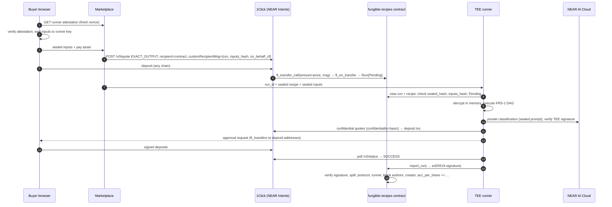

# Architecture

## Processes

| Process | Code | Holds secrets? | Talks to |
|---|---|---|---|
| Creator / buyer client | `web/` (also `scripts/lib/client.ts` for the CLI) | buyer's fresh-address key (browser only) | marketplace, runner attestation (via marketplace) |
| Marketplace + exchange | `server/` | none (ciphertext only) | contract, runner, 1Click |
| TEE runner | `runner/` | X25519 sealing key, ed25519 report key (from dstack `getKey` in production) | contract (views + relayed report), FastNEAR, NEAR RPC, 1Click, NEAR AI Cloud |
| Contract | `contracts/fungible-recipes` (mirror: `core/src/ledger.ts`) | none | payment token (NEP-141), 1Click solver deliveries |

## Lifecycle of one run

## Money flow (CLNP, $0.75 per run)

| Payee | Rule | Amount |
|---|---|---|
| Protocol | 2% of price (+ rounding dust) | $0.0150 |
| TEE runner | fixed `fee_per_run` | $0.0300 |
| Block authors | each block's `fee_per_call`, for blocks actually used | $0.1400 (5 authors) |
| Creator | royalty 10% of the remainder | $0.0565 |
| Shareholders | the rest, pro rata through `acc_per_share` | $0.5085 |

Publishing is rejected unless `price ≥ protocol + runner + Σ block fees`. Fees cannot be changed after a recipe is published, so a published recipe can never go under water.

## Why shares make the price "fair"

Each share earns `pool / total_shares` per run, so a share's value tracks expected future runs. The exchange shows **runs to pay back a share** (`price / dividend per share per run`), a P/E analogue. A recipe with a real edge (CLNP: private AI guard + confidential routing) can charge more per run and attract more runs than a public copycat (SWPR). Both effects show up in its share price. Nobody has to reveal the recipe for the market to price it.

Shares trade in **frequent batch auctions** rather than on a continuous order book. Orders collect for one batch interval (12 s in the demo), then `clear_batch` fills everything that crosses at a single uniform price, chosen to maximise volume, then minimise imbalance, then take the midpoint. A new recipe's first batch is its opening auction, so the creator doesn't have to guess the price. Recipe markets will usually be thin. In a batch auction, speed doesn't earn an edge, one order can't walk the book, and a batch's indicative price is a steadier fair-value signal than the last trade. Clearing rules are tested against vectors from an independent Python reference (`scripts/gen-auction-vectors.py`).

## Local mode wiring

`scripts/demo.mjs` starts the runner with
`FRS_REWRITE=api.fastnear.com=…/mock/fastnear,rpc.mainnet.fastnear.com=…/mock/rpc,1click.chaindefuser.com=…/mock/1click,cloud-api.near.ai=…/mock/nearai`.
Blocks always build real URLs. The capability guard checks the **real** host, then the rewrite swaps in the mock base URL. When a 1Click mock delivery targets the contract with a `customRecipientMsg`, the mock behaves like the solver and calls `ft_on_transfer` on the ledger mirror.

## Production deployment

1. `cargo near build`, then deploy the contract to testnet or mainnet (commands in the contract README).
2. Build `runner/Dockerfile`, push it by digest, and set the digest in `runner/docker-compose.yml`. Deploy to a dstack TDX CVM (Phala Cloud, or the Shade Agent template).
3. Owner fetches `/attestation?nonce=…`, runs `scripts/verify-quote.ts` (Intel DCAP via `@phala/dcap-qvl`), then calls `add_runner` with the attested keys and code hash.
4. Point the marketplace at the deployed contract. Not built yet: `server/` currently uses the in-process mirror, and a near-api-js adapter with the same method names is the planned replacement. Clients already verify the attestation before sealing.
