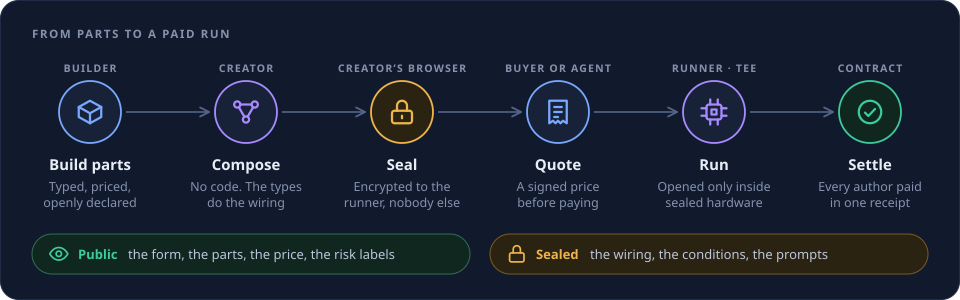
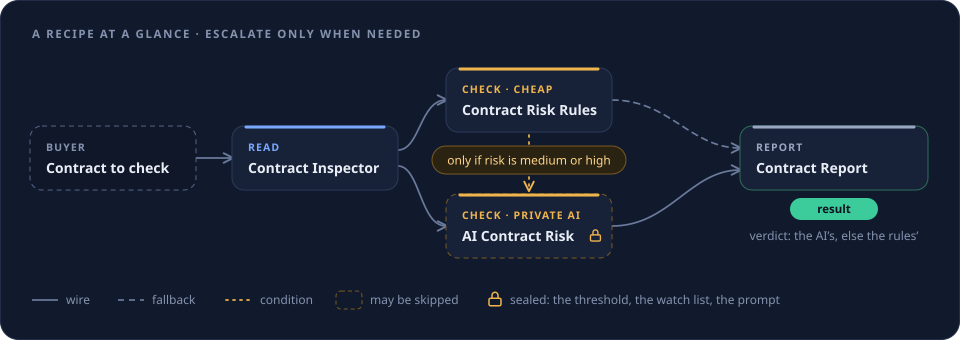
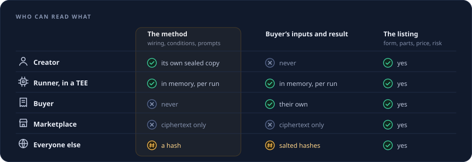
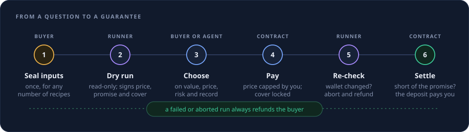

# SRS-1: the Sealed Recipe Spec

**Build a workflow from other people's parts without writing code. Sell runs of it without showing how it works. Pay everyone who built a part, every time it runs.**



| Version | License | Reference implementation | Conformance suite |
|---|---|---|---|
| 1.0 | MIT | [`core/src/srs.ts`](../core/src/srs.ts), [`runner/src/executor.ts`](../runner/src/executor.ts), [`core/src/partkit.ts`](../core/src/partkit.ts) | `npm test`, chiefly [`tests/srs.test.ts`](../tests/srs.test.ts) |

Types and parts live in [`standard/parts.json`](../standard/parts.json), example recipes in [`standard/examples/`](../standard/examples/). MUST, SHOULD and MAY follow RFC 2119. Every rule with a code below is enforced by `validateRecipe`, the same function in the composer, the runner and the tests.

## Why SRS-1

> A stranger's workflow is about to run on your wallet. You should know what it can touch, what it costs and what it promises before it starts, and the people who built it should be paid. This format makes all of that true at once.

| You are | You get | Read |
|---|---|---|
| **A part builder** | Paid every time any recipe uses your part, on any market that settles SRS-1 | [§2](#2-part-manifest), [§11](#11-admission-of-parts) |
| **A recipe creator** | A method you can sell without revealing it. No code, no prompt engineering | [§3](#3-recipe), [§5](#5-sealing-and-the-privacy-boundary) |
| **A buyer or a wallet** | A signed price before you pay and, when funds move, a promise backed by a deposit | [§7](#7-quotes-and-guarantees) |
| **An AI agent** | A typed form to fill and signed quotes to compare. You never need to read a recipe | [§10](#10-adopting-srs-1) |

Four promises hold for every recipe:

1. **It snaps together.** Parts declare typed ports. Add parts and the types do the wiring. Whatever no part provides becomes a question on the buyer's form.
2. **It is sealed, and still checkable.** The method is encrypted. What a buyer needs in order to decide is public, and computed rather than claimed.
3. **It is priced before it runs.** A read-only dry run on the buyer's sealed inputs returns a signed quote.
4. **It pays by construction.** One settlement pays the protocol, the runner, every part author and the creator.

| | n8n | Chainlink CRE | SRS-1 |
|---|---|---|---|
| Unit of composition | nodes in a JSON workflow | capabilities called from Go or TypeScript, compiled to WASM | typed parts in a JSON graph |
| Who composes | a user in a visual editor | a developer | a creator, with no code and no prompt engineering |
| Who can read a workflow | anyone with access to the instance | its owner and the nodes that run it | only its creator; the runner opens it inside a TEE |
| Typing | untyped JSON items | the host language's types | nominal types with schemas, checked when composing and at every port while running |
| Control flow | IF, Switch, Merge, Loop, error workflows, sub-workflows | anything code can express | conditions, fallbacks and skip-on-error; loops and nested recipes are not in this version |
| Price known before running | not part of the format | not part of the format | a signed quote from a read-only dry run |
| Who is paid per run | no payment to node authors | node operators | every part author, the runner and the creator, in one settlement |
| A step fails | the error workflow runs | handled in code | the buyer is refunded, or the node is skipped where the creator planned a fallback |

### A recipe at a glance



- **Buyers see** one question, four parts, a low-risk label, a report and a price.
- **Only the creator knows** that the AI is asked only when the rules are unsure, which brands the rules watch for, and what the AI is told.
- **Every run settles the same way**, so the chain never shows what the rules concluded for a buyer.

<details><summary>The recipe as JSON (standard/examples/ESCL.json, shortened)</summary>

```json
{ "srs": "1.0", "kind": "recipe",
  "meta":  { "ticker": "ESCL", "name": "Contract check, escalated only when needed", "creator": "chef.testnet", "description": "…" },
  "form":  [ { "id": "contract", "label": "Contract you are about to sign for", "type": "near.account", "required": true } ],
  "nodes": [
    { "id": "facts",  "part": "near.contract-facts@1.0.0", "inputs": { "contract": "form.contract" } },
    { "id": "rules",  "part": "rules.contract-risk@1.0.0", "inputs": { "facts": "facts.facts" }, "params": { "lookalikes": ["ref-finance", "…"] } },
    { "id": "judge",  "part": "ai.contract-risk@1.0.0",    "inputs": { "facts": "facts.facts" }, "params": { "policy": "…" },
      "when": { "ref": "rules.verdict", "match": { "risk": ["medium", "high"] } } },
    { "id": "report", "part": "report.contract@1.0.0",     "inputs": { "facts": "facts.facts", "verdict": ["judge.verdict", "rules.verdict"] } } ],
  "output": "report.report",
  "listing": { "price_per_run": "150000", "bill": "declared" } }
```

</details>

## Conventions

> Small rules that keep every hash, amount and name unambiguous.

- **Canonical JSON.** `canonical(x)` sorts object keys, drops whitespace and omits `undefined` members. Every hash in SRS-1 is SHA-256, in hex, of canonical JSON ([`core/src/canonical.ts`](../core/src/canonical.ts)).
- **Amounts** are integer strings in the payment token's smallest unit. The reference deployment settles in USDC, so `"10000"` is $0.01.
- **Names.** A reference splits at its first `.`, so names that start a reference never contain one.

| Name | Grammar | Example |
|---|---|---|
| part id | `<namespace>.<name>@<major>.<minor>.<patch>`, lower case, at most 64 characters | `intents.confidential-swap@1.0.0` |
| type | dot-separated lower-case segments | `address.near.fresh` |
| type variable | one capital letter | `T` |
| port, param | `[a-z_][a-z0-9_]*` | `max_share` |
| node id, form field, constant | `[a-z][a-z0-9_]{0,31}` | `judge` |
| ticker, the on-chain recipe id | `[A-Z0-9]{3,6}` | `ESCL` |
| reference | `form.<field>`, `const.<name>` or `<node>.<port>` | `rules.verdict` |
| binding | a reference, or a non-empty list of them | `["judge.verdict", "rules.verdict"]` |

## 1. Types

> Types are how parts from strangers fit together safely, without anyone reading anyone's code.

### 1.1 Subtyping

A type may extend one parent. A value of type `A` fits a port of type `B` when `A` is `B` or extends it.

```json
"address.near":       { "extends": null },
"address.near.fresh": { "extends": "address.near", "proof": true }
```

A swap that needs a proven-fresh address can't be fed a raw form field, while anything that takes an `address.near` happily takes a fresh one. A `proof` type can only come out of a part, never from the buyer or a constant (`type.proof`). Only `addr.fresh-check` produces `address.near.fresh`, so the type works as a certificate.

### 1.2 Value schemas

A type MAY carry a schema, written in this subset of JSON Schema: `type`, `enum`, `pattern`, `minimum`, `maximum`, `properties`, `required`, `items`. A value of type `A` satisfies the schema of `A` and of every type it extends (`checkValue`).

```json
"contract.verdict": { "extends": null, "description": "Risk verdict on a contract",
  "schema": { "type": "object", "required": ["risk", "reasons", "source"],
              "properties": { "risk": { "type": "string", "enum": ["low", "medium", "high"] } } } }
```

| What is checked | When | Why it matters |
|---|---|---|
| constants, and every field a condition names | while composing | mistakes never reach a buyer |
| every output of every part | while running, before the next part sees it | a faulty part can't hand a bad value to the part that builds a transaction |
| the same checks, in quote mode | before anyone pays | most faults surface at quote time |

A part that returns something off-schema fails the run, and the buyer is refunded. Every standard type declares a schema or inherits one.

### 1.3 Type variables

One utility part can serve every type.

```json
{ "id": "util.pick@1.0.0", "type_params": { "T": { "extends": null } },
  "inputs": { "a": { "type": "T" }, "b": { "type": "T" } }, "outputs": { "out": { "type": "T" } } }
```

- Each node binds `T` to the most specific type every wired value fits: their nearest common ancestor. Fallbacks count too. Outputs typed `T` take that type.
- `pick(fresh, fresh)` returns `address.near.fresh` and can feed a swap that needs one. `pick(fresh, raw)` returns `address.near` and cannot.
- No common ancestor is `port.generic`. A binding outside the bound is `port.type`. A variable MUST appear on at least one input (`type_params.unbound`), so a recipe can always bind it.

### 1.4 The standard vocabulary

| Group | Types | The buyer can type it |
|---|---|---|
| Identities | `near.account`, `address.near`, `address.near.fresh`, `asset.id` | yes, except `address.near.fresh`, which only a part can prove |
| Quantities | `usd`, `percent` | yes |
| Wallet state | `token.holdings`, `key.list`, `stake.list`, `contract.facts` | no, parts read these |
| Judgements | `token.flags`, `contract.verdict` | no |
| Plans and results | `swap.plan`, `swap.receipts`, `report` | no |

`swap.receipts` is the one result whose value a quote can promise and a deposit can back (§7): value delivered to the buyer's recipient, from swaps, staking withdrawals or claimed drops. The vocabulary grows by proposal (§10).

## 2. Part manifest

> A part says what it takes, what it returns, where it may reach and what it costs. The runner holds it to every word.

```json
{
  "id": "intents.confidential-swap@1.0.0",
  "name": "Confidential Swap (Intents)",
  "category": "action",
  "author": "veil.testnet",
  "summary": "Quotes every token into the target asset via 1Click with confidentiality=basic, so deposits and withdrawals cannot be linked on-chain.",
  "inputs":  { "tokens": { "type": "token.holdings" }, "to": { "type": "address.near.fresh" }, "target": { "type": "asset.id" } },
  "outputs": { "receipts": { "type": "swap.receipts" } },
  "params":  { "slippage_bps": { "type": "number", "default": 100, "secret": true } },
  "capabilities": ["net:1click.chaindefuser.com", "wallet:approve"],
  "fee_per_call": "50000",
  "disclosure": { "…": "§2.1" },
  "limits": { "…": "§2.2" }
}
```

| Field | What it means |
|---|---|
| `id` | Registered on-chain with `manifest_hash = sha256(canonical(manifest))`. New behaviour, new version |
| `category` | `source` reads, `guard` narrows or certifies, `transform` computes, `action` changes the world, `sink` reports. Only an `action` may declare `wallet:approve` |
| `capabilities` | Enforced. `net:<host>` is the only network the part gets (`guardedFetch`). `wallet:approve` lets it ask the buyer to sign, never sign for them |
| `params` | `string`, `number`, `boolean` or `string[]`. `secret: true` marks the creator's edge, which exists only inside the sealed recipe |
| `type_params` | Type variables (§1.3) |
| `fee_per_call` | Paid to `author` for every node that uses the part, in every settlement that bills it (§6.1) |

### 2.1 Disclosure and withdrawal risk

Could this part be rebuilt if its supplier vanished? Every part answers in five fields.

```json
"disclosure": {
  "model":        { "kind": "open-weights", "name": "Qwen/Qwen3-30B-A3B-Instruct-2507", "host": "NEAR AI Cloud (private, TEE)" },
  "instructions": "sealed", "harness": "open", "verification": "open", "runtime": "bundled"
}
```

| Field | Values |
|---|---|
| `model.kind` | `none` (plain code), `open-weights`, `closed`. Every part MUST disclose its model |
| `instructions`, `harness`, `verification` | prompts and settings; tools, lookups and retries; how the part checks itself. Each is `open` (published), `sealed` (escrowed to the runner, rebuildable unseen) or `closed` (held by the supplier) |
| `runtime` | `bundled` (ships in the attested runner, pinned by hash) or `remote` (run by the supplier) |

| Risk | When |
|---|---|
| **high** | a closed model, or a remote part with a closed harness or closed verification |
| **medium** | a remote part whose layers are all open or sealed: rebuildable, but its operator can stop it |
| **low** | a bundled part with no model or an open-weights model |

Open weights can be re-hosted by anyone. A closed model can be retired, changed or repriced by its provider overnight. A recipe carries the highest risk of its parts, shown on every listing and quote, and the validator warns on closed models (`part.closed-model`).

### 2.2 Per-run limits

```json
"limits": { "max_ms": 20000, "max_http_calls": 12, "max_model_calls": 2, "max_output_bytes": 32000 }
```

Wall time (wallet waits excluded), HTTP calls, model calls and output size, enforced by the runner ([`runner/src/limits.ts`](../runner/src/limits.ts)). Past a limit the part fails (§3.4). The price was fixed before the run, so a runaway part never becomes a surprise bill.

## 3. Recipe

> A recipe is a typed graph of parts. The creator makes the choices; the types check them.

```json
{
  "srs": "1.0", "kind": "recipe",
  "meta":    { "ticker": "CLNP", "name": "Clean up and protect", "creator": "chef.testnet", "description": "…" },
  "form":    [ { "id": "wallet", "label": "Wallet to clean", "type": "near.account", "required": true },
               { "id": "recipient", "label": "Fresh address", "type": "address.near", "generator": "fresh-implicit" } ],
  "nodes":   [ { "id": "scan",  "part": "near.wallet-scanner@1.0.0", "inputs": { "account": "form.wallet" } },
               { "id": "fresh", "part": "addr.fresh-check@1.0.0",    "inputs": { "recipient": "form.recipient" } }, "…" ],
  "consts":  { "usdc": { "type": "asset.id", "value": "nep141:…" } },
  "output":  "swap.receipts",
  "listing": { "price_per_run": "750000", "reserve_bps": 1000, "bond": "25000000" }
}
```

| Field | What it holds |
|---|---|
| `srs` | the spec version: `"1.0"` |
| `form` | the buyer's questions, typed. Six at most is the guidance (`form.long`). `generator: "fresh-implicit"` makes a new address in the buyer's browser |
| `nodes` | one catalog part each, every input bound, params optional. A node MAY add `when` (§3.2) and `on_error` (§3.4) |
| `consts` | fixed values, checked against their type's schema |
| `output` | the result, a binding (§3.1). Its type is the recipe's `output_type` |
| `listing` | price and collateral (§4), `settle_mode` (§8), `bill` (§6.1) |

### 3.1 References and bindings

A reference points at a value: `form.<field>`, `const.<name>` or `<node>.<port>`. A binding is one reference or a list of them (§3.3). Inputs and the `output` are bindings; a condition reads one reference. Nodes may be written in any order. Dependencies decide when each runs.

### 3.2 Conditions

A node with `when` runs only if its test holds.

```json
"when": { "ref": "rules.verdict", "match": { "risk": ["medium", "high"] } }
```

| Test | Holds when |
|---|---|
| `"is": "nonempty"` (default) | there is a value, and it is not an empty list, an empty object, `null` or `""` |
| `"is": "empty"` | the opposite. A value from a skipped part counts as empty |
| `"match": { field: [values] }` | an object whose field has one of the values |
| `"some": { field: [values] }` | a list with at least one item whose field has one of the values |

One test per condition (`when.shape`). `"not": true` flips it, which is how a recipe writes *else*. The validator resolves `ref` (`when.ref`) and checks each field and value against the type's schema (`when.field`, `when.value`); a type with no schema gets a warning (`when.unchecked`).

Conditions read typed values, never code or free text. They can decide whether a part runs, never what it does.

### 3.3 Fallbacks

A list takes the first value that is there.

```json
"inputs": { "verdict": ["judge.verdict", "rules.verdict"] }
```

Every entry MUST fit the port (`port.type`) and appear once (`port.alternatives`). The node waits for all of them. An `output` may list fallbacks too; its type is their nearest common ancestor.

### 3.4 Skipping on error

`"on_error": "skip"` lets a run go on without a part that throws, breaks a limit (§2.2) or returns an off-schema value (§1.2). The default, `"fail"`, stops the run and refunds the buyer.

A part with `wallet:approve` MUST NOT skip (`node.on_error`). Once it has asked the buyer to sign, funds may have moved, and nothing after it should build on an unknown state.

### 3.5 How a run executes

The runner MUST follow these steps ([`execute`](../runner/src/executor.ts)). Quotes take the same steps in read-only mode (§7).

1. Validate the recipe and the buyer's inputs. Order the nodes by dependency; ties keep the written order.
2. A reference is **present** when it names a form field, a constant, or the output of a part that ran. A binding takes its first present reference.
3. For each node: skip it if an input has nothing present, or if its condition does not hold. Otherwise run the part, with the manifest's default params overlaid by the node's, under its limits. Every output MUST be present and on-schema. If the part fails, skip it when `on_error` is `"skip"`, and fail the run otherwise.
4. The result is the first present reference of `output`. If there is none, the run fails.
5. A run that succeeds reports `ok` and bills as in §6.1. A run that fails bills nothing and refunds the buyer.

Skipping travels downstream: a part that needs a skipped value, with no fallback, is skipped as well. The validator lists the parts that may be skipped and warns when the result itself might be missing (`recipe.output-optional`). It knows two shapes that always leave one fallback present: a fallback that runs when its primary is empty (`"is": "empty"` on the primary's output), and an if/else pair with the same test, one side negated.

| To build | Do this |
|---|---|
| If / else | two parts with the same `when`, one with `"not": true`, joined by a fallback list |
| Switch | several parts, each with `match` on a different value of one verdict |
| Escalate only when needed | `match` on the cheap verdict, then a fallback list in the report ([`ESCL`](../standard/examples/ESCL.json)) |
| Survive a provider outage | `on_error: "skip"`, a backup part with `"is": "empty"`, a fallback list ([`FALL`](../standard/examples/FALL.json)) |
| Act only when needed | `"some": { "action": ["revoke"] }` on the acting part |
| Merge two streams | a part with two inputs, or a generic one (§1.3) |
| Wait | `time.wait`, which survives runner restarts (§8) |

### 3.6 Validation rules

Errors block sealing. Warnings are shown to the creator. All live in `validateRecipe` ([`core/src/srs.ts`](../core/src/srs.ts)).

| Code | Level | Rule |
|---|---|---|
| `srs.version` | error | `srs` is `"1.0"` and `kind` is `"recipe"` |
| `meta.ticker`, `meta.name` | error | a ticker matching `^[A-Z0-9]{3,6}$`, and a name |
| `form.id`, `form.duplicate`, `form.type` | error | field ids follow the grammar, are unique and use known types |
| `type.proof` | error | no form field or constant has a `proof` type (§1.1) |
| `form.long`, `form.unused` | warning | six fields at most; every field used |
| `const.id`, `const.type`, `const.value` | error | names follow the grammar; types are known; values are on-schema |
| `listing.price`, `listing.reserve`, `listing.bond`, `listing.pricing`, `listing.settle_mode`, `listing.bill` | error | a positive integer price; `reserve_bps` from 0 to 10000; an integer bond; `price_floor ≤ price_per_run ≤ price_ceiling` with `target_runs ≥ 1`; known modes |
| `recipe.empty`, `node.id`, `node.duplicate`, `node.reserved`, `node.part` | error | at least one node; ids follow the grammar, are unique and aren't `form` or `const`; parts exist |
| `port.unwired`, `port.ref`, `port.alternatives` | error | every input bound; every reference resolves; lists non-empty, without repeats |
| `port.type`, `port.generic` | error | every entry fits its port; type variables bind within their bounds |
| `port.extra`, `param.missing` | warning | a binding for a port the part lacks; an unset secret param with no default |
| `when.shape`, `when.ref`, `when.field`, `when.value` | error | §3.2 |
| `when.unchecked` | warning | the condition reads a type with no schema |
| `node.on_error` | error | `fail` or `skip`, and never `skip` on a signing part |
| `graph.cycle` | error | no cycles |
| `recipe.output` | error | the result resolves, and its fallbacks share a type |
| `recipe.output-optional` | warning | on some runs the result may be missing, so the run would refund |
| `node.deadend` | warning | nothing reads a part's output, yet it is still billed |
| `bill.reveals-branch` | warning | `bill: "executed"` with parts that may be skipped (§6.1) |
| `param.secret-egress` | warning | a secret param on a part that can reach a host outside the confidential set (§5.4) |
| `part.closed-model` | warning | a part runs on a closed model (§2.1) |

It also returns the run order, the billable parts, every capability, the total part fees, the risk, the type of every output and the parts that may be skipped.

### 3.7 Drop-in swaps

`compatibleSwaps(recipe, nodeId)` finds every part that can replace a node without rewiring: it accepts the existing inputs, provides every output the recipe reads, and introduces no new validation error. Conditions and fallbacks count as readers. `swapPart` keeps the matching params and fills the rest with defaults. A swap changes the parts list, so a published recipe with a swapped part is published as a new recipe (§8).

## 4. Public listing

> Everything the market sees. Enough to choose, never enough to copy.

`publicListing(recipe)` is the only recipe-derived data the marketplace and the chain receive: `ticker, name, creator, description, form, parts, capabilities, output_type, price_per_run, pricing, reserve_bps, interface_hash`, plus risk, disclosure and privacy labels recomputed from the parts (`labelsFromParts`), never taken from the creator.

| Field | Why it looks this way |
|---|---|
| `parts` | a sorted multiset, one entry per node. The contract needs it to bill and to check reports; the run order is part of the method and stays sealed |
| `interface_hash` | `sha256(canonical({form, parts, output_type}))`: what a buyer interacts with, apart from how it works |
| `pricing` | `{price_floor, price_ceiling, target_runs}`. The price follows paid runs inside the band; without it the price is fixed |
| `reserve_bps`, `bond` | the creator's own collateral: the deposit posted at publish, and the share of each run that tops it up. No shares, no supply, no investment fields |

Wiring, conditions, params and constants are not in the listing.

## 5. Sealing and the privacy boundary

> Only the creator can read a recipe. The runner opens it inside sealed hardware, only to run it.



### 5.1 Envelopes

`seal(payload, runnerEncPk, purpose)` makes an `srs-seal-v1` envelope: an anonymous NaCl box (ephemeral X25519, XSalsa20-Poly1305) over `canonical({salt, payload})`. The salt stops anyone from confirming a guess against the hash. On-chain, only `sealed_hash = sha256(canonical(envelope))`. Buyer inputs are sealed the same way and hashed into `inputs_hash`.

The creator's browser also seals a copy of each version to the creator alone (purpose `creator-copy`). Its key is `sha256("srs-creator-key-v1" || signature)`, where the signature is the creator's wallet signing a fixed NEP-413 message ([`core/src/creator.ts`](../core/src/creator.ts)). The signature is deterministic, so the creator can reopen any version on any device, and nothing is stored in a browser.

### 5.2 Who can read what

| Party | The method | The buyer's inputs and result | The listing |
|---|---|---|---|
| Creator | yes, its own sealed copy | no | yes |
| Runner, in a TEE | in memory, for a paid run or a quote | the same | yes |
| Buyer | no | their own, sealed to a one-time `reply_to` key | yes |
| Marketplace | ciphertext only; a test checks the server never imports the decryption function | ciphertext only | yes |
| The chain, and everyone | `sealed_hash` | `inputs_hash`, a salted `output_hash`, the billed parts, and a bonded quote's values if the buyer chose one | yes |
| Part authors | no; their code sees only its own inputs and params | only what their part is given | yes |
| Hosts a part calls | only what that part sends them (§5.4) | the same | |

### 5.3 What the public data gives away

Sealing hides the text of a recipe, not what its interface implies. Types constrain wiring, so a short linear recipe often has only one wiring that validates. That is by design: the edge lives in what the interface can't reveal. The prompt a classifier is given, the thresholds, the brands on a watch list, the slippage, which case takes which branch.

| Channel | What is public |
|---|---|
| parts, in the listing and in reports | a sorted multiset, never the run order (§4) |
| events while a run executes | step `i` of `n`, for run and skipped steps alike. Names, node ids, logs and results are sealed to the buyer |
| approvals relayed by the marketplace | keyed by step number, not node id |
| which branch ran for a buyer | nothing, by default (§6.1) |
| the result | `output_hash`, salted with a value only the buyer receives (§6) |

Still visible, by design or by physics: the number of steps, how long each takes (a skipped one is instant), billing times in `checkpoint` mode (§8), a bonded quote's values (§7), and the requests a part sends to its declared hosts.

### 5.4 Secret params

A secret is only as private as the hosts its part can reach. The validator warns (`param.secret-egress`) when a secret param sits on a part that can reach beyond the confidential set: public NEAR data hosts and NEAR AI Cloud's attested inference (`CONFIDENTIAL_HOSTS`). Parts that send data anywhere new are admitted only after human review, which asks whether that data needs to leave at all (§11).

## 6. Execution and report

> One signed line settles a run.

Before it runs anything, the runner checks three things against the chain: `sha256(sealed recipe) == run.sealed_hash`, `sha256(sealed inputs) == run.inputs_hash`, and the run is `Pending`. It also checks that the decrypted recipe uses exactly the parts listed on-chain, the list every public label is computed from. Then it executes (§3.5) and signs:

```
srs-run-v3|<contract>|<run_id>|<recipe_id>|<ok|fail|abort>|<output_hash>|<delivered>|<parts_used,…>
```

| Field | Meaning |
|---|---|
| `output_hash` | `sha256(canonical({run_id, salt, output}))`. The salt reaches only the buyer, sealed with the output, so only the buyer can check it |
| `parts_used` | the sorted multiset of billed parts (§6.1); empty for `fail` and `abort` |
| outcome | `ok` settles. `fail` and `abort` refund the buyer and release any locked cover. `abort` means the runner chose not to start (§7) |

`report_run` verifies the signature with `env::ed25519_verify` and requires `parts_used` to be a sub-multiset of the recipe's registered parts, so no runner can bill a part the recipe lacks. Once a run is verified as paid, pending and its own, the runner signs a report on every exit path. Nobody waits for a timeout.

### 6.1 Billing

| `listing.bill` | Who is paid on an `ok` run | Trade-off |
|---|---|---|
| `"declared"` (default) | every part, whether it ran or was skipped | every settlement looks the same, so nobody learns which branch ran. The creator covers the fees of parts that didn't run; the buyer's price never changes |
| `"executed"` | only the parts that ran | the creator keeps more, but each settlement shows which branch ran (`bill.reveals-branch`) |

Without conditions or `on_error`, every part runs, and both bill the same.

## 7. Quotes and guarantees

> Before paying, a buyer knows the price and, when funds move, the least they will receive.



A recipe whose result is `swap.receipts` delivers a measurable value: what reached the buyer's recipient, in payment-token units. Only such a recipe can promise a value and back it with its **bond**, shown to buyers as a *guarantee deposit*: collateral the creator posts, which pays shortfalls and nothing else. Any other recipe quotes its price alone, with `expected = promised = cover = 0`.

1. **Seal.** The buyer seals `{inputs, salt, reply_to}` once, with `job_hash = sha256(canonical({inputs, salt}))`. The salt keeps the hash from being traced back to a wallet. One sealed request can go to any number of recipes.
2. **Quote.** The runner checks the recipe and the request against their hashes and dry-runs the recipe: read-only, swaps priced with dry 1Click quotes, no approvals. `expected` comes from expected outputs, `promised` from post-slippage minimums, and `cover = min(promised, bond_available)`. It signs<br>`srs-quote-v3|<contract>|<recipe>|<sealed_hash>|<job_hash>|<inputs_hash>|<buyer>|<price>|<expected>|<promised>|<cover>|<expires_ns>`<br>with `price` locked for this request. A request may carry `max_price`; recipes above it are not asked. The quote is sealed to `reply_to`, and the buyer's client checks the signature before paying.
3. **Choose.** By expected value, promise, price, privacy, withdrawal risk and track record.
4. **Pay.** The signed quote travels in the payment's `customRecipientMsg`, which makes its values public; paying without a quote keeps them private. The contract checks the price against the band and `max_price`, then, in order: `job_hash` format, recipe version, runner active, signature, expiry, single use, `cover ≤ promised`, `bond_available ≥ cover`. Then it locks `cover`.
5. **Re-check.** Just before running, the runner prices the run again. A fresh promise below 98% of the quoted one means the wallet changed: it signs `abort`, the buyer is refunded and the cover returns to the bond.
6. **Settle.** The runner measures `delivered`, counting anything the buyer withheld after the re-check at its quoted minimum, so the bond insures the market, not the buyer's own choices. The contract pays `min(max(0, promised − delivered), cover)` to the buyer, updates the track record and releases the rest.

Conditions behave the same in a quote as in a run, so a quote prices the branch the buyer's inputs would take.

## 8. Durable runs, settlement modes and versions

> Long runs survive restarts, and nobody is asked to sign twice.

| Piece | How it works |
|---|---|
| **Durable parts** | A part about to do something irreversible calls `ctx.saveState(state)` first, and resumes from `ctx.resumeState` after a restart. Approvals given before a restart arrive as `ctx.priorApproval`. `ctx.wait(ms)` pauses without counting against `max_ms`. Checkpoints record skipped parts too, so a resumed run takes the same branches |
| **`settle_mode: "final"`** (default) | one receipt at the end |
| **`settle_mode: "checkpoint"`** | each part's fee is paid on-chain when it finishes, and the final receipt pays the rest, skipped parts included. Safer for authors of long runs, at the cost of showing when each part finished (§5.3) |
| **Versions** | `update_sealed` replaces the sealed graph after the contract's notice period (`update_delay_ns`). The parts list cannot change; different parts make a different recipe |

## 9. Conformance

> One set of checks, run the same way everywhere.

| Document | Check | Where |
|---|---|---|
| Part manifest | `validatePartManifest`: id grammar, a known category, an author account, a one-line summary, lower_snake_case ports and params with known types, well-formed type variables (§1.3), at least one output, `net:` or `wallet:approve` capabilities (signing only for actions), an integer fee, a full disclosure (§2.1) and limits (§2.2) | [`core/src/partkit.ts`](../core/src/partkit.ts) |
| Part source | `lintPartSource`: exports a `PartHandler`; uses `ctx.http`, never `fetch`; no `process.env`, `require`, file system or `eval`; reads its inputs and returns every output; a signing part handles quote mode and saves and resumes state (§8); model calls go through the verified-chat helper | [`core/src/partkit.ts`](../core/src/partkit.ts) |
| Part source, security | `securityScan`: only runner helpers and `node:crypto` imported; no dynamic `import()`, `require`, `process`, global object, `eval`, `Function`, reflection tricks, WebAssembly, workers or raw network; no hidden or decoded text; every host named is declared; code that builds transactions declares `wallet:approve` | [`core/src/review.ts`](../core/src/review.ts) |
| Recipe | `validateRecipe` (§3.6) | [`core/src/srs.ts`](../core/src/srs.ts) |
| Part output, at run time | `checkValue` against the port's type (§1.2) | [`runner/src/executor.ts`](../runner/src/executor.ts) |

Static checks catch mistakes and the usual escapes, not every malicious idea. At run time buyers are protected by admission (§11): audited runner code, a sandbox for open parts, human review for parts that reach somewhere new or ask for signatures, and a type check on every value a part returns.

`npm test` runs it all: every part passes the manifest and source checks, every seed recipe and example validates, every seed recipe can be rebuilt in the composer from scratch, and [`tests/srs.test.ts`](../tests/srs.test.ts) covers each composition rule, including how the runner treats skipped, failing and off-schema parts.

## 10. Adopting SRS-1

> The format is open. Anything that speaks it can join the market.

| You build | You implement |
|---|---|
| **Parts** | a manifest that conforms (§9) and code that follows the part interface, admitted by tier (§11). Your fee is paid in every settlement of every recipe that uses the part |
| **Recipes** | nothing. Add parts and the types decide what connects; values no part provides become the buyer's questions; conditions, fallbacks and skip-on-failure are picked from menus built from the same types, so the composer only offers logic the validator accepts |
| **Wallets and agents** | read a public form, seal inputs, compare signed quotes. A recipe never has to be read |
| **Marketplaces and runners** | the three documents, the quote message (§7) and the report message (§6). A recipe sealed to a conforming runner can be listed anywhere that verifies its attestation |

**For an agent, a run is five steps.**

1. Read the listing: `form`, `output_type`, `risk`, `capabilities`, the price band.
2. Verify the runner's attestation, then seal `{inputs, salt, reply_to}` to its key.
3. Ask one or more recipes for quotes, with a `max_price`.
4. Check each quote's signature and pick one by your own policy.
5. Pay with the quote attached, read the sealed result, and check it against `output_hash` with the salt you receive.

**Versioning.** Parts and the spec carry semantic versions. Within 1.x every change is additive: new types, new optional fields, new optional features gated by the `srs` field. A breaking change to a part is a new major version with a new id, and the old one stays valid, so published recipes never break.

**Proposals.** A new type arrives as a proposal: its JSON definition with a schema, one part and one recipe that use it, and a passing conformance suite. An independent body will run proposals once there are external implementations.

**License.** MIT, for the spec and its reference implementation.

## 11. Admission of parts

> The more a part can do, the more it must prove before it runs.

A part runs inside other people's sealed recipes, on buyers' wallets. Nobody can watch it there, so admission happens first, and what a part must prove depends on what its manifest lets it do (`partTier`).

| Tier | When | Admitted by | Runs |
|---|---|---|---|
| **Open** | pure, or reads only public NEAR data from the known hosts (`api.fastnear.com`, `rpc.mainnet.fastnear.com`, `1click.chaindefuser.com`) | the automated checks | in the sandbox |
| **Reviewed** | sends buyer data somewhere new: a model, a service, any other host | automated checks and **one** appointed reviewer | in the runner |
| **Signing** | asks the buyer to sign (`wallet:approve`) | automated checks and **two independent** appointed reviewers | in the runner |

The manifest is what makes review tractable. A reviewer doesn't have to guess what a part might do; the manifest says it, and the question is whether the code does only that. Typed ports with schemas, declared hosts, one network primitive, read-only quotes and declared limits turn most of a review into checks a machine runs. People judge only what a sandbox can't: whether data needs to go somewhere new, whether a model's output could steer the part, and above all whether a transaction is the one the buyer meant to sign.

| Step | What happens |
|---|---|
| **Automated checks** (`runChecks`) | Manifest conformance, the static source checks and the security scan (§9). Then a behaviour test in the sandbox, once as a quote and once as a run, against mocks of the declared hosts only, with every wallet request recorded and declined. Reaching an undeclared host, signing or saving state in a quote, missing or off-type outputs, or overrunning `max_ms` fails it. The report shows the reviewer every host reached and every transaction requested |
| **Sandbox** ([`runner/src/sandbox.ts`](../runner/src/sandbox.ts)) | One compiled file in its own process, with Node's permission model on (it can read only itself: no writes, child processes, workers or addons), no code generation from strings, and its network and `process` escapes removed. `ctx.http` is its only channel, relayed and counted by the runner. It is killed at `max_ms`. Open parts never receive secrets. The production target is the same contract as a fuel-metered WASM module inside the TEE |
| **Review** | Reviewers are appointed by the owner (`standard/reviewers.json`). Each confirms the tier's checklist (`checklistFor`) and signs `srs-part-review-v1|<submission>|<part>|<manifest hash>|<code hash>|<reviewer>|<verdict>|<checklist>`. Nobody reviews their own part, a signing part needs two different reviewers, and every review is public and named |
| **Release log** | Admitted parts ship in a runner release (`npm run release:parts`), each with a record in `standard/reviews.json`: tier, manifest hash as reviewed, code hash, basis (`genesis`, `automated` or `review` with its signatures) and the automated report's hash. The log and the reviewer set sit inside the runner's code hash, so verifying the runner's attestation also verifies who admitted every part |
| **Enforcement** | At start the runner checks every part against its record (`verifyRecord`). A part that doesn't match is refused, a recipe that uses it fails before anything runs, and the buyer is refunded. Open parts never load in the runner's own process |

**Toward permissionless.** The open tier already is. For the rest, the path runs through a multisig or DAO as owner, reviewers who post stake that is slashed if a part they approved proves malicious, several independent runners pinning their own releases, and reproducible builds that let anyone match the released code to the reviewed code.

## 12. How many parts the spec supports

> No ceiling. Every new type opens a new market.

| Measure | Answer |
|---|---|
| **The format** | No limit. Part ids are namespaced and versioned, the vocabulary is open (§10), and nothing caps the nodes in a recipe |
| **Interfaces over the 15 standard types** | 110,160 slots: 816 input combinations (up to three inputs) × 135 output combinations (one or two outputs). Any number of builders can fill each slot. Parts in one slot are drop-in swaps (§3.7), so they compete on fee, risk and track record inside recipes already selling. A part with a type variable fills many slots at once |
| **Recipes** | Combinatorial. Each recipe multiplies by its wirings, conditions, params and the drop-in parts for each node: five nodes with three competing parts each is 3⁵ = 243 variants from swaps alone |

New types grow the space fastest. A type that one part produces and another consumes opens a market for both. Some that would each unlock a family of parts:

| Proposed type | Produced by | Consumed by | A recipe it enables |
|---|---|---|---|
| `nft.holdings` | an NFT scanner | a spam-NFT burner, a floor-price reporter | clean spam NFTs out of a wallet |
| `storage.deposits` | a storage-deposit reader | a `storage_withdraw` / `storage_unregister` action | reclaim NEAR locked in unused token storage |
| `price.series` | a price-history source | a timing guard, a DCA planner | buy only below the 30-day average |
| `tx.history` | an indexer | an anomaly guard, a cost-basis report | flag unusual outflows, then lock down keys |

## 13. Not in this version, and why

> A feature earns its place only if recipes stay checkable, quotable, bounded in cost and payable to every author.

| Feature | Why it waits | What it needs |
|---|---|---|
| **Nested recipes** | The most valuable next step: creators building on creators, the inner creator paid per use, the inner method still sealed | an interface manifest derived from the listing, expansion inside the runner, the inner parts added to the bill, and a contract change to pay the inner creator |
| **Loops, per-item runs** | Parts take whole lists, so billed calls equal nodes and the price is known in advance | a `map` over a list port with a declared maximum, and per-item billing |
| **Triggers, standing orders** | Every run is paid for and every action approved in the buyer's wallet | pre-authorised spending, such as a key with an allowance or a signed standing intent. Until then, an agent can quote and pay on its own schedule (§10) |
| **Free-form expressions** | An expression is code no reviewer reads and no validator can type. Computation belongs in parts, where it is admitted, limited and paid | nothing; this is a choice |
| **Several results** | One result type is what a listing promises and a quote measures | combine results with a part |
